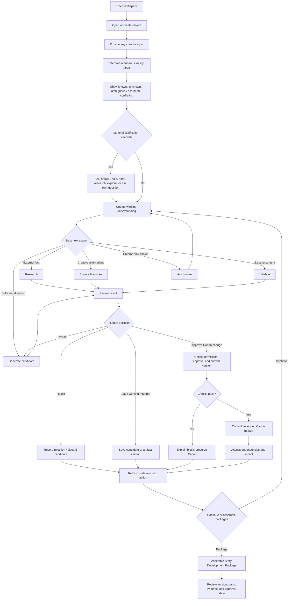
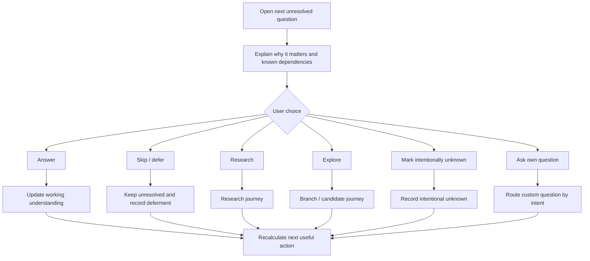
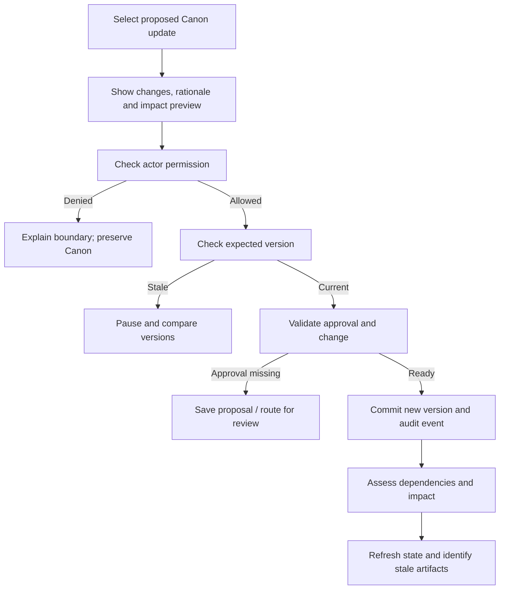
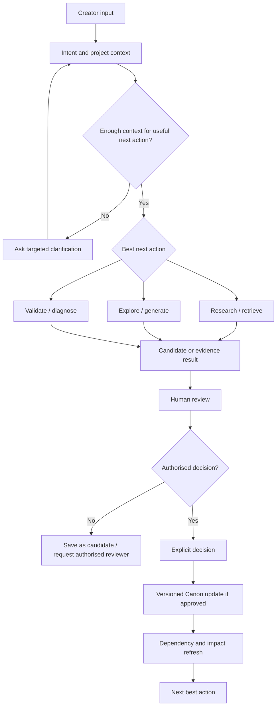

# Tattava Copilot — User Flows
**Document ID:** EXP-UF-01 | **Version:** 1.0 | **Status:** Implementation-oriented experience baseline  
**Product:** Tattava Copilot — V1 Narrative Intelligence | **Company:** Tattava Co. / Don Vanzara Showbiz LLP

## Contents
1. Purpose and source authority
2. Experience model and roles
3. Global journey
4. Navigation model
5. Detailed journeys
6. State and recovery matrix
7. Traceability
8. Open decisions and release checks

## 1. Purpose and source authority

This document specifies the major user journeys, decision points, alternate paths, exceptions and completion states for Tattava Copilot V1. It is intended for Product, Design, Engineering, AI/ML, QA, Research and Creative stakeholders. It defines observable experience behaviour; it does not claim that a production interface or visual wireframes already exist.

The experience follows this source precedence: (1) updated Product Strategy V1.1 for strategic direction; (2) updated PRD / consolidated product requirements for behaviour and V1 scope; (3) BRD for business context and lifecycle intent; (4) approved scope and decision-resolution materials; (5) supporting research, discovery, architecture and existing design artifacts. Where older material implies a rigid template-first or chat-centric flow, the current project-first strategy takes precedence.

V1 is Narrative Intelligence: arbitrary creator input → persistent project understanding → research/creative reasoning → reviewed candidates and decisions → a human-approved Story Development Package. V2 visual intelligence, V3 film/video generation, V4 localization, production scheduling, budgeting, shoot execution and broader DVS/MVV OS workflows are not treated as available V1 capabilities unless separately approved.

Status language used below: **Confirmed direction** means supported by strategy/PRD; **V1 experience default** means a recommended interaction rule; **Open decision** means management/policy confirmation is required; **Validation required** means user or technical evaluation remains necessary.

## 2. Experience model and roles

### 2.1 Persistent project loop

```text
Creator input → intent understanding → project state → identify known / unknown / ambiguous / assumed / conflicting
→ ask / research / explore / generate / validate → candidate or evidence → human review → authorised decision
→ versioned state update → dependency / impact assessment → next useful action
```

A journey is not complete merely because the AI generated text. Completion means the requested work reaches an observable state—such as saved candidate, reviewed evidence, recorded decision, or approved package—and the user can tell what changed, what did not change, and what remains unresolved.

### 2.2 Roles and authority

| Role | Experience responsibilities | Authority boundary |
|---|---|---|
| Producer | Reviews project progress and package readiness; makes final project approval/greenlight decisions where applicable | Final project authority; business, rights and greenlight decisions remain human |
| Content Head | Content oversight within assigned permissions | Exact action-level permissions remain configurable; do not infer from title alone |
| Creative Director | Script/editorial authority; reviews narrative choices | Parallel authority domain to Content Head under Producer, not a presumed reporting chain |
| Writer | Develops concepts, characters, story, screenplay and dialogue; edits candidates | Can create candidates; Canon changes require applicable authority and approval |
| Researcher | Supports evidence, source review and research implications | Evidence support does not itself establish creative Canon |
| AI / Tattava | Interprets, retrieves, researches, compares, drafts, diagnoses and recommends | Never self-authorises, greenlights or silently mutates Canon |

The canonical role label is **Content Head** only. Do not attach an individual’s name to the role in product data or UX. The interface must enforce action-level permissions; a role label alone is not proof of permission.

### 2.3 Objects that must remain distinct

| Object | Meaning | Experience treatment |
|---|---|---|
| Input | Material supplied/imported | Preserve origin and source identity; distinguish original from extracted text |
| Evidence | What a source supports | Show source, excerpt/locator, retrieval date and qualifications where available |
| Finding | Claim or observation derived from evidence | Link to supporting evidence and conflicting material |
| Interpretation | AI/human reasoning about meaning | Label as interpretation, not verified fact |
| Candidate | Proposed creative content | Editable and versioned; not Canon by default |
| Creative decision | Human choice with rationale and affected items | Record actor, time, decision and rationale where applicable |
| Canon | Authoritative approved project state | Versioned, permission-controlled, auditable; never silently changed by AI |
| Branch | Isolated alternative direction | Show base version; prevent accidental mixing with main Canon |

## 3. Global journey



This flow is a product-level model, not a deterministic AI pipeline. The user may enter through any task and redirect at any point. A generated answer is not equivalent to a saved artifact or approved decision. Protected actions require server-side permission and version checks.

## 4. Navigation model

Recommended V1 information architecture (screen grouping can change, but state distinctions must remain discoverable):

```text
Workspace
├── Projects
│   ├── Project overview / next best action
│   └── Project workspace
│       ├── Project understanding / Story Brain
│       ├── Research & evidence
│       ├── Story development / characters / world
│       ├── Writing / screenplay / dialogue
│       ├── Branches & alternatives
│       ├── Canon & decisions
│       ├── Continuity & impact
│       ├── Artifacts & versions
│       └── Story Development Package
├── Task activity / notifications (if supported)
├── Help / feedback
└── Workspace or account settings (supported controls only)
```

This is project-oriented navigation, not a requirement that each domain become a separate top-level module. The workspace should prioritise current task, high-impact unresolved items, pending review, failed tasks and package readiness. It should not require users to navigate among disconnected agents.

## 5. Detailed journeys

### UF-01 — Authenticate and enter an authorised workspace
**Trigger:** user opens Tattava. **Outcome:** only permitted workspaces and projects are accessible. The exact identity provider, SSO, invitation and recovery flow are not specified in the source baseline. Post-authenticated behaviour is defined here: access-denied and expired-session states must be clear; project names and metadata must not leak to unauthorised users; protected actions must require re-authorisation when needed; safe work should be recoverable where draft persistence exists.

**Acceptance:** unauthorised users cannot retrieve project data; session expiry is not represented as successful completion; after re-authentication, the user resumes safely or is told what unsaved work was lost.

### UF-02 — Create a project from arbitrary input
**Trigger:** idea, character, scene, screenplay, book/adaptation brief, research question, files, multiple versions, or “I do not know what I want to make.” **Need:** begin with available material without choosing a format or template first. **Prerequisite:** permission to create a project.

**Primary path:** select New project; optionally name it; enter text and/or attach supported files; inspect input receipt and extraction state; review Tattava’s provisional interpretation; correct or confirm it; create project state; receive a recommended next action. Original input remains preserved and separate inputs retain source identity.

**Alternatives:** sparse idea creates an incomplete project; mixed screenplay and research files remain distinct; vague intent leads to exploration or a focused question; incorrect intent can be corrected without changing approved Canon. If one file fails, other inputs can proceed. If extraction fails, preserve the original file and offer retry, remove or manual text entry. If intent cannot be inferred, ask what the user wants to do rather than force a taxonomy.

**Completion:** project exists; inputs and processing states are visible; initial understanding is provisional; next action is available.

### UF-03 — Inspect and correct project understanding
**Trigger:** project creation, new input, material change or user opens Story Brain. **Outcome:** user can inspect Known, Unknown, Ambiguous, Assumed, Conflicting, Blocked and Resolved items. Group by meaningful concepts, not a flat database dump. Each item should show current value if any, status, origin, last change, links to evidence/decision/Canon, known dependencies and permitted actions. User may correct a working interpretation, mark intentionally unknown, research, explore or resolve a conflict. A correction must not silently rewrite Canon.

### UF-04 — Resolve the next important question
**Trigger:** project has material unresolved questions. **Outcome:** user can answer, skip, defer, research, explore alternatives, mark intentionally unknown or ask their own question.



Explain impact without overstating the dependency graph. If coverage is incomplete, qualify the explanation. Deferring a question must not block unrelated work unless a real dependency exists.

### UF-05 — Research a factual question
**Trigger:** external reality may answer a question. **Outcome:** source-backed findings with uncertainty visible.

1. User asks a question or selects Research.
2. Tattava clarifies scope only when material (period, geography, source type).
3. System retrieves accessible, permitted sources and extracts evidence.
4. User sees task status and can safely navigate away.
5. Findings link to source provenance, excerpt/locator, retrieval date and qualifications where available.
6. Conflicts or weak evidence are marked; narrative implications are labelled as interpretations.
7. User may inspect, refine, retry, continue with caveat, or use findings for creative exploration.

No-source, inaccessible-source and partial-result cases must preserve the claim as unverified. Do not invent citations or present partial research as exhaustive.

### UF-06 — Explore alternatives and branches
**Trigger:** multiple plausible creative directions or explicit request for options. **Outcome:** alternatives can be compared without changing main Canon.

The user chooses an exploration goal; Tattava prepares differentiated options with implications and trade-offs; the user edits, compares, saves a branch, discards or requests synthesis. Each branch retains base Canon version and divergent assumptions/decisions. Persistent scope label must say which branch is active and whether main Canon remains unchanged.

**Merge:** compare differences → prepare proposal → user chooses keep from A / keep from B / synthesis / reject / defer → permission and version checks → required approval → commit only selected changes. Never bulk-merge automatically.

### UF-07 — Generate or revise story material
**Trigger:** enough direction exists for a requested artifact. **Outcome:** editable, traceable candidate linked to relevant context. For context-sensitive tasks, show task intent, branch and relevant Canon version. Candidate is editable, saveable as a version, regenerable and rejectable. Regeneration must not silently overwrite user edits. If project state changes during generation, check for staleness before acceptance or commit.

### UF-08 — Review a candidate and record a decision
**Trigger:** candidate is ready for human review. **Outcome:** accepted, revised, rejected, saved as working material or submitted for authorised approval. “Save candidate,” “Accept as working material,” and “Approve as Canon” must be distinct. Approval applies to an exact version. If approver routing is unknown, do not invent a named approver; block the protected action and surface the unresolved route.

### UF-09 — Update Canon safely
**Trigger:** authorised human attempts a Canon-changing action. **Outcome:** versioned update only when permission and version checks pass.



Do not automatically rebase and commit against newer Canon. “No impact found” is not proof that no impact exists.

### UF-10 — Validate continuity and impact
**Trigger:** explicit continuity check or material change. **Outcome:** diagnostic report distinguishing confirmed contradictions, possible risks and unevaluated areas. Each finding shows item checked, scope/version, evidence/context, affected entities, recommendation and coverage limitation. Users can inspect source passage, mark reviewed, dismiss with rationale where supported, or request re-evaluation. “No issue detected” is not “fully validated.”

### UF-11 — Assemble and approve the Story Development Package
**Trigger:** user prepares project for formal review. **Outcome:** versioned package with gaps, evidence, state and approval explicit.

Potential sections, depending on project: identity/intent; logline/synopsis; format/genre/story direction; structure; characters/relationships; story world; research/evidence; creative decisions and Canon; diagnostics; open questions/risks; linked artifacts and versions; package completeness and approval state.

Path: assemble from current approved state and linked artifacts; label missing/unresolved sections; review and revise; approve the exact package version through an authorised human. If Canon changes later, flag possible staleness. “Ready for review,” “Approved,” and “Greenlit” are distinct states. Do not fabricate sections to make the package appear complete.

### UF-12 — Return to an interrupted or failed task
**Trigger:** navigation, session expiry, timeout, cancellation or provider outage. **Outcome:** user knows what completed, what failed, what remains running and what can safely be retried. Display Queued, Running, Awaiting input, Awaiting approval, Succeeded, Partially succeeded, Failed or Cancelled. Preserve useful partial results and previous approved state. Retry is explicit when it may incur cost or create a new candidate; do not promise identical output.

### UF-13 — Manage access and settings
Only expose controls supported by approved policy. Membership, role mapping, export, deletion, retention, notification settings and provider data policy require implementation and policy confirmation. For export/deletion, explain scope and known limitations; do not promise unsupported deletion of backups, derived indexes or provider copies.

### UF-14 — Help, feedback and correction
Provide contextual help for Canon, candidate, evidence, branch, version and package readiness. Let users correct intent, flag incorrect research, report continuity findings and explain rejected output. Attach feedback to the relevant task/item where permitted, minimise confidential content, and do not imply feedback instantly retrains the model. Human support channels and response times are not specified.

## 6. State and recovery matrix

| Situation | Visible state | Recovery | Must not happen |
|---|---|---|---|
| No projects | Helpful empty state + New project | Start with arbitrary input | Force template selection |
| Sparse project | Incomplete understanding | Ask one high-value question or explore | Invent missing facts |
| Research running | Progress/task state | Navigate safely; task remains discoverable | Indefinite spinner |
| Partial research | Partial label + missing steps | Inspect, retry failed stages, continue with caveat | Claim exhaustive success |
| Conflicting sources | Conflict label and comparison | Inspect, research further, request review | Silently choose one |
| AI conflicts with Canon | Conflict and affected items | Revise candidate or use branch | Commit automatically |
| Permission denied | Action-specific block | Explain next step if known | Leak restricted data |
| Stale Canon | Version conflict | Compare/refresh/revise | Blind overwrite |
| Provider outage | Failed/unavailable | Retry or return later | Pretend completion |
| Incomplete dependency graph | Coverage qualifier | Review known impacts cautiously | Claim no impact exists |
| Package gaps | Gap list | Resolve or explicitly accept omission if policy allows | Fabricate missing sections |
| Session expiry | Re-authentication | Resume safely; disclose unsaved work | Commit protected action after expiry |

## 7. Traceability

The consolidated PRD uses FR-001–FR-024, UX-001–UX-012, NFR-001–NFR-016 and release gates G-01–G-16. Older source excerpts also use legacy IDs such as FR-1.1-001 and UX-1.1-001. Preserve source IDs and maintain canonical mappings in the Requirements Traceability artifact; do not silently renumber them.

| Journey | Primary requirements | UX/AI pattern | Verification focus |
|---|---|---|---|
| UF-01 access | Security, authorization, NFR-001/002 | Permission and session states | Cross-project isolation, denied action |
| UF-02 entry | FR-001/002 | Flexible entry, intent interpretation | Sparse/mixed input and correction |
| UF-03 understanding | FR-002/004/005 | State visibility, context transparency | Unknown remains unknown; Canon unchanged |
| UF-04 question | FR-003/007 | Next action; Ask routing | Own question and defer paths work |
| UF-05 research | FR-008–011 | Evidence visibility; research pattern | Provenance and conflicts |
| UF-06 branch | FR-016 | Branch isolation; explore pattern | No Canon contamination |
| UF-07 generation | FR-012–015 | Candidate review; context disclosure | Context/version consistency |
| UF-08 review | FR-017–020 | Approval clarity | Exact-version approval |
| UF-09 Canon | FR-018–020 | Protected mutation | Unauthorized/stale write rejected |
| UF-10 continuity | FR-021/022 | Impact preview | Evidence-backed finding and coverage caveat |
| UF-11 package | FR-023 | Package readiness | Gaps visible; versioned approval |
| UF-12 recovery | FR-024, NFR-003–006 | Task recovery | State preserved under failure |
| UF-13 settings | Security/privacy NFRs, D decisions | Permission settings | No unsupported controls |
| UF-14 feedback | FR-024 and evaluation | Correction loop | Feedback linked safely and truthfully |

## 8. Open decisions and release checks

| ID | Decision | Experience implication |
|---|---|---|
| D-01 | Action-level role permissions | Approval controls/routes cannot be finalised until approved |
| D-04 | External provider data policy | Disclosure and consent language depend on Security/Legal |
| D-05 | Retention/deletion | Do not promise unsupported deletion semantics |
| D-06 | Research source hierarchy | Evidence labels need approved criteria |
| D-07 | KPI and AI quality thresholds | Avoid uncalibrated numeric confidence/quality badges |
| D-08 | Final package schema | Mandatory sections need approval |
| D-11 | Concurrent edits/version conflicts | Stale commits must pause; merge interaction needs validation |
| D-12 | Data portability | Export UI depends on approved scope |
| D-13 | Latency/availability/recovery/cost budgets | Do not invent numeric progress/SLO promises |
| D-14 | File types and limits | Entry validation must match implementation |
| EXP-OD-01 | Authentication/SSO/session model | Exact auth screens depend on identity architecture |
| EXP-OD-02 | Notification/support channels | No unapproved delivery or escalation promises |
| EXP-OD-03 | Brand and responsive values | Visual tokens remain provisional |

**Release checklist:** arbitrary entry without mandatory template; explicit epistemic states; user-authored questions; source provenance/conflict visibility; candidate/branch/Canon separation; server-side authorization and version validation; safe failure/retry; partial-result labelling; package gaps/version/approval visible; keyboard, screen-reader, zoom, contrast and reduced-motion validation complete.

---

## 9. Screen and interaction hand-off map (refinement)

This map links the journey layer to the UX and AI specifications. It is a hand-off aid, not a claim that every listed screen is already implemented. Screen IDs are stable identifiers for design, engineering and QA discussion.

| Screen ID | Experience surface | Entry trigger | Primary user outcome | Key requirements / related specifications |
|---|---|---|---|---|
| EXP-S01 | Project Home / Project State | Open an existing project or create a project | Understand current state and next useful action | FR-001–FR-006; UX project-state visibility; AI context resolution |
| EXP-S02 | Universal Input / Intent Review | User provides an idea, document, question or partial brief | Begin without being forced into a template | FR-001–FR-003; adaptive clarification |
| EXP-S03 | Clarification Panel | Material ambiguity blocks a useful or safe next step | Resolve only the uncertainties that matter now | FR-002–FR-005; uncertainty interaction pattern |
| EXP-S04 | Research Workspace | User asks for research or a factual gap blocks progress | Inspect evidence, provenance, conflicts and limitations | FR-006–FR-009; research/evidence patterns |
| EXP-S05 | Candidate Review | AI returns a draft, analysis, options or recommendation | Edit, compare, accept, reject or defer a candidate | FR-010–FR-016; candidate lifecycle |
| EXP-S06 | Branch / Version Comparison | User explores an alternative or compares revisions | Preserve alternatives and understand differences | FR-014–FR-017; branch isolation and version comparison |
| EXP-S07 | Canon / Decision Review | A proposed change may affect authoritative project state | Make an explicit, authorised decision | FR-015–FR-019; approval and Canon protection |
| EXP-S08 | Change Impact Preview | Canon or a dependency changes | Understand affected story elements before committing | FR-018–FR-020; dependency/impact intelligence |
| EXP-S09 | Story Development Package | User requests a package or reviews readiness | Inspect included sections, gaps, versions and approvals | FR-021–FR-024; package readiness |
| EXP-S10 | Run Status / Recovery | Long-running task, partial success or failure | Resume safely without losing approved work | FR-022–FR-024; async status and recovery |

### 9.1 End-to-end state hand-off



The key design consequence is that every AI run must terminate in an understandable state: a result, a partial result, a clarification request, an approval request, a blocked state, or a recoverable failure. It must not disappear into an opaque “thinking” state.

## 10. Journey coverage additions

The baseline journeys should be validated against these cases before implementation sign-off:

| Coverage area | Required journey variation | Expected observable behaviour |
|---|---|---|
| Project entry | User starts with unstructured text or a file rather than a template | System interprets intent and identifies material unknowns; no forced template-first gate |
| Context mismatch | User asks about a different project or branch | System surfaces the active context and asks before switching or applying changes |
| Conflicting evidence | Sources disagree on a factual claim | Conflict is represented explicitly; the system does not silently choose a source |
| AI partial success | Research succeeds but synthesis fails, or vice versa | Successful artefacts remain accessible and incomplete steps are named |
| Approval denied | Current user lacks authority | Protected action is unavailable or blocked with a clear next step |
| Stale version | Project state changes during a review | User sees a stale-version warning and must refresh/rebase before committing |
| Retry | User retries a failed task | Retry does not duplicate canonical decisions or overwrite approved artefacts |
| Returning user | User reopens a project after a period away | Project state, open questions, recent decisions and next actions are restored from authoritative project data |
| Package incomplete | Required sections remain unknown, conflicting or unapproved | Package readiness reflects gaps; the system does not imply final approval |
| Branch comparison | User compares an alternative with Canon | Alternative remains isolated until an explicit, authorised merge/commit |

## 11. Role and authority experience guardrails

The interface must use the canonical role title **Content Head** only. Do not attach a person’s name to this role in the product database, role labels, approval routes or UX copy.

Producer is the final project authority. Content Head provides content oversight. Creative Director holds creative/script editorial authority. These are distinct authority domains; the experience must not imply a rigid reporting hierarchy between Content Head and Creative Director. Writers execute creative work, Researchers support evidence, and AI remains an assistance layer rather than an authority.

Exact action-level permissions remain an open decision. If a user’s authority cannot be resolved, the UI must not infer permission from job title or ask the model to decide access. The protected action should remain blocked until server-side authorisation confirms eligibility.

