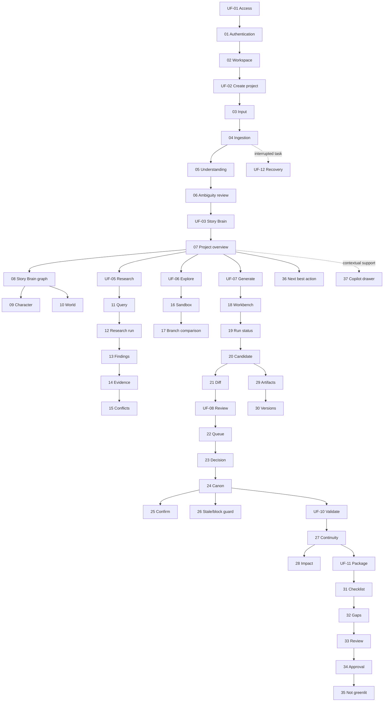

# TattvaCo Copilot — Traceable Screen-by-Screen UX Specification & Complete Wireframes

**Document ID:** EXP-UX-WF-02 | **Version:** 1.1 | **Status:** Engineering handover baseline — requires product/design/engineering sign-off

**Purpose.** This pack combines the existing 37-screen low-to-mid fidelity wireframe source with a screen-level traceability layer, acceptance checks, state/permission guardrails and source alignment. It is intended to help Product, UX, Engineering, QA and AI/ML teams implement the same experience.

**Scope discipline.** V1 is Narrative Intelligence. The 37 screens describe the target V1 experience and its supporting governance surfaces; they do not by themselves authorise every capability for a single release. Screenplay/dialogue, proactive intelligence, branch merge, package sign-off and other capability gates must follow the current PRD/backlog and release decision. V2 visual intelligence, V3 generative video/film, V4 localisation, production scheduling/budgeting/shoot execution and broader DVS/MVV OS are future horizons unless separately approved.

**Evidence and confidence labels.** “Source-derived” means directly present in the current UX/user-flow/wireframe sources. “Traceability mapping” links the screen to the existing user-flow IDs and BRD requirement families. “Acceptance check” is an implementation test derived from the source-backed product principles; it is not a claim that the test has already passed. Any policy recommendation still awaiting approval is not silently promoted to an approved requirement.

**Core interaction contract:** Project first, not prompt first; unknown is a valid state; evidence and interpretation remain separate; candidates precede Canon; consequential state transitions require explicit human authority; failures preserve prior approved work; a developed package is not a production greenlight.

## 1. Source baseline and traceability rules

| Source | Role in this specification | Authority applied here |
|---|---|---|
| Product Strategy V1.1 / current scope decisions | Product intent and release boundaries | Governs product horizon and core principles |
| PRD / consolidated requirements | V1 capability scope and behaviour | Governs feature and acceptance scope; backlog/release gates still apply |
| BRD / requirement families BR-01…BR-12 | Business outcomes and requirement coverage | Used for traceability, not to invent unprovided requirement text |
| `01_User_Flows.md` (UF-01…UF-14) | Journey intent, alternate paths and completion | Journey source for screen mapping |
| `02_UX_Specification.md` (UX-S01…UX-S14) | Shared UX rules, state model, accessibility and behavior | Shared interaction contract |
| `Tattava_Copilot_V1_Complete_UI_Wireframe_Spec.md` (37 screens) | Screen layout, controls, sample copy and wireframe sketches | Screen-level visual/interaction source, refined below for consistency |
| AI/engineering blueprint | Agent boundaries, run states, permissions, provenance and persistence | Governs system behavior; UI must not imply hidden capabilities |

### Traceability convention

Each screen is mapped to (1) its stable wireframe screen ID, (2) one or more journey IDs UF-01…UF-14, (3) business requirement families BR-01…BR-12 where supported, and (4) observable acceptance checks. The screen ID is stable across implementation, analytics, QA test cases and bug reports. Map individual frontend components and API contracts to the same screen ID in the engineering backlog. Do not infer an FR identifier when the authoritative PRD/BRD text is not available in the source excerpt.

### Requirement-family legend (BRD traceability)

| ID | Requirement family |
|---|---|
| BR-01 | Create/manage projects |
| BR-02 | Persistent project context / Story Brain |
| BR-03 | Credible research |
| BR-04 | Story development |
| BR-05 | Screenplay creation (release-gated where designated P1) |
| BR-06 | Dialogue (release-gated where designated P1) |
| BR-07 | Continuity and evaluation |
| BR-08 | Human creative authority / approval |
| BR-09 | Research traceability |
| BR-10 | Secure creative IP / access isolation |
| BR-11 | AI observability / recoverability |
| BR-12 | Story Development Package |

## 2. Screen-by-screen traceability register

| # | Stable screen ID | Screen | Journey mapping | BRD requirement mapping | Minimum acceptance check |
|---:|---|---|---|---|---|
| 01 | `UX-S01-A` | Login / Authentication | UF-01 | BR-10, BR-11 | Authenticate, resume safely, and prevent cross-project disclosure. |
| 02 | `UX-S01-B` | Workspace / Project Dashboard | UF-01, UF-02 | BR-01, BR-02, BR-10 | Only authorised projects appear; empty, populated, loading and access-error states are explicit. |
| 03 | `UX-S02` | Create New Project / Universal Input | UF-02 | BR-01, BR-02, BR-04 | Raw input can be submitted without forcing a template; original input is preserved. |
| 04 | `UX-S02-P` | File Processing & Ingestion | UF-02, UF-12 | BR-01, BR-02, BR-11 | Per-file processing status is visible; partial failure preserves successful inputs and originals. |
| 05 | `UX-S04-A` | Input Receipt / Understanding | UF-02, UF-03 | BR-02, BR-04 | Interpretation is provisional, correctable, and distinct from approved Canon. |
| 06 | `UX-S04-B` | Unknown / Ambiguity Review | UF-03, UF-04 | BR-02, BR-04, BR-08 | Unknown, ambiguous, assumed, conflicting and intentionally unknown remain distinguishable. |
| 07 | `UX-S03` | Project Overview & Health Hub | UF-03, UF-04, UF-12 | BR-01, BR-02, BR-07, BR-11, BR-12 | Project state, pending decisions, task failures and next actions are grounded in current persisted state. |
| 08 | `UX-S04-C` | Story Brain / Project Intelligence Graph | UF-03 | BR-02, BR-04, BR-08 | Graph nodes expose status, origin, version, dependencies and permitted actions. |
| 09 | `UX-S04-D` | Character Intelligence | UF-03, UF-07 | BR-02, BR-04, BR-08 | Character edits remain candidate/working state until authorised Canon transition. |
| 10 | `UX-S04-E` | World Intelligence | UF-03, UF-05, UF-07 | BR-02, BR-03, BR-04, BR-09 | World rules show provenance/status; factual assertions link to evidence. |
| 11 | `UX-S05-A` | Research Workspace & Query Composer | UF-05 | BR-03, BR-09, BR-10 | Research intent, scope, source policy and provider selection are explicit before run. |
| 12 | `UX-S05-B` | Research Processing & Deep Search | UF-05, UF-12 | BR-03, BR-09, BR-11 | Run status, providers/tools, partial completion and retryable failures are visible. |
| 13 | `UX-S05-C` | Research Results & Synthesis | UF-05 | BR-03, BR-09 | Findings separate supported claims from interpretation and show confidence/qualifications. |
| 14 | `UX-S05-D` | Evidence Detail & Provenance Inspector | UF-05 | BR-03, BR-09 | Source, publisher, URL, retrieval date, locator/excerpt and verification status are inspectable. |
| 15 | `UX-S05-E` | Conflicting Sources & Claim Resolution | UF-05, UF-04 | BR-03, BR-09, BR-08 | Conflicts are not silently reconciled; user choice and rationale are recorded as a decision. |
| 16 | `UX-S07-A` | Creative Exploration & Sandboxing | UF-06 | BR-02, BR-04, BR-08 | Alternative exploration is isolated from main Canon and names its base version. |
| 17 | `UX-S07-B` | Branch Comparison & Fork Resolution | UF-06 | BR-02, BR-04, BR-08 | Comparison exposes divergence and stale base; merge is a proposal, not silent mutation. |
| 18 | `UX-S06-A` | Candidate Generation & Prompting Workbench | UF-07 | BR-02, BR-04, BR-11 | Generation scope includes task, branch, selected context and relevant Canon version. |
| 19 | `UX-S06-B` | AI Generation State | UF-07, UF-12 | BR-04, BR-11 | Queued/running/awaiting-input/partial/failed states remain observable and recoverable. |
| 20 | `UX-S06-C` | Candidate Result & Inline Editor | UF-07, UF-08 | BR-04, BR-08, BR-11 | Generated output is labelled candidate, editable, versioned and never auto-committed to Canon. |
| 21 | `UX-S06-D` | Candidate Version Comparison (Diff View) | UF-07, UF-08 | BR-04, BR-08 | Changes are attributable to versions and can be reviewed before a decision. |
| 22 | `UX-S08-A` | Review Queue & Triage Center | UF-08 | BR-08, BR-11 | Queue is permission-aware and separates pending decisions from informational items. |
| 23 | `UX-S08-B` | Human Decision & Protected Action | UF-08, UF-09 | BR-08, BR-10, BR-11 | Approve/reject/revise controls are authorised, scoped and audited. |
| 24 | `UX-S08-C` | Canon & Authoritative Decisions Ledger | UF-09 | BR-02, BR-08, BR-10, BR-11 | Canon and decisions are versioned, attributable and inspectable. |
| 25 | `UX-S08-D` | Canon Change Confirmation & Sign-off | UF-09 | BR-08, BR-10, BR-11 | Confirmation names affected items, target version, actor authority and downstream impact. |
| 26 | `UX-S08-E` | Stale Version & Blocked Canon Warning | UF-09, UF-12 | BR-08, BR-10, BR-11 | Stale version or permission failures block mutation and preserve current Canon. |
| 27 | `UX-S09-A` | Continuity Analysis & Anomaly Detection | UF-10 | BR-07, BR-11 | Findings show coverage/limitations and distinguish detected issue from confirmed defect. |
| 28 | `UX-S09-B` | Impact Map & Dependency Graph | UF-09, UF-10 | BR-02, BR-07, BR-08 | Affected dependencies are inspectable; impact prediction is not presented as certainty. |
| 29 | `UX-S10-A` | Artifacts Repository & Asset Browser | UF-07, UF-11, UF-12 | BR-02, BR-04, BR-12 | Artifacts are searchable with status, version and project/branch context. |
| 30 | `UX-S10-B` | Version History & Point-in-Time Restore | UF-09, UF-12 | BR-02, BR-08, BR-11 | Restore creates a traceable new version or compensating action; history is not silently overwritten. |
| 31 | `UX-S11-A` | Package Builder & Readiness Checklist | UF-11 | BR-04, BR-09, BR-12 | Readiness is a checklist/status, not an unexplained percentage; gaps link to source items. |
| 32 | `UX-S11-B` | Package Gaps & Resolution Matrix | UF-11 | BR-03, BR-07, BR-12 | Each gap has severity, owner/action path, evidence or dependency and status. |
| 33 | `UX-S11-C` | Final Package Review | UF-11 | BR-08, BR-09, BR-12 | Review snapshot and unresolved conflicts are visible; review is distinct from greenlight. |
| 34 | `UX-S11-D` | Package Approval & Sign-Off | UF-11 | BR-08, BR-10, BR-11, BR-12 | Only authorised reviewer can approve; approval binds to a specific package snapshot. |
| 35 | `UX-S11-E` | Developed ≠ Greenlit Boundary Notice | UF-11 | BR-08, BR-12 | Package readiness never implies commercial, legal, production or studio greenlight. |
| 36 | `UX-S12-A` | Proactive Intelligence / Next Best Action Feed | UF-03, UF-04, UF-10, UF-11 | BR-02, BR-07, BR-11, BR-12 | Recommendations explain why now, evidence/context, destination and safe dismiss/defer behavior. |
| 37 | `UX-S12-B` | Global Copilot Drawer / Contextual Inspector | UF-03, UF-05, UF-07, UF-14 | BR-02, BR-03, BR-04, BR-09, BR-11 | Copilot receives explicit authorised context; response can be inspected and saved only through clear actions. |

## 3. End-to-end traceability path



The flow is navigational rather than strictly linear. Users can enter at a task, revisit evidence, branch or artifact screens, and return to the project hub. A generated result is not a completed journey until its resulting state (candidate, evidence, decision or package) is saved and visible.

## 4. Shared interaction contract (applies to all 37 screens)

1. **Project context:** Show project name and, where relevant, active branch and Canon/artifact version. Context switching must be explicit.
2. **State semantics:** Distinguish `Input`, `Evidence`, `Finding`, `Interpretation`, `Candidate`, `Creative Decision`, `Canon`, `Branch`, and `Package`. Do not label them interchangeably.
3. **AI transparency:** For asynchronous work show queued/running/awaiting input/awaiting approval/partial/failed/cancelled/completed as applicable. Provide task details and recovery actions.
4. **Permission-aware controls:** UI visibility is a convenience; the server enforces authorization. A denied action explains the reason without leaking restricted data.
5. **Canon safety:** AI output never mutates Canon directly. Protected mutation checks authorization, expected current version, conflict state and explicit confirmation; stale attempts preserve current Canon.
6. **Research provenance:** A factual claim links to source identity, publisher, URL/stable identifier, retrieval date, excerpt/locator, status and known qualifications/conflicts when available. Provider-generated prose is not itself verified evidence.
7. **Version safety:** Save/restore creates a traceable version or compensating action. Do not overwrite audit history.
8. **Package readiness:** Use named checklist states and explicit blockers. Do not show an unexplained completeness percentage or equate narrative readiness with studio greenlight.
9. **No silent failure:** Partial extraction/research/generation is labelled partial; retain successful work and provide safe retry/continue options.
10. **Accessibility:** Keyboard access, visible focus, semantic headings/labels, non-colour status indicators, error association and WCAG 2.2 AA target. Validate with assistive technology.
11. **Responsive behavior:** Desktop is the primary authoring layout; tablet supports review; mobile prioritizes status, evidence inspection and approval rather than dense graph editing.
12. **Privacy:** Do not expose project content in cross-project search, notifications, telemetry or provider calls without authorization and policy approval.

## 5. Detailed screen wireframes and interaction specifications

The following section retains the complete 37-screen wireframe source and adds the traceability register above. Each screen includes the original low-fidelity layout and source-specified purpose, controls, navigation and states. The traceability register adds the minimum testable contract for each screen. Wireframes are structural, not final visual styling; brand tokens and high-fidelity visual assets remain subject to design-system approval.

---

# Tattava Copilot V1 — Complete Low-to-Mid Fidelity UI Wireframe & Interaction Specification
**Document ID:** EXP-WF-37 | **Version:** 1.0 | **Author:** Senior Product Designer, UX Architect & AI Specialist
**Source Precedence:** 01_User_Flows.md (UF-01..14) > 02_UX_Specification.md (UX-S01..14) > 03_AI_Interaction_Specification.md > 04_Design_System.md
**Scope:** Complete 37-Screen Production Wireframe Architecture for V1 Narrative Intelligence

## 1. Executive Summary & Core Design Thesis

This document establishes the complete, production-grade low-to-mid fidelity UI wireframe specification for **Tattava Copilot V1 (Narrative Intelligence)**. Grounded directly in the source documentation, the interface embodies the core thesis: **Project First, Not Chat First**.

The interface enforces the non-negotiable operational principles across all 37 screens:

1. **AI Proposes; Humans Own Creative Consequence:** AI produces Candidates, Evidence, and Interpretations; only authorized human users can commit to Canon or approve packages.

2. **Unknown is a Valid State:** Missing details are classified as Unknown, Ambiguous, Assumed, or Conflicting. The system never hallucinates filler to make screens look complete.

3. **Candidates Before Canon:** 'Save,' 'Draft,' 'Review,' and 'Commit to Canon' are discrete, consequential, audited workflow states with explicit governance gates.

4. **Evidence Stays Close to Claims:** All research, historical facts, and world rules feature inspectable provenance down to the verbatim source passage.

5. **Developed ≠ Greenlit:** Package completion certifies narrative readiness; commercial and production greenlight remains an explicit human studio decision.

## 2. Global Desktop Layout Shell Architecture

Every authenticated workspace screen shares an ergonomic three-column layout designed for deep creative focus and high information density:

```text
┌──────────────────────────────────────────────────────────────────────────────────────────────┐
│ TattvaCo                         Search project...                 ⌕   ◐   🔔   KAUSTUBH ▾   │
├───────────────────┬──────────────────────────────────────────────────────┬───────────────────┤
│                   │                                                      │                   │
│  🏠 Home          │                                                      │                   │
│  📁 Projects      │                  MAIN WORKSPACE                      │   COPILOT         │
│  🧠 Story Brain   │                                                      │   PANEL           │
│  🔎 Research      │             (Flexible width, high-focus              │                   │
│  👤 Characters    │              content canvas, editors,                │   Context         │
│  🌍 World         │              timelines, diffs, audits)               │   Evidence       │
│  ✍ Story          │                                                      │   AI response    │
│  🎬 Screenplay    │                                                      │   Actions         │
│  💬 Dialogue      │                                                      │                   │
│  📦 Packages      │                                                      │                   │
│                   │                                                      │                   │
│  ─────────────    │                                                      │                   │
│  Review Queue ⑥   │                                                      │                   │
│  Activity         │                                                      │                   │
│  Library          │                                                      │                   │
│                   │                                                      │                   │
│  ⚙ Settings       │                                                      │                   │
└───────────────────┴──────────────────────────────────────────────────────┴───────────────────┘
```

- **Left Navigation Sidebar (~240px):** Persistent studio navigation, project modules, review queue triage count, and settings.
- **Main Workspace Canvas (Flexible):** Adaptive, content-first workspace accommodating rich editors, visual graph networks, comparison diffs, and reading modes.
- **Global Copilot Drawer (~360–420px):** Contextual assistant displaying active screen context, source evidence citations, and interactive reasoning tools.

## 3. Complete Screen Inventory & Information Architecture

| Screen # | Screen ID | Screen Name | Phase | User Job | Flow ID | Key States |
|---|---|---|---|---|---|---|
| 01 | `UX-S01-A` | **Login / Authentication** | 01 — ENTRY | Authenticate identity via Google or ... | `UX-S01` | Default/Empty, Typing, Authe... |
| 02 | `UX-S01-B` | **Workspace / Project Dashboard** | 01 — ENTRY | Browse, filter, and open existing st... | `UX-S01` | Loading (Skeleton cards), Po... |
| 03 | `UX-S02` | **Create New Project / Universal Input** | 02 — PROJECT CREATION | Introduce a raw concept, logline, sc... | `UX-S02` | Empty input, Active typing, ... |
| 04 | `UX-S02-P` | **File Processing & Ingestion** | 02 — PROJECT CREATION | Monitor the extraction of story elem... | `UX-S02` | Running (Step-by-step checkm... |
| 05 | `UX-S04-A` | **Input Receipt / Understanding** | 02 — PROJECT CREATION | Validate the AI's initial comprehens... | `UX-S04` | Generating understanding, Ve... |
| 06 | `UX-S04-B` | **Unknown / Ambiguity Review** | 02 — PROJECT CREATION | Address high-consequence narrative u... | `UX-S04` | Review pending, Item answere... |
| 07 | `UX-S03` | **Project Overview & Health Hub** | 03 — PROJECT HUB | Get an immediate 360-degree pulse on... | `UX-S03` | All healthy, Awaiting review... |
| 08 | `UX-S04-C` | **Story Brain / Project Intelligence Graph** | 04 — STORY BRAIN | Explore how characters, factions, hi... | `UX-S04` | Graph rendering, Node select... |
| 09 | `UX-S04-D` | **Character Intelligence** | 04 — STORY BRAIN | Refine a character's internal confli... | `UX-S04` | Canon locked (Read-only with... |
| 10 | `UX-S04-E` | **World Intelligence** | 04 — STORY BRAIN | Establish immutable rules of the set... | `UX-S04` | Rule active, Draft rule unco... |
| 11 | `UX-S05-A` | **Research Workspace & Query Composer** | 05 — RESEARCH | Formulate a grounded research inquir... | `UX-S05` | Empty composer, Sources conf... |
| 12 | `UX-S05-B` | **Research Processing & Deep Search** | 05 — RESEARCH | Observe which academic and archival ... | `UX-S05` | Scraping/Querying, Parsing c... |
| 13 | `UX-S05-C` | **Research Results & Synthesis** | 05 — RESEARCH | Review the synthesized findings, ins... | `UX-S05` | Results loaded, Partial resu... |
| 14 | `UX-S05-D` | **Evidence Detail & Provenance Inspector** | 05 — RESEARCH | Examine the exact primary source pas... | `UX-S05` | Drawer expanded, Highlightin... |
| 15 | `UX-S05-E` | **Conflicting Sources & Claim Resolution** | 05 — RESEARCH | Decide which historical school of th... | `UX-S05` | Unresolved conflict, User se... |
| 16 | `UX-S07-A` | **Creative Exploration & Sandboxing** | 06 — CREATIVE EXPLORATION | Try out alternate narrative directio... | `UX-S07` | Active sandbox branch, Unsav... |
| 17 | `UX-S07-B` | **Branch Comparison & Fork Resolution** | 06 — CREATIVE EXPLORATION | Evaluate the line-by-line and beat-b... | `UX-S07` | Clean merge possible (Green ... |
| 18 | `UX-S06-A` | **Candidate Generation & Prompting Workbench** | 07 — CANDIDATE GENERATION | Direct the AI Copilot to generate sp... | `UX-S06` | Ready to generate, Missing r... |
| 19 | `UX-S06-B` | **AI Generation State** | 07 — CANDIDATE GENERATION | Observe generation progress without ... | `UX-S06` | Streaming active, Candidate ... |
| 20 | `UX-S06-C` | **Candidate Result & Inline Editor** | 07 — CANDIDATE GENERATION | Read, refine, edit, and grade genera... | `UX-S06` | Pristine candidate, User edi... |
| 21 | `UX-S06-D` | **Candidate Version Comparison (Diff View)** | 07 — CANDIDATE GENERATION | Compare nuanced differences in dialo... | `UX-S06` | Synchronized scrolling activ... |
| 22 | `UX-S08-A` | **Review Queue & Triage Center** | 08 — HUMAN REVIEW | Triage, batch review, and prioritize... | `UX-S08` | Queue populated (Items pendi... |
| 23 | `UX-S08-B` | **Human Decision & Protected Action** | 08 — HUMAN REVIEW | Inspect the complete diff, read AI i... | `UX-S08` | Awaiting decision, Processin... |
| 24 | `UX-S08-C` | **Canon & Authoritative Decisions Ledger** | 09 — CANON | Inspect the authoritative project Ca... | `UX-S08` | Canon clean and synchronized... |
| 25 | `UX-S08-D` | **Canon Change Confirmation & Sign-off** | 09 — CANON | Acknowledge consequential downstream ... | `UX-S08` | Unchecked (CTA disabled), Ch... |
| 26 | `UX-S08-E` | **Stale Version & Blocked Canon Warning** | 09 — CANON | Detect that a scene or character pro... | `UX-S08` | Stale blocked state, Realign... |
| 27 | `UX-S09-A` | **Continuity Analysis & Anomaly Detection** | 10 — CONTINUITY & IMPACT | Run project-wide continuity audits a... | `UX-S09` | Audit running (Progress spin... |
| 28 | `UX-S09-B` | **Impact Map & Dependency Graph** | 10 — CONTINUITY & IMPACT | Simulate or inspect the blast radius... | `UX-S09` | Default view, Blast radius a... |
| 29 | `UX-S10-A` | **Artifacts Repository & Asset Browser** | 11 — ARTIFACTS & VERSIONS | Locate, organize, download, or revie... | `UX-S10` | Populated grid, Filtered vie... |
| 30 | `UX-S10-B` | **Version History & Point-in-Time Restore** | 11 — ARTIFACTS & VERSIONS | Browse chronological snapshots of an... | `UX-S10` | Viewing snapshot, Diff activ... |
| 31 | `UX-S11-A` | **Package Builder & Readiness Checklist** | 12 — STORY DEVELOPMENT PACKAGE | Assemble required creative assets (L... | `UX-S11` | Package in progress, Ready f... |
| 32 | `UX-S11-B` | **Package Gaps & Resolution Matrix** | 12 — STORY DEVELOPMENT PACKAGE | Resolve blockers and missing section... | `UX-S11` | Gaps present, Gap resolving ... |
| 33 | `UX-S11-C` | **Final Package Review** | 12 — STORY DEVELOPMENT PACKAGE | Read and scrutinize the compiled Sto... | `UX-S11` | Reading mode, Annotation too... |
| 34 | `UX-S11-D` | **Package Approval & Sign-Off Ceremony** | 12 — STORY DEVELOPMENT PACKAGE | Formally sign off and freeze the Sto... | `UX-S11` | Awaiting signatures, Signatu... |
| 35 | `UX-S11-E` | **Developed ≠ Greenlit Boundary Notice** | 12 — STORY DEVELOPMENT PACKAGE | Understand that package completion r... | `UX-S11` | Acknowledged state, Export q... |
| 36 | `UX-S12-A` | **Proactive Intelligence / Next Best Action Feed** | 12 — STORY DEVELOPMENT PACKAGE | Discover high-impact unblockers, nar... | `UX-S12` | Populated feed, Action execu... |
| 37 | `UX-S12-B` | **Global Copilot Drawer / Contextual Inspector** | 12 — STORY DEVELOPMENT PACKAGE | Chat with project intelligence, quer... | `UX-S12` | Collapsed drawer, Expanded d... |

## 4. End-to-End Screen-to-Screen Flow

```text
[Screen 01: Login / Auth]
       │
       ▼
[Screen 02: Workspace Dashboard] ───(Open Project)───► [Screen 07: Project Overview]
       │                                                     │
       ▼ (+ New Project)                                     ├──► [Screen 08: Story Brain] ──► [Screens 09/10: Char & World]
[Screen 03: Universal Input]                                  ├──► [Screen 11: Research] ──► [Screen 12 -> 13 -> 14/15]
       │                                                     ├──► [Screen 16: Sandboxing] ──► [Screen 17: Branch Diff]
       ▼                                                     ├──► [Screen 18: Candidates] ──► [Screen 19 -> 20 -> 21]
[Screen 04: File Ingestion Processing]                        ├──► [Screen 22: Review Queue] ──► [Screen 23: Human Decision]
       │                                                     ├──► [Screen 24: Canon Ledger] ──► [Screens 25 & 26]
       ▼                                                     ├──► [Screen 27: Continuity Audit] ──► [Screen 28: Impact Map]
[Screen 05: Input Receipt / Understanding]                    ├──► [Screen 29: Artifacts Repo] ──► [Screen 30: Versions]
       │                                                     └──► [Screen 31: Package Builder] ──► [Screen 32 -> 33 -> 34]
       ▼                                                                                                   │
[Screen 06: Unknown / Ambiguity Review] ─────────────────────────────────────────────────────────────► [Screen 35: Developed ≠ Greenlit]
       │                                                                                                   │
       ▼                                                                                                   ▼
[Screen 07: Project Overview] ◄─────────────────────────────────────────────────────────────────── [Ambient: 36 & 37]
```

## 5. Screen-by-Screen Specifications & Wireframes

### SCREEN 01 — LOGIN / AUTHENTICATION
**Screen ID:** `UX-S01-A` | **Phase:** `01 — ENTRY`

> **Traceability — UX-S01-A** | Journey: UF-01 | Requirement families: BR-10, BR-11
> **Acceptance check:** Authenticate, resume safely, and prevent cross-project disclosure.


- **Purpose:** Secure authentication and workspace access for creators and producers.
- **User Goal:** Authenticate identity via Google or email/password and resume active narrative projects.
- **Key UI Components:**
  - TattvaCo branding and secure header
  - OAuth / Single Sign-On (Continue with Google, Email)
  - Email & Password input fields with visibility toggle
  - Forgot Password modal trigger
  - Create Account navigation link
- **Primary CTA:** `[ SIGN IN ]`
- **Secondary Actions:** [ Continue with Google ], [ Continue with Email ], [ Forgot Password? ], [ Create Account ]
- **Content / Data Displayed:** Workspace branding, secure form inputs, security badges, privacy and terms links.
- **Agent Interaction:** None (System-level authentication gateway).
- **Navigation / Next Step:** Routes directly to Screen 02 (Workspace / Project Dashboard) upon successful authentication.
- **Important States:** Default/Empty, Typing, Authenticating (Loading spinner on CTA), Auth Error (Invalid credentials / locked account), SSO Redirecting.

**Desktop Wireframe Layout:**
```text
┌──────────────────────────────────────────────────────────────────────────────┐
│ TattvaCo                                              Help   Contact   ◉     │
├──────────────────────────────────────────────────────────────────────────────┤
│                                                                              │
│                         ┌─────────────────────────────┐                      │
│                         │                             │                      │
│                         │       TattvaCo              │                      │
│                         │                             │                      │
│                         │     Welcome back            │                      │
│                         │                             │                      │
│                         │  Sign in to your workspace  │                      │
│                         │                             │                      │
│                         │  [ Continue with Google ]   │                      │
│                         │  [ Continue with Email  ]   │                      │
│                         │                             │                      │
│                         │          ─ OR ─            │                      │
│                         │                             │                      │
│                         │  Email                      │                      │
│                         │  ┌───────────────────────┐ │                      │
│                         │  │ you@company.com       │ │                      │
│                         │  └───────────────────────┘ │                      │
│                         │                             │                      │
│                         │  Password                   │                      │
│                         │  ┌───────────────────────┐ │                      │
│                         │  │ •••••••••••       ◉ │ │                      │
│                         │  └───────────────────────┘ │                      │
│                         │                             │                      │
│                         │       Forgot password?      │                      │
│                         │                             │                      │
│                         │  [        SIGN IN        ]  │                      │
│                         │                             │                      │
│                         │  Don't have an account?     │                      │
│                         │  Create account             │                      │
│                         └─────────────────────────────┘                      │
│                                                                              │
└──────────────────────────────────────────────────────────────────────────────┘
```

---

### SCREEN 02 — WORKSPACE / PROJECT DASHBOARD
**Screen ID:** `UX-S01-B` | **Phase:** `01 — ENTRY`

> **Traceability — UX-S01-B** | Journey: UF-01, UF-02 | Requirement families: BR-01, BR-02, BR-10
> **Acceptance check:** Only authorised projects appear; empty, populated, loading and access-error states are explicit.


- **Purpose:** Central creative landing pad displaying user projects, studio status, and fast onboarding.
- **User Goal:** Browse, filter, and open existing story universes or initiate a new narrative project.
- **Key UI Components:**
  - Global App Shell (Left Nav, Search Bar, Global Notifications, Profile)
  - Greeting & creative mission statement header
  - Format filter tabs (All, Feature Film, Series, Documentary, Short Film)
  - Project card grid with poster thumbnail, title, genre, development stage, and sync status
  - Primary [+ New Project] action button
  - Secondary empty state container with dropzone indicator
- **Primary CTA:** `[ + New Project ]`
- **Secondary Actions:** [ Filter by Format ], [ Search Projects... ], [ Sort by Recent/Alpha ], [ Open Project Card ]
- **Content / Data Displayed:** Active project portfolio, format tags, completion milestones, review queue counters (e.g. 'Review Queue ⑥').
- **Agent Interaction:** Background proactive agent monitors active projects for pending reviews, continuity alerts, or stale artifacts and displays aggregate badges.
- **Navigation / Next Step:** Clicking [+ New Project] opens Screen 03. Clicking an existing project card opens Screen 07 (Project Overview).
- **Important States:** Loading (Skeleton cards), Populated (Grid of narrative cards), Empty State ('No projects yet. Your next story starts here'), Error (Network/Auth failure).

**Desktop Wireframe Layout:**
```text
┌──────────────────────────────────────────────────────────────────────────────┐
│ TattvaCo      Search projects...                     🔔   KAUSTUBH ▾          │
├──────────────┬───────────────────────────────────────────────────────────────┤
│              │                                                               │
│ 🏠 Home      │  Welcome back, Kaustubh                                     │
│ 📁 Projects  │                                                               │
│ 🧠 Story     │  Ideas shape cultures.                                       │
│ 🔎 Research  │  We help you bring them to life.                             │
│              │                                                               │
│              │  [+ New Project]                                             │
│              │                                                               │
│              │  ───────────────────────────────────────────────────────     │
│              │                                                               │
│              │  PROJECTS                                                     │
│              │                                                               │
│              │  [All] [Feature Film] [Series] [Documentary] [Short Film]   │
│              │                                                               │
│              │  ┌─────────────────┐  ┌─────────────────┐                    │
│              │  │                 │  │                 │                    │
│              │  │  PROJECT IMAGE  │  │  PROJECT IMAGE  │                    │
│              │  │                 │  │                 │                    │
│              │  │ Silent Harbor   │  │ Rajyam          │                    │
│              │  │ Feature Film    │  │ Historical      │                    │
│              │  │ In Development  │  │ Research        │                    │
│              │  └─────────────────┘  └─────────────────┘                    │
│              │                                                               │
│              │  ┌─────────────────┐  ┌─────────────────┐                    │
│              │  │ Ashes of        │  │ Project Aamra   │                    │
│              │  │ Tomorrow        │  │ Documentary     │                    │
│              │  └─────────────────┘  └─────────────────┘                    │
└──────────────┴───────────────────────────────────────────────────────────────┘
```

---

### SCREEN 03 — CREATE NEW PROJECT / UNIVERSAL INPUT
**Screen ID:** `UX-S02` | **Phase:** `02 — PROJECT CREATION`

> **Traceability — UX-S02** | Journey: UF-02 | Requirement families: BR-01, BR-02, BR-04
> **Acceptance check:** Raw input can be submitted without forcing a template; original input is preserved.


- **Purpose:** Frictionless multimodal onboarding accepting arbitrary creative input without forcing rigid setup questionnaires.
- **User Goal:** Introduce a raw concept, logline, script excerpt, research link, or draft file to bootstrap a story.
- **Key UI Components:**
  - Progressive breadcrumb (Projects > New Project)
  - Universal freeform text input area (expands dynamically)
  - Direct action triggers: [+ Upload Files], [Paste Link], [Use Template]
  - Format quick-start starters ([Historical drama], [Mythological series], [Documentary])
  - File dropzone badge supporting PDF, DOCX, TXT, Final Draft, Images
- **Primary CTA:** `[ Continue → ]`
- **Secondary Actions:** [ + Upload Files ], [ Paste Link ], [ Use Template ], [ Select Example Starter ], [ Cancel ]
- **Content / Data Displayed:** Inspirational prompt guidance, character/word counter, file attachment pill tags, supported formats guideline.
- **Agent Interaction:** Zero-shot listening; does not evaluate or force structure until submitted.
- **Navigation / Next Step:** Submitting triggers Screen 04 (File Processing / Ingestion) or Screen 05 (Input Receipt / Understanding).
- **Important States:** Empty input, Active typing, File dragged over (Dropzone highlight), Uploading attachments, Disabled CTA when empty.

**Desktop Wireframe Layout:**
```text
┌──────────────────────────────────────────────────────────────────────────────┐
│ Projects  >  New Project                                                     │
├──────────────────────────────────────────────────────────────────────────────┤
│                                                                              │
│                         Bring your idea to life.                             │
│                                                                              │
│                 Describe your story, concept or anything                     │
│                 you already know about the project.                          │
│                                                                              │
│ ┌──────────────────────────────────────────────────────────────────────────┐ │
│ │                                                                          │ │
│ │  I want to create a historical series about Kalinga...                  │ │
│ │                                                                          │ │
│ │                                                                          │ │
│ │                                                                          │ │
│ └──────────────────────────────────────────────────────────────────────────┘ │
│                                                                              │
│  [ + Upload Files ]  [ Paste Link ]  [ Use Template ]                       │
│                                                                              │
│  Supported: PDF • DOCX • TXT • Images • Research                            │
│                                                                              │
│  Try an example:                                                            │
│  [Historical drama] [Mythological series] [Documentary]                     │
│                                                                              │
│                                              [ Continue → ]                  │
└──────────────────────────────────────────────────────────────────────────────┘
```

---

### SCREEN 04 — FILE PROCESSING & INGESTION
**Screen ID:** `UX-S02-P` | **Phase:** `02 — PROJECT CREATION`

> **Traceability — UX-S02-P** | Journey: UF-02, UF-12 | Requirement families: BR-01, BR-02, BR-11
> **Acceptance check:** Per-file processing status is visible; partial failure preserves successful inputs and originals.


- **Purpose:** Transparent multimodal extraction pipeline providing real-time visibility into document parsing and entity extraction.
- **User Goal:** Monitor the extraction of story elements from uploaded files and understand processing progression.
- **Key UI Components:**
  - Progressive status indicator with percentage completion (e.g., 68%)
  - Task milestone checklist (Uploaded file, Extracting text, Identifying entities, Understanding intent, Detecting unknowns, Building project intelligence)
  - Active processing spinner and animated status pips
  - Background execution escape hatch
- **Primary CTA:** `[ Continue in Background ]`
- **Secondary Actions:** [ Cancel Extraction ], [ View Parser Log ]
- **Content / Data Displayed:** Filename, file size, current extraction pipeline step, percentage progress, detected text block tally.
- **Agent Interaction:** AI Parser & Entity Recognition Agent executes multimodal decomposition, script element labeling, and initial dependency extraction.
- **Navigation / Next Step:** On completion (100%), automatically advances to Screen 05 (Input Receipt / Understanding).
- **Important States:** Running (Step-by-step checkmarks appearing), Backgrounded (Notification toast persists), Parsing Error (Corrupt file / format unsupported), Partial Success.

**Desktop Wireframe Layout:**
```text
┌──────────────────────────────────────────────────────────────────────────────┐
│ Create Project > Processing                                                   │
├──────────────────────────────────────────────────────────────────────────────┤
│                                                                              │
│                       Understanding your material                            │
│                                                                              │
│                         ◉ Processing...                                      │
│                                                                              │
│  ✓ Uploaded Rajyam_Concept.pdf                                              │
│  ✓ Extracting text                                                          │
│  ✓ Identifying entities                                                     │
│  ◉ Understanding story intent                                               │
│  ○ Detecting unknowns                                                       │
│  ○ Building project intelligence                                            │
│                                                                              │
│  ─────────────────────────────────────────────────────────── 68%             │
│                                                                              │
│                         [ Continue in Background ]                           │
└──────────────────────────────────────────────────────────────────────────────┘
```

---

### SCREEN 05 — INPUT RECEIPT / UNDERSTANDING
**Screen ID:** `UX-S04-A` | **Phase:** `02 — PROJECT CREATION`

> **Traceability — UX-S04-A** | Journey: UF-02, UF-03 | Requirement families: BR-02, BR-04
> **Acceptance check:** Interpretation is provisional, correctable, and distinct from approved Canon.


- **Purpose:** Inspectable baseline presentation of what the AI Copilot parsed, categorised into epistemological truth states.
- **User Goal:** Validate the AI's initial comprehension of the premise, genre, format, and characters before committing.
- **Key UI Components:**
  - Split comprehension canvas: Inferred Project Identity vs Knowledge State Matrix
  - Inferred identity card (Working Title, Format, Genre, Logline/Premise summary)
  - Epistemological Knowledge Classification breakdown (✓ Known, ! Needs Clarity / Ambiguous, ? Unknown, ⚠ Conflicting)
  - Quick-edit inline trigger for premise modifications
- **Primary CTA:** `[ Confirm & Continue → ]`
- **Secondary Actions:** [ Edit Understanding ], [ Add Missing Context ], [ Re-run Classification ]
- **Content / Data Displayed:** Summary of extracted narrative parameters, categorized count badges (Known 4, Needs Clarity 3, Unknown 2, Conflicting 1).
- **Agent Interaction:** Epistemological Classifier surfaces confidence scores and grounds parsed items strictly in user source material.
- **Navigation / Next Step:** Directs to Screen 06 (Unknown / Ambiguity Review) if open items require resolution, or straight to Screen 07 (Project Overview).
- **Important States:** Generating understanding, Verified summary, User edited state, Low-confidence alert.

**Desktop Wireframe Layout:**
```text
┌──────────────────────────────────────────────────────────────────────────────┐
│ New Project > Understanding                                                  │
├──────────────────────────────────────────────────────────────────────────────┤
│                                                                              │
│  Here's what I understand so far.                                           │
│                                                                              │
│ ┌──────────────────────────────────────┐  ┌────────────────────────────────┐ │
│ │ PROJECT                              │  │ KNOWLEDGE STATE                 │ │
│ │                                      │  │                                │ │
│ │ The Silent Harbor                    │  │ ✓ KNOWN (4)                    │ │
│ │ Feature Film                         │  │   Protagonist                   │ │
│ │ Drama                                 │  │   Coastal setting              │ │
│ │                                      │  │   Present day                   │ │
│ │ A journalist returns to a coastal    │  │   Family conflict              │ │
│ │ town and uncovers the truth behind   │  │                                │ │
│ │ a decades-old tragedy.               │  │ ! NEEDS CLARITY (3)            │ │
│ │                                      │  │   Antagonist                    │ │
│ └──────────────────────────────────────┘  │   Ending                        │ │
│                                           │   Motivation                     │ │
│                                           │                                │ │
│                                           │ ? UNKNOWN (2)                   │ │
│                                           │   Historical context             │ │
│                                           │   Political background           │ │
│                                           │                                │ │
│                                           │ ⚠ CONFLICTING (1)              │ │
│                                           │   Incident source               │ │
│                                           └────────────────────────────────┘ │
│                                                                              │
│  [ Edit Understanding ]                 [ Confirm & Continue → ]             │
└──────────────────────────────────────────────────────────────────────────────┘
```

---

### SCREEN 06 — UNKNOWN / AMBIGUITY REVIEW
**Screen ID:** `UX-S04-B` | **Phase:** `02 — PROJECT CREATION`

> **Traceability — UX-S04-B** | Journey: UF-03, UF-04 | Requirement families: BR-02, BR-04, BR-08
> **Acceptance check:** Unknown, ambiguous, assumed, conflicting and intentionally unknown remain distinguishable.


- **Purpose:** Structured resolution interface for narrative gaps, unverified assumptions, and contradictory story data.
- **User Goal:** Address high-consequence narrative unknowns or intentionally mark them as creative ambiguities to be solved later.
- **Key UI Components:**
  - Attention item list categorized by priority and impact
  - Unknown item cards detailing Item Name, Rationale, and Potential Impact
  - Tri-action resolution bar on each item: [ Answer Now ], [ Keep as Unknown ], [ Research This ]
  - Inline input drawer for rapid context injection
  - Epistemological state badge toggles
- **Primary CTA:** `[ Continue to Project Overview → ]`
- **Secondary Actions:** [ Answer Now ], [ Keep as Unknown ], [ Research This ], [ Resolve All Automatically (Conservative) ]
- **Content / Data Displayed:** Identified gap description, AI reasoning for why it matters, downstream dependencies affected by this choice.
- **Agent Interaction:** AI Socratic Clarification Agent articulates why a missing detail matters and suggests factual vs creative branching options.
- **Navigation / Next Step:** Selecting [Research This] queues research tasks and opens Screen 11; clicking primary CTA opens Screen 07 (Project Overview).
- **Important States:** Review pending, Item answered inline, Marked as intentional unknown, Research dispatched.

**Desktop Wireframe Layout:**
```text
┌──────────────────────────────────────────────────────────────────────────────┐
│ Project Understanding                                                       │
├──────────────────────────────────────────────────────────────────────────────┤
│                                                                              │
│  Tattva found a few things that need attention.                             │
│                                                                              │
│ ┌──────────────────────────────────────────────────────────────────────────┐ │
│ │ NEEDS CLARITY                                                            │ │
│ │                                                                          │ │
│ │ Who is the antagonist?                                                   │ │
│ │                                                                          │ │
│ │ ○ Local politician                                                       │ │
│ │ ○ Former journalist                                                      │ │
│ │ ○ Unknown yet                                                            │ │
│ │                                                                          │ │
│ │ [ Research ] [ Decide later ] [ Add my answer ]                         │ │
│ └──────────────────────────────────────────────────────────────────────────┘ │
│                                                                              │
│ ┌──────────────────────────────────────────────────────────────────────────┐ │
│ │ CONFLICTING INFORMATION                                                  │ │
│ │                                                                          │ │
│ │ Two sources describe the incident differently.                          │ │
│ │                                                                          │ │
│ │ Source A: 1978                                                            │ │
│ │ Source B: 1981                                                            │ │
│ │                                                                          │ │
│ │ [ View Sources ] [ Research Conflict ] [ Keep Unresolved ]               │ │
│ └──────────────────────────────────────────────────────────────────────────┘ │
│                                                                              │
│                              [ Continue → ]                                 │
└──────────────────────────────────────────────────────────────────────────────┘
```

---

### SCREEN 07 — PROJECT OVERVIEW & HEALTH HUB
**Screen ID:** `UX-S03` | **Phase:** `03 — PROJECT HUB`

> **Traceability — UX-S03** | Journey: UF-03, UF-04, UF-12 | Requirement families: BR-01, BR-02, BR-07, BR-11, BR-12
> **Acceptance check:** Project state, pending decisions, task failures and next actions are grounded in current persisted state.


- **Purpose:** Central command cockpit displaying story health, module statuses, recent canon updates, and recommended actions.
- **User Goal:** Get an immediate 360-degree pulse on project development, review pending work, and select the next creative task.
- **Key UI Components:**
  - Project Header (Title, Format, Active Branch: 'main', Version: 'v1.4', Canon Status: 'Healthy')
  - Story Pulse metrics (Known elements %, Resolved Canon nodes, Open review candidates, Continuity index)
  - Module navigation grid (Story Brain, Research, Characters, World, Screenplay, Dialogue, Package)
  - Recent Activity feed & Decision timeline
  - Next Best Action proactive card with contextual execution trigger
- **Primary CTA:** `[ Continue: Character Development → ] (Dynamic based on Next Best Action)`
- **Secondary Actions:** [ Switch Branch ], [ View Canon Ledger ], [ Open Review Queue (6) ], [ Export Snapshot ]
- **Content / Data Displayed:** Logline, genre tags, canon lock status, team collaborators, active agent tasks in flight, pending reviews count.
- **Agent Interaction:** Project Orchestrator analyzes project graph integrity, identifies bottlenecks, and suggests highest-leverage next actions.
- **Navigation / Next Step:** Deep-links to individual modules (Screens 08, 09, 10, 11, 16, 22, 24, 31).
- **Important States:** All healthy, Awaiting reviews (Badge highlighted), Continuity alerts detected (Amber banner), Stale package warning.

**Desktop Wireframe Layout:**
```text
┌──────────────────────────────────────────────────────────────────────────────┐
│ Silent Harbor                                      ● In Development          │
├──────────────┬───────────────────────────────────────────────────────────────┤
│ Project nav  │                                                               │
│              │  OVERVIEW                                                     │
│ Overview     │                                                               │
│ Timeline     │  ┌──────────┐ ┌──────────┐ ┌──────────┐ ┌──────────┐        │
│ Research     │  │ 12       │ │ 3        │ │ 62%      │ │ 8        │        │
│ Characters   │  │ Open     │ │ Reviews  │ │ Package  │ │ Stale    │        │
│ World        │  │ Questions│ │ Pending  │ │ Ready    │ │ Items    │        │
│ Story        │  └──────────┘ └──────────┘ └──────────┘ └──────────┘        │
│ Screenplay   │                                                               │
│ Dialogue     │  RECENT ACTIVITY                                              │
│ Canon        │                                                               │
│ Continuity   │  • Research completed — 2h ago                               │
│ Package      │  • Character updated — Maya — yesterday                      │
│              │  • 3 story directions generated — yesterday                  │
│              │                                                               │
│              │  NEXT BEST ACTION                                             │
│              │  ┌───────────────────────────────────────────────────────┐   │
│              │  │ Explore story directions                              │   │
│              │  │                                                        │   │
│              │  │ Based on current project state, 3 narrative options   │   │
│              │  │ are ready for exploration.                             │   │
│              │  │                                                        │   │
│              │  │                         [ Start → ]                    │   │
│              │  └───────────────────────────────────────────────────────┘   │
└──────────────┴───────────────────────────────────────────────────────────────┘
```

---

### SCREEN 08 — STORY BRAIN / PROJECT INTELLIGENCE GRAPH
**Screen ID:** `UX-S04-C` | **Phase:** `04 — STORY BRAIN`

> **Traceability — UX-S04-C** | Journey: UF-03 | Requirement families: BR-02, BR-04, BR-08
> **Acceptance check:** Graph nodes expose status, origin, version, dependencies and permitted actions.


- **Purpose:** Inspectable, interactive knowledge graph and thematic matrix of all narrative entities, relationships, and arcs.
- **User Goal:** Explore how characters, factions, historical events, and thematic rules interlock in the narrative universe.
- **Key UI Components:**
  - Graph visualization view / Structured entity table toggle
  - Entity category filters (Characters, World Rules, Themes, Historical Events, Plot Beats)
  - Epistemological status filter (Show Known, Ambiguous, Unknown, Conflicting)
  - Selected Entity detail drawer (Properties, Canon status, In-story appearances, Source evidence link)
  - Branch selector and merge indicator
- **Primary CTA:** `[ Add Story Entity + ]`
- **Secondary Actions:** [ Filter View ], [ Re-index Graph ], [ Inspect Dependencies ], [ Propose Canon Update ]
- **Content / Data Displayed:** Visual nodes & directed edges representing relationships (e.g., 'Protagonist -> Bitter Rival of -> Antagonist'), node confidence ratings.
- **Agent Interaction:** Knowledge Graph Reasoner surfaces latent conflicts, orphaned story beats, and circular causal dependencies.
- **Navigation / Next Step:** Clicking any character node opens Screen 09; clicking world/rule node opens Screen 10.
- **Important States:** Graph rendering, Node selected (Inspector expanded), Dependency conflict highlighted (Red pulse), Empty graph.

**Desktop Wireframe Layout:**
```text
┌──────────────────────────────────────────────────────────────────────────────┐
│ Silent Harbor > Story Brain                                                   │
├──────────────┬───────────────────────────────────────────────────────────────┤
│              │ [Knowledge Graph] [Timeline] [Entities] [Research] [Canon]  │
│              │                                                               │
│              │                    CHARACTERS                                 │
│              │                       ○                                       │
│              │                      / \                                      │
│              │                     /   \                                     │
│              │                    /     \                                    │
│              │       THEMES ○──── PROJECT ────○ WORLD                        │
│              │                    │ │                                       │
│              │                    │ │                                       │
│              │          ○────────┘ └────────○                               │
│              │       LOCATIONS             CANON                            │
│              │                                                               │
│              │       ○ REFERENCES       ○ OPEN QUESTIONS                    │
│              │                                                               │
│              │                    ○ DEPENDENCIES                            │
│              │                                                               │
│              │  Selected: Maya                                               │
│              │  ┌─────────────────────────────────────────────────────────┐ │
│              │  │ Character · Protagonist · Canonical                     │ │
│              │  │                                                         │ │
│              │  │ Known: Journalist                                       │ │
│              │  │ Unknown: Motivation                                     │ │
│              │  │ Conflicts: Age differs across sources                   │ │
│              │  └─────────────────────────────────────────────────────────┘ │
└──────────────┴───────────────────────────────────────────────────────────────┘
```

---

### SCREEN 09 — CHARACTER INTELLIGENCE
**Screen ID:** `UX-S04-D` | **Phase:** `04 — STORY BRAIN`

> **Traceability — UX-S04-D** | Journey: UF-03, UF-07 | Requirement families: BR-02, BR-04, BR-08
> **Acceptance check:** Character edits remain candidate/working state until authorised Canon transition.


- **Purpose:** Deep-dive dossier on character psychology, narrative arcs, dramatic relationships, voice attributes, and canon rules.
- **User Goal:** Refine a character's internal conflict, dialogue cadence, secret motivations, and trace their arc consistency.
- **Key UI Components:**
  - Character roster list with arc status pills (Protagonist, Antagonist, Supporting, Foil)
  - Character dossier workspace (Core Motivation, Fatal Flaw, Dramatic Need, Voice & Tone sample)
  - Arc progression timeline across Acts I, II, III
  - Relationship matrix with bidirectional friction indicators
  - Canon Lock badge with timestamped approval history
- **Primary CTA:** `[ Propose Character Arc Update ]`
- **Secondary Actions:** [ Generate Dialogue Test ], [ Explore Alternate Motivation ], [ Link World Entity ], [ Lock to Canon ]
- **Content / Data Displayed:** Character bio, psychological wound, voice guidelines, key dialogue excerpts, scene presence counter.
- **Agent Interaction:** Character Persona Engine evaluates dialogue authenticity against established voice guidelines and flags out-of-character actions.
- **Navigation / Next Step:** Selecting [Generate Dialogue Test] opens Screen 18/20; selecting [Lock to Canon] triggers Screen 25.
- **Important States:** Canon locked (Read-only with unlock challenge), Candidate draft under review, Voice conflict detected.

**Desktop Wireframe Layout:**
```text
┌──────────────────────────────────────────────────────────────────────────────┐
│ Story Brain > Characters > Maya                                               │
├─────────────┬────────────────────────────────────────────────────────────────┤
│ Characters  │  MAYA                                  ● In Development        │
│             │                                                                │
│ Maya        │  [Profile] [Backstory] [Relationships] [Arc] [Voice] [Refs]   │
│ Arjun       │                                                                │
│ Raghav      │  ┌───────────────────────┐                                    │
│ Meera       │  │       CHARACTER       │                                    │
│             │  │        IMAGE          │                                    │
│ + Character │  └───────────────────────┘                                    │
│             │                                                                │
│             │  CORE IDENTITY                                                  │
│             │  Occupation: Journalist                                        │
│             │  Want: Closure                                                  │
│             │  Need: Understand the past                                     │
│             │  Fear: Losing loved ones                                       │
│             │  Strength: Persistent                                          │
│             │  Secret: Family connection                                     │
│             │                                                                │
│             │  RELATIONSHIPS                                                 │
│             │  Maya ───── Arjun                                               │
│             │       └──── Raghav                                              │
│             │                                                                │
│             │  [ Ask Tattva ] [ Generate Candidate ] [ Edit ]                │
└─────────────┴────────────────────────────────────────────────────────────────┘
```

---

### SCREEN 10 — WORLD INTELLIGENCE
**Screen ID:** `UX-S04-E` | **Phase:** `04 — STORY BRAIN`

> **Traceability — UX-S04-E** | Journey: UF-03, UF-05, UF-07 | Requirement families: BR-02, BR-03, BR-04, BR-09
> **Acceptance check:** World rules show provenance/status; factual assertions link to evidence.


- **Purpose:** Repository of worldbuilding rules, historical constraints, geographical settings, cultural norms, and magic/tech systems.
- **User Goal:** Establish immutable rules of the setting and verify that plot events do not violate physical or cultural world logic.
- **Key UI Components:**
  - World ontology browser (Locations, Eras, Cultural Institutions, Magic/Technology Laws, Factions)
  - Rule card grid with enforcement level (Hard Canon Law vs Cultural Belief vs Soft Convention)
  - Historical timeline integration showing temporal boundaries
  - Evidence citation tags linking directly to research dossiers
- **Primary CTA:** `[ Define New World Rule + ]`
- **Secondary Actions:** [ Verify World Consistency ], [ Attach Research Dossier ], [ Export Lore Bible ]
- **Content / Data Displayed:** Rule name, scope of application, consequences of violation, cross-references to scenes and character lore.
- **Agent Interaction:** World Rule Validator verifies scene drafts against active world rules and flags anachronisms or physical impossibilities.
- **Navigation / Next Step:** Selecting [Attach Research Dossier] routes to Screen 11; selecting rule flags navigates to Screen 27 (Continuity Analysis).
- **Important States:** Rule active, Draft rule uncommitted, Contradiction detected with Scene 14.

**Desktop Wireframe Layout:**
```text
┌──────────────────────────────────────────────────────────────────────────────┐
│ Story Brain > World                                                           │
├──────────────────────────────────────────────────────────────────────────────┤
│ [Overview] [Locations] [Culture] [Politics] [Society] [Economy] [Gallery]  │
│                                                                              │
│  PRIMARY SETTING                                                             │
│                                                                              │
│ ┌────────────────────────────────────┐  ┌──────────────────────────────────┐ │
│ │                                    │  │ KEY DETAILS                      │ │
│ │          WORLD IMAGE               │  │                                  │ │
│ │                                    │  │ Location                         │ │
│ │                                    │  │ Coastal town                     │ │
│ │                                    │  │                                  │ │
│ │                                    │  │ Time Period                      │ │
│ │                                    │  │ 1990s                            │ │
│ │                                    │  │                                  │ │
│ │                                    │  │ Climate                          │ │
│ │                                    │  │ Tropical coastal                 │ │
│ └────────────────────────────────────┘  │                                  │ │
│                                         │ Population                       │ │
│  WORLD ELEMENTS                         │  ~50,000                          │ │
│                                         │                                  │ │
│  [Locations] [Institutions] [Culture]   │ Cultural influences              │ │
│  [History] [Economy] [Politics]         │ Coastal traditions               │ │
│                                         └──────────────────────────────────┘ │
└──────────────────────────────────────────────────────────────────────────────┘
```

---

### SCREEN 11 — RESEARCH WORKSPACE & QUERY COMPOSER
**Screen ID:** `UX-S05-A` | **Phase:** `05 — RESEARCH`

> **Traceability — UX-S05-A** | Journey: UF-05 | Requirement families: BR-03, BR-09, BR-10
> **Acceptance check:** Research intent, scope, source policy and provider selection are explicit before run.


- **Purpose:** Dedicated environment for framing historical, scientific, cultural, or archival inquiries with source rigor.
- **User Goal:** Formulate a grounded research inquiry to verify historical facts, technical procedures, or cultural authenticity.
- **Key UI Components:**
  - Research inquiry input box with scope toggles (Primary Sources, Academic, Archival, Pop Culture)
  - Context injection pills (Selected Characters, Active Eras, Specific Geographic Regions)
  - Active research dossier collection tab bar
  - Recent queries list with cached synthesis status
  - Source provenance criteria selector
- **Primary CTA:** `[ Dispatch Research Agent → ]`
- **Secondary Actions:** [ Add Custom Source URL/PDF ], [ Save Inquiry Template ], [ Import Archival Record ]
- **Content / Data Displayed:** Inquiry prompt, target domains, temporal bounds (e.g., '261 BCE - Kalinga War'), depth setting (Fast / Rigorous / Forensic).
- **Agent Interaction:** Research Query Optimizer rewrites colloquial creative prompts into multi-angle historical search queries.
- **Navigation / Next Step:** Dispatching routes directly to Screen 12 (Research Processing).
- **Important States:** Empty composer, Sources configured, Query executing, Saved queries list.

**Desktop Wireframe Layout:**
```text
┌──────────────────────────────────────────────────────────────────────────────┐
│ Silent Harbor > Research                                                     │
├──────────────┬───────────────────────────────────────────────────────────────┤
│ Research     │  [Search] [Results] [Evidence] [Timeline] [Analysis] [Notes]│
│              │                                                               │
│ Saved        │  Research question                                           │
│              │  ┌────────────────────────────────────────────────────────┐ │
│              │  │ Kalinga empire history, etymology, culture, rulers... │ │
│              │  └────────────────────────────────────────────────────────┘ │
│              │                                              [ 🔍 Search ]   │
│              │                                                               │
│              │  Research mode: [ Deep Research ▾ ]                          │
│              │                                                               │
│              │  SOURCES                                                     │
│              │  [All] [Government] [Academic] [Archives] [Books] [News]     │
│              │                                                               │
│              │  ┌────────────────────────────────────────────────────────┐ │
│              │  │ History & Heritage — Government of Odisha              │ │
│              │  │ official.odisha.gov.in                                  │ │
│              │  │ Government · Official                                    │ │
│              │  │                                                        🔖│ │
│              │  └────────────────────────────────────────────────────────┘ │
│              │                                                               │
│              │  ┌────────────────────────────────────────────────────────┐ │
│              │  │ Epigraphia Indica — Archaeological Survey              │ │
│              │  │ Academic / Primary                                      │ │
│              │  └────────────────────────────────────────────────────────┘ │
└──────────────┴───────────────────────────────────────────────────────────────┘
```

---

### SCREEN 12 — RESEARCH PROCESSING & DEEP SEARCH
**Screen ID:** `UX-S05-B` | **Phase:** `05 — RESEARCH`

> **Traceability — UX-S05-B** | Journey: UF-05, UF-12 | Requirement families: BR-03, BR-09, BR-11
> **Acceptance check:** Run status, providers/tools, partial completion and retryable failures are visible.


- **Purpose:** Live telemetry display of autonomous web and archive information retrieval, claim extraction, and cross-referencing.
- **User Goal:** Observe which academic and archival sources are being interrogated in real time.
- **Key UI Components:**
  - Live source inspection ticker (e.g., 'Accessing Epigraphica Indica, Vol IV...')
  - Extraction pipeline progress bar with phase indicators (Query Expansion > Retrieval > Fact Extraction > Cross-Check)
  - Live discovered sources counter with reliability rating badges
  - Interactive pause / cancel controls
- **Primary CTA:** `[ Run in Background ]`
- **Secondary Actions:** [ Cancel Research Task ], [ View Raw Search Logs ]
- **Content / Data Displayed:** Retrieved URL titles, extraction confidence percentages, detected claim counts, processing elapsed time.
- **Agent Interaction:** Research Agent gathers, parses, evaluates domain authority, and isolates verifiable claims from speculative assertions.
- **Navigation / Next Step:** Advances to Screen 13 (Research Results) on completion.
- **Important States:** Scraping/Querying, Parsing claims, Triangulating facts, Timeout/Network Retry state.

**Desktop Wireframe Layout:**
```text
┌──────────────────────────────────────────────────────────────────────────────┐
│ Research > Kalinga History                                                   │
├──────────────────────────────────────────────────────────────────────────────┤
│                                                                              │
│                      Research in progress                                    │
│                                                                              │
│  ✓ Understanding question                                                   │
│  ✓ Creating research plan                                                    │
│  ✓ Searching official sources                                                │
│  ✓ Searching academic sources                                                │
│  ◉ Comparing evidence                                                        │
│  ○ Extracting claims                                                         │
│  ○ Detecting conflicts                                                       │
│                                                                              │
│  ─────────────────────────────────────────────────────────────── 78%          │
│                                                                              │
│  Sources discovered: 24                                                     │
│  Sources retrieved: 16                                                       │
│  Claims extracted: 31                                                        │
│  Conflicts detected: 2                                                       │
│                                                                              │
│                     [ Continue in Background ]                               │
└──────────────────────────────────────────────────────────────────────────────┘
```

---

### SCREEN 13 — RESEARCH RESULTS & SYNTHESIS
**Screen ID:** `UX-S05-C` | **Phase:** `05 — RESEARCH`

> **Traceability — UX-S05-C** | Journey: UF-05 | Requirement families: BR-03, BR-09
> **Acceptance check:** Findings separate supported claims from interpretation and show confidence/qualifications.


- **Purpose:** Synthesized intelligence findings organized into verified facts, speculative hypotheses, and creative narrative hooks.
- **User Goal:** Review the synthesized findings, inspect cited claims, and convert research into story elements.
- **Key UI Components:**
  - Executive summary card with confidence rating ('High Epistemic Confidence')
  - Structured findings cards categorized into: Verified Facts, Cultural Context, and Story Opportunities
  - Direct inline citations linked to source records
  - Action trigger on every finding: [ Adopt into Story Brain ], [ Inspect Sources ], [ Refute / Hide ]
  - Discrepancy alert badge if conflicting historical claims exist
- **Primary CTA:** `[ Commit Findings to Story Brain ]`
- **Secondary Actions:** [ Inspect Evidence Detail ], [ Resolve Conflicts (1) ], [ Export Research Dossier PDF ]
- **Content / Data Displayed:** Synthesized paragraphs, bulleted factual constraints, primary source citation links, conflicting claim banner.
- **Agent Interaction:** Narrative Synthesis Agent translates academic research into actionable dramatic constraints and scene ideas.
- **Navigation / Next Step:** Clicking citation opens Screen 14; clicking conflict banner opens Screen 15; committing findings returns to Screen 08.
- **Important States:** Results loaded, Partial results (Some sources unreachable), Conflict detected banner, Filtered by tag.

**Desktop Wireframe Layout:**
```text
┌──────────────────────────────────────────────────────────────────────────────┐
│ Research Results                                                             │
├──────────────────────────────────────────────────────────────────────────────┤
│                                                                              │
│  Kalinga — Historical Context                                                │
│                                                                              │
│  24 sources · 31 claims · 2 conflicts                                       │
│                                                                              │
│  ┌────────────────────────────────────────────────────────────────────────┐ │
│  │ FINDING 01                                                             │ │
│  │                                                                         │ │
│  │ Kalinga appears in multiple historical contexts and requires            │ │
│  │ period-specific interpretation.                                          │ │
│  │                                                                         │ │
│  │ Confidence: HIGH                                                        │ │
│  │                                                                         │ │
│  │ Supporting sources: 5                                                    │ │
│  │ [ View Evidence ] [ Use in Project ]                                    │ │
│  └────────────────────────────────────────────────────────────────────────┘ │
│                                                                              │
│  ┌────────────────────────────────────────────────────────────────────────┐ │
│  │ FINDING 02                                                             │ │
│  │                                                                         │ │
│  │ Traditional etymological interpretation                                │ │
│  │                                                                         │ │
│  │ Confidence: MEDIUM                                                      │ │
│  │ Status: Interpretation / not established fact                           │ │
│  │                                                                         │ │
│  │ [ View Sources ] [ Keep Separate ]                                      │ │
│  └────────────────────────────────────────────────────────────────────────┘ │
└──────────────────────────────────────────────────────────────────────────────┘
```

---

### SCREEN 14 — EVIDENCE DETAIL & PROVENANCE INSPECTOR
**Screen ID:** `UX-S05-D` | **Phase:** `05 — RESEARCH`

> **Traceability — UX-S05-D** | Journey: UF-05 | Requirement families: BR-03, BR-09
> **Acceptance check:** Source, publisher, URL, retrieval date, locator/excerpt and verification status are inspectable.


- **Purpose:** Forensic provenance drawer displaying exact source excerpts, archival timestamps, author credentials, and domain trust score.
- **User Goal:** Examine the exact primary source passage backing up a narrative claim before approving it as Canon.
- **Key UI Components:**
  - Slide-over inspector drawer over the main research canvas
  - Source metadata card (Author, Institution, Publication Date, Peer-Review status, Domain Trust: 94/100)
  - Highlighted verbatim source passage with surrounding context
  - Extracted claim card with confidence score and corroboration count
  - Verification status badge (Primary Source, Secondary Analysis, Oral Tradition)
- **Primary CTA:** `[ Mark as Authoritative Source ]`
- **Secondary Actions:** [ Open Original Source Link ↗ ], [ Flag Disputed Source ], [ Close Drawer ]
- **Content / Data Displayed:** Full source citation, DOI / archival accession number, highlighted passage, verification audit trail.
- **Agent Interaction:** Source Provenance Inspector cross-checks author credentials and verifies archival validity against curated blacklists/whitelists.
- **Navigation / Next Step:** Closing drawer returns to Screen 13 or Screen 15.
- **Important States:** Drawer expanded, Highlighting matching text, Source offline/cached view, Disputed status tag.

**Desktop Wireframe Layout:**
```text
┌──────────────────────────────────────────────────────────────────────────────┐
│ Research > Evidence > Kalinga                                                │
├──────────────────────────────┬───────────────────────────────────────────────┤
│ Evidence                     │ CLAIM                                         │
│                              │                                               │
│ Sources (3)                  │ Kalinga appears in historical records...      │
│                              │                                               │
│ ✓ Government of Odisha       │ Confidence: HIGH                             │
│ ✓ ASI / Epigraphia Indica   │                                               │
│ ✓ Oxford Academic            │ ─────────────────────────────────────────     │
│                              │                                               │
│                              │ SUPPORTING EVIDENCE                           │
│                              │                                               │
│                              │ “Exact source passage...”                     │
│                              │                                               │
│                              │ Source: Government of Odisha                  │
│                              │ Publisher: Government                         │
│                              │ Tier: Primary / Official                     │
│                              │ Published: 2023                              │
│                              │ Retrieved: 08 Oct 2026                       │
│                              │                                               │
│                              │ [ Open Original Source ↗ ]                   │
│                              │                                               │
│                              │ [ Add to Project Evidence ]                  │
└──────────────────────────────┴───────────────────────────────────────────────┘
```

---

### SCREEN 15 — CONFLICTING SOURCES & CLAIM RESOLUTION
**Screen ID:** `UX-S05-E` | **Phase:** `05 — RESEARCH`

> **Traceability — UX-S05-E** | Journey: UF-05, UF-04 | Requirement families: BR-03, BR-09, BR-08
> **Acceptance check:** Conflicts are not silently reconciled; user choice and rationale are recorded as a decision.


- **Purpose:** Side-by-side arbitration interface where divergent historical accounts or scientific claims are compared for creative election.
- **User Goal:** Decide which historical school of thought or factual interpretation the creative project will adopt as its Canon.
- **Key UI Components:**
  - Side-by-side claim comparison cards (Claim A vs Claim B)
  - Evidence weighting and source credibility metrics for both sides
  - Creative implication summary (How choosing A vs B shifts the protagonist's motivation)
  - Human election action buttons: [ Elect Claim A as Canon ], [ Elect Claim B as Canon ], [ Adopt Both as In-World Ambiguity ]
- **Primary CTA:** `[ Confirm Creative Election ]`
- **Secondary Actions:** [ Seek Third Opinion Agent ], [ Mark as Unresolved in Canon ], [ Dismiss Conflict ]
- **Content / Data Displayed:** Opposing excerpts, author names, historical context, dramatic friction generated by each option.
- **Agent Interaction:** Epistemic Conflict Resolver presents unbiased trade-offs and outlines dramatic consequences for each choice without making the choice itself.
- **Navigation / Next Step:** Electing a claim logs a Human Decision in Screen 24 and updates Screen 08/10.
- **Important States:** Unresolved conflict, User selected choice, Ambiguity elected, Canon updated successfully.

**Desktop Wireframe Layout:**
```text
┌──────────────────────────────────────────────────────────────────────────────┐
│ ⚠ Research Conflict                                                          │
├──────────────────────────────────────────────────────────────────────────────┤
│                                                                              │
│ Two authoritative sources disagree.                                         │
│                                                                              │
│ ┌────────────────────────────┐      ┌────────────────────────────┐           │
│ │ SOURCE A                   │      │ SOURCE B                   │           │
│ │                            │      │                            │           │
│ │ Government archive         │      │ Academic publication       │           │
│ │ Date: 1978                 │      │ Date: 1981                 │           │
│ │                            │      │                            │           │
│ │ [Evidence passage]         │      │ [Evidence passage]         │           │
│ └────────────────────────────┘      └────────────────────────────┘           │
│                                                                              │
│ Tattva will NOT silently resolve this conflict.                             │
│                                                                              │
│ [ Research Further ] [ Mark Unresolved ] [ User Decision ]                  │
└──────────────────────────────────────────────────────────────────────────────┘
```

---

### SCREEN 16 — CREATIVE EXPLORATION & SANDBOXING
**Screen ID:** `UX-S07-A` | **Phase:** `06 — CREATIVE EXPLORATION`

> **Traceability — UX-S07-A** | Journey: UF-06 | Requirement families: BR-02, BR-04, BR-08
> **Acceptance check:** Alternative exploration is isolated from main Canon and names its base version.


- **Purpose:** Low-stakes branching playground where creators can experiment with radical plot twists, alternate character deaths, or non-linear structures.
- **User Goal:** Try out alternate narrative directions on isolated branches without contaminating the established project Canon.
- **Key UI Components:**
  - Branch switcher & branch manager bar (Active Branch: 'feature/radical-twist-act2')
  - Branch tree visualizer showing divergence point from 'main'
  - Sandboxed script/beat canvas with clear 'Sandbox / Uncommitted' banner
  - Fast iteration prompt bar for scenario simulation ('What if Protagonist allies with Antagonist in Act II?')
  - Merge readiness checklist
- **Primary CTA:** `[ Create Candidate from Sandbox ]`
- **Secondary Actions:** [ Compare with Main Branch ], [ Discard Branch ], [ Switch to Main ], [ Share Sandbox Link ]
- **Content / Data Displayed:** Divergent beats, simulated character reactions, ripple effect preview, branch isolation notice.
- **Agent Interaction:** Scenario Simulation Agent projects downstream narrative consequences across all 3 acts for the hypothetical premise.
- **Navigation / Next Step:** Clicking [Compare with Main] opens Screen 17 (Branch Comparison); [Create Candidate] routes to Screen 18.
- **Important States:** Active sandbox branch, Unsaved exploratory beats, High-conflict divergence warning, Clean branch.

**Desktop Wireframe Layout:**
```text
┌──────────────────────────────────────────────────────────────────────────────┐
│ Silent Harbor > Explore                                                      │
├──────────────────────────────────────────────────────────────────────────────┤
│                                                                              │
│  What could this story become?                                              │
│                                                                              │
│  Based on:                                                                   │
│  ✓ Project Canon                                                            │
│  ✓ Research Evidence                                                        │
│  ✓ Character Intelligence                                                   │
│  ✓ World Intelligence                                                       │
│                                                                              │
│  ┌───────────────────┐ ┌───────────────────┐ ┌───────────────────┐          │
│  │ DIRECTION A       │ │ DIRECTION B       │ │ DIRECTION C       │          │
│  │                   │ │                   │ │                   │          │
│  │ The Family Secret │ │ The Town's Silence│ │ Past & Present    │          │
│  │                   │ │                   │ │                   │          │
│  │ Emotional         │ │ Mystery           │ │ Parallel timeline │          │
│  │                   │ │                   │ │                   │          │
│  │ Strength: HIGH    │ │ Strength: HIGH    │ │ Strength: MEDIUM   │          │
│  │                   │ │                   │ │                   │          │
│  │ Risk: Medium      │ │ Risk: High        │ │ Risk: Medium       │          │
│  │                   │ │                   │ │                   │          │
│  │ [Explore]         │ │ [Explore]         │ │ [Explore]         │          │
│  └───────────────────┘ └───────────────────┘ └───────────────────┘          │
│                                                                              │
│                       [ Compare Directions ]                                │
└──────────────────────────────────────────────────────────────────────────────┘
```

---

### SCREEN 17 — BRANCH COMPARISON & FORK RESOLUTION
**Screen ID:** `UX-S07-B` | **Phase:** `06 — CREATIVE EXPLORATION`

> **Traceability — UX-S07-B** | Journey: UF-06 | Requirement families: BR-02, BR-04, BR-08
> **Acceptance check:** Comparison exposes divergence and stale base; merge is a proposal, not silent mutation.


- **Purpose:** Visual diff engine comparing an exploratory branch against the authoritative Main Canon.
- **User Goal:** Evaluate the line-by-line and beat-by-beat differences between narrative branches before attempting a merge.
- **Key UI Components:**
  - Unified vs Split side-by-side diff view of story beats and character traits
  - Color-coded narrative changes: Additions (Green), Deletions (Red), Modifications (Yellow)
  - Impact summary card (Beats affected, Character arc alterations, World rule changes)
  - Merge action toolbar with selective cherry-pick checkboxes
- **Primary CTA:** `[ Propose Merge to Review Queue ]`
- **Secondary Actions:** [ Cherry-pick Selected Beats ], [ Abandon Branch ], [ Return to Sandbox ], [ Export Diff Report ]
- **Content / Data Displayed:** Base branch vs target branch versions, conflict flags (e.g. 'Character dies in Branch B but speaks in Act III of Main').
- **Agent Interaction:** Merge Conflict Agent detects logical incompatibilities between the branch and Canon, proposing specific resolution compromises.
- **Navigation / Next Step:** Submitting merge routes the change package to Screen 22 (Review Queue).
- **Important States:** Clean merge possible (Green badge), Merge conflicts present (Amber warning), Stale branch base detected.

**Desktop Wireframe Layout:**
```text
┌──────────────────────────────────────────────────────────────────────────────┐
│ Explore > Compare Branches                                                   │
├──────────────────────────────────────────────────────────────────────────────┤
│                                                                              │
│                    A                 B                 C                     │
│                                                                              │
│ Emotional Core      ████████          █████             ██████               │
│ Mystery             █████             ████████          ██████               │
│ Character Depth     ████████          ██████            ███████              │
│ Commercial Appeal   ██████            ████████          ██████               │
│ Production Risk     Low               Medium            High                 │
│                                                                              │
│ Trade-offs:                                                                 │
│                                                                              │
│ A — strongest family emotion                                                │
│ B — strongest mystery engine                                                 │
│ C — strongest historical depth                                               │
│                                                                              │
│ [ Select A ]       [ Select B ]       [ Select C ]                          │
│                                                                              │
│ NOTE: Selection creates a creative decision candidate.                      │
│ It does NOT automatically change Canon.                                     │
└──────────────────────────────────────────────────────────────────────────────┘
```

---

### SCREEN 18 — CANDIDATE GENERATION & PROMPTING WORKBENCH
**Screen ID:** `UX-S06-A` | **Phase:** `07 — CANDIDATE GENERATION`

> **Traceability — UX-S06-A** | Journey: UF-07 | Requirement families: BR-02, BR-04, BR-11
> **Acceptance check:** Generation scope includes task, branch, selected context and relevant Canon version.


- **Purpose:** Goal-oriented narrative generation studio for drafting scenes, dialogue sequences, treatments, or beat sheets.
- **User Goal:** Direct the AI Copilot to generate specific creative candidates constrained by Canon rules and character voices.
- **Key UI Components:**
  - Target artifact selector (Scene Screenplay, Treatment Chapter, Character Monologue, Step Outline)
  - Context injection controls (Included Characters, Location constraints, Mood/Pacing slider)
  - Canon adherence toggle ('Strict Canon Adherence' vs 'Experimental Latitude')
  - Prompt directive input area with narrative guidance suggestions
  - Multi-candidate generation counter selector (1, 2, or 3 candidate variations)
- **Primary CTA:** `[ Generate Candidates (2 Variations) ]`
- **Secondary Actions:** [ Load Scene Template ], [ Attach Story Beat from Brain ], [ Clear Parameters ]
- **Content / Data Displayed:** Active scene beat context, character voice summaries, locked world rules that will govern generation.
- **Agent Interaction:** Prompt Synthesizer compiles user directives together with strict Canon constraints, character lore, and tone parameters.
- **Navigation / Next Step:** Clicking CTA triggers Screen 19 (AI Generation State).
- **Important States:** Ready to generate, Missing required context warning, Custom parameter overrides active.

**Desktop Wireframe Layout:**
```text
┌──────────────────────────────────────────────────────────────────────────────┐
│ Explore > Generate Candidate                                                  │
├──────────────────────────────────────────────────────────────────────────────┤
│                                                                              │
│  Generate story treatment                                                    │
│                                                                              │
│  Context used                                                                │
│  ✓ Canon                                                                      │
│  ✓ Character: Maya                                                           │
│  ✓ World: Coastal Town                                                       │
│  ✓ Research: Kalinga                                                        │
│  ✓ Selected Direction: B                                                     │
│                                                                              │
│  Constraints                                                                  │
│  [ Feature Film ] [ Drama ] [ 120 min ]                                     │
│                                                                              │
│                         [ Generate → ]                                       │
└──────────────────────────────────────────────────────────────────────────────┘
```

---

### SCREEN 19 — AI GENERATION STATE
**Screen ID:** `UX-S06-B` | **Phase:** `07 — CANDIDATE GENERATION`

> **Traceability — UX-S06-B** | Journey: UF-07, UF-12 | Requirement families: BR-04, BR-11
> **Acceptance check:** Queued/running/awaiting-input/partial/failed states remain observable and recoverable.


- **Purpose:** Non-blocking generation runtime providing transparent streaming and multi-step reasoning progression.
- **User Goal:** Observe generation progress without locking the interface, with the ability to pause, stop, or tweak in flight.
- **Key UI Components:**
  - Streaming text terminal displaying progressive draft generation
  - Live reasoning badge ticker ('Applying Character Voice Rules...', 'Verifying Dialogue Rhythm...')
  - Cancellation & stop generation button
  - Tokens / latency estimator
- **Primary CTA:** `[ Stop Generation ]`
- **Secondary Actions:** [ Run in Background ], [ Tweak & Restart ]
- **Content / Data Displayed:** Streaming formatted screenplay / prose, active sub-agent status indicator, elapsed time counter.
- **Agent Interaction:** Narrative Generation Sub-agent streams candidate drafts while internal critique agents evaluate continuity in real time.
- **Navigation / Next Step:** Automatically transitions to Screen 20 (Candidate Result) once streaming finishes.
- **Important States:** Streaming active, Candidate 1 complete / Candidate 2 streaming, Stopped by user, Generation error.

**Desktop Wireframe Layout:**
```text
┌──────────────────────────────────────────────────────────────────────────────┐
│ Generating candidate                                                         │
├──────────────────────────────────────────────────────────────────────────────┤
│                                                                              │
│                       Tattva is reasoning...                                │
│                                                                              │
│  ✓ Context resolved                                                          │
│  ✓ Evidence selected                                                         │
│  ✓ Constraints loaded                                                        │
│  ◉ Narrative structure                                                        │
│  ○ Character implications                                                    │
│  ○ Continuity validation                                                     │
│                                                                              │
│  [████████████████──────────────] 64%                                       │
│                                                                              │
│  This may take a moment.                                                     │
└──────────────────────────────────────────────────────────────────────────────┘
```

---

### SCREEN 20 — CANDIDATE RESULT & INLINE EDITOR
**Screen ID:** `UX-S06-C` | **Phase:** `07 — CANDIDATE GENERATION`

> **Traceability — UX-S06-C** | Journey: UF-07, UF-08 | Requirement families: BR-04, BR-08, BR-11
> **Acceptance check:** Generated output is labelled candidate, editable, versioned and never auto-committed to Canon.


- **Purpose:** First-class candidate evaluation and rich-text editing workspace for human polish and critique.
- **User Goal:** Read, refine, edit, and grade generated candidates, then decide whether to save as draft or promote to review.
- **Key UI Components:**
  - Candidate selector tabs (Candidate A vs Candidate B vs Human Draft)
  - Candidate Status Watermark: 'CANDIDATE — NOT CANON'
  - Full rich-text screenplay / prose editor with industry standard formatting
  - AI Self-Critique & Continuity Scorecard panel in sidebar
  - Candidate action bar: [ Save as Draft ], [ Send to Review Queue ], [ Regenerate with Notes ]
- **Primary CTA:** `[ Submit Candidate to Review Queue → ]`
- **Secondary Actions:** [ Save as Working Draft ], [ Edit Inline ], [ Compare Versions ], [ Discard Candidate ]
- **Content / Data Displayed:** Draft text, word count, estimated screen time, detected tone match percentage, continuity compliance tags.
- **Agent Interaction:** Inline Copilot Assistant offers localized micro-refinements ('Sharpen subtext in line 14', 'Fix formatting').
- **Navigation / Next Step:** Submitting opens Screen 22 (Review Queue); clicking [Compare Versions] opens Screen 21.
- **Important States:** Pristine candidate, User edited candidate (Indicated by 'Modified by User' pill), Auto-saved draft.

**Desktop Wireframe Layout:**
```text
┌──────────────────────────────────────────────────────────────────────────────┐
│ Candidate > Story Treatment                                                   │
├──────────────────────────────────────────────────────────────────────────────┤
│                                                                              │
│  THE TOWN'S SILENCE                                                         │
│  AI Candidate · Version 1 · Not Canon                                       │
│                                                                              │
│ ┌──────────────────────────────────────────────────────────────────────────┐ │
│ │ LOGLINE                                                                  │ │
│ │                                                                          │ │
│ │ A journalist returns to her hometown...                                  │ │
│ └──────────────────────────────────────────────────────────────────────────┘ │
│                                                                              │
│ SYNOPSIS                                                                    │
│                                                                              │
│ [Generated story content...]                                                 │
│                                                                              │
│ ─────────────────────────────────────────────────────────────────────────── │
│                                                                              │
│ CONTEXT USED                                                                │
│ ✓ Maya v3                                                                    │
│ ✓ World v2                                                                   │
│ ✓ Evidence #18                                                              │
│                                                                              │
│ EVIDENCE                                                                     │
│ [3 supporting sources]                                                       │
│                                                                              │
│ [ Edit ] [ Regenerate ] [ Save Candidate ] [ Reject ]                       │
└──────────────────────────────────────────────────────────────────────────────┘
```

---

### SCREEN 21 — CANDIDATE VERSION COMPARISON (DIFF VIEW)
**Screen ID:** `UX-S06-D` | **Phase:** `07 — CANDIDATE GENERATION`

> **Traceability — UX-S06-D** | Journey: UF-07, UF-08 | Requirement families: BR-04, BR-08
> **Acceptance check:** Changes are attributable to versions and can be reviewed before a decision.


- **Purpose:** Granular comparison view between competing candidate drafts or between candidate and prior version.
- **User Goal:** Compare nuanced differences in dialogue pacing, action description, and emotional resonance across draft iterations.
- **Key UI Components:**
  - Side-by-side synchronized scroll comparison columns
  - Word-level and line-level diff highlighting
  - Metric comparison card (Reading time, dialogue-to-action ratio, sentiment curve)
  - Merge / synthesis selector (Allowing user to pick lines from Candidate A and lines from Candidate B)
- **Primary CTA:** `[ Adopt Synthesized Version ]`
- **Secondary Actions:** [ Select Candidate A Entirely ], [ Select Candidate B Entirely ], [ Return to Editor ]
- **Content / Data Displayed:** Version A metadata vs Version B metadata, synchronized screenplay lines, inline change markers.
- **Agent Interaction:** Draft Synthesis Agent combines selected highlights from both versions into a unified third draft.
- **Navigation / Next Step:** Routes back to Screen 20 with the synthesized draft active.
- **Important States:** Synchronized scrolling active, User selection in progress, Conflicting formatting flagged.

**Desktop Wireframe Layout:**
```text
┌──────────────────────────────────────────────────────────────────────────────┐
│ Candidate > Compare Versions                                                  │
├─────────────────────────────┬────────────────────────────────────────────────┤
│ VERSION 1                   │ VERSION 2                                    │
│                             │                                                │
│ Original AI draft           │ Regenerated draft                             │
│                             │                                                │
│ Maya returns...             │ Maya returns...                               │
│                             │                                                │
│ [old content]               │ [new content]                                 │
│                             │                                                │
│                             │                                                │
│ Changes:                    │ Changes:                                       │
│                             │ + stronger antagonist                          │
│                             │ + revised ending                               │
│                             │ - removed historical detail                    │
│                             │                                                │
└─────────────────────────────┴────────────────────────────────────────────────┘

                    [ Keep V1 ] [ Keep V2 ] [ Edit Manually ]
```

---

### SCREEN 22 — REVIEW QUEUE & TRIAGE CENTER
**Screen ID:** `UX-S08-A` | **Phase:** `08 — HUMAN REVIEW`

> **Traceability — UX-S08-A** | Journey: UF-08 | Requirement families: BR-08, BR-11
> **Acceptance check:** Queue is permission-aware and separates pending decisions from informational items.


- **Purpose:** Authoritative governance inbox collecting all pending candidates, branch merges, and story mutations requiring human approval.
- **User Goal:** Triage, batch review, and prioritize pending creative proposals awaiting producer/writer decision.
- **Key UI Components:**
  - Filterable queue table / cards (All Pending, Screenplay Beats, Character Mutators, World Rules, High Impact)
  - Item card summarizing Title, Proposer (AI / Writer), Timestamp, Risk Level, Affected Canon Entities
  - Quick action triggers on each queue card: [ Quick Review ], [ Delegate ], [ Reject ]
  - Impact warning tags (e.g. 'Affects 4 downstream scenes')
- **Primary CTA:** `[ Open First Pending Review → ]`
- **Secondary Actions:** [ Batch Reject Selected ], [ Filter by Risk Level ], [ Sort by Date / Impact ]
- **Content / Data Displayed:** Queue counter (e.g. '6 Items Awaiting Review'), author identity, proposed changes overview, dependency counts.
- **Agent Interaction:** Risk Assessor categorizes proposals into Low, Medium, High narrative impact based on graph dependency analysis.
- **Navigation / Next Step:** Selecting an item opens Screen 23 (Human Decision Modal/Drawer).
- **Important States:** Queue populated (Items pending), Queue empty ('All reviews cleared'), Item claimed by collaborator.

**Desktop Wireframe Layout:**
```text
┌──────────────────────────────────────────────────────────────────────────────┐
│ Review Queue                                                            ⑥    │
├──────────────────────────────────────────────────────────────────────────────┤
│                                                                              │
│ [Needs Me] [High Impact] [Creative] [Research] [Continuity] [Canon]         │
│                                                                              │
│ ┌──────────────────────────────────────────────────────────────────────────┐ │
│ │ 🔴 HIGH                                                                   │ │
│ │ Research conflict: two authoritative dates                               │ │
│ │ Research · 2 hours ago                                                   │ │
│ │                                                     [Review →]            │ │
│ └──────────────────────────────────────────────────────────────────────────┘ │
│                                                                              │
│ ┌──────────────────────────────────────────────────────────────────────────┐ │
│ │ 🟠 CREATIVE                                                               │ │
│ │ Story Direction B requires decision                                      │ │
│ │ Creative decision · yesterday                                             │ │
│ │                                                     [Review →]            │ │
│ └──────────────────────────────────────────────────────────────────────────┘ │
│                                                                              │
│ ┌──────────────────────────────────────────────────────────────────────────┐ │
│ │ 🟡 CONTINUITY                                                             │ │
│ │ Maya age conflict affects 4 scenes                                       │ │
│ │ Continuity · yesterday                                                    │ │
│ │                                                     [Review →]            │ │
│ └──────────────────────────────────────────────────────────────────────────┘ │
└──────────────────────────────────────────────────────────────────────────────┘
```

---

### SCREEN 23 — HUMAN DECISION & PROTECTED ACTION
**Screen ID:** `UX-S08-B` | **Phase:** `08 — HUMAN REVIEW`

> **Traceability — UX-S08-B** | Journey: UF-08, UF-09 | Requirement families: BR-08, BR-10, BR-11
> **Acceptance check:** Approve/reject/revise controls are authorised, scoped and audited.


- **Purpose:** Formal review modal where authorized creators make explicit decisions with full consequence visibility.
- **User Goal:** Inspect the complete diff, read AI impact reasoning, write editorial feedback, and decide: Approve, Reject, or Request Revision.
- **Key UI Components:**
  - Modal header with explicit target: 'Proposed Mutation to: Character Arc — Protagonist'
  - Full proposed diff viewer with source provenance link
  - AI Impact Analysis card ('Approving this will invalidate Scene 12 dialogue and 1 World Rule')
  - Editorial feedback text area
  - Tripartite decision buttons: [ Reject Candidate ], [ Request Revision with Notes ], [ Approve & Commit to Canon ]
- **Primary CTA:** `[ Approve & Commit to Canon ]`
- **Secondary Actions:** [ Request Revision with Notes ], [ Reject Candidate ], [ Cancel / Close ]
- **Content / Data Displayed:** Full proposal text, author metadata, impact summary, downstream dependency tree, required permissions.
- **Agent Interaction:** Gatekeeper Agent enforces human-in-the-loop governance: AI cannot execute approval; requires human signature.
- **Navigation / Next Step:** Clicking [Approve] triggers Screen 25 (Canon Change Confirmation) or commits to Screen 24 (Canon & Decisions).
- **Important States:** Awaiting decision, Processing approval, Feedback typed, Revision dispatched.

**Desktop Wireframe Layout:**
```text
┌──────────────────────────────────────────────────────────────────────────────┐
│ Review Candidate                                                              │
├──────────────────────────────────────────────────────────────────────────────┤
│                                                                              │
│  Direction B — The Town's Silence                                           │
│                                                                              │
│  AI recommendation                                                            │
│  Strongest mystery engine with manageable production complexity.             │
│                                                                              │
│  ─────────────────────────────────────────────────────────────────────────   │
│                                                                              │
│  IMPACT                                                                       │
│                                                                              │
│  Characters affected: Maya, Raghav                                           │
│  Story elements: Antagonist, Ending                                         │
│  Artifacts affected: Treatment, Beat Sheet                                  │
│                                                                              │
│  Decision                                                                     │
│                                                                              │
│  [ Accept ]     [ Reject ]     [ Revise ]                                   │
│                                                                              │
│  Rationale                                                                    │
│  ┌────────────────────────────────────────────────────────────────────────┐ │
│  │                                                                        │ │
│  └────────────────────────────────────────────────────────────────────────┘ │
│                                                                              │
│                     [ Record Decision ]                                     │
└──────────────────────────────────────────────────────────────────────────────┘
```

---

### SCREEN 24 — CANON & AUTHORITATIVE DECISIONS LEDGER
**Screen ID:** `UX-S08-C` | **Phase:** `09 — CANON`

> **Traceability — UX-S08-C** | Journey: UF-09 | Requirement families: BR-02, BR-08, BR-10, BR-11
> **Acceptance check:** Canon and decisions are versioned, attributable and inspectable.


- **Purpose:** Immutable, audit-ready source of narrative truth documenting all locked story facts and historical creative decisions.
- **User Goal:** Inspect the authoritative project Canon, search locked facts, and review the chronological audit trail of human decisions.
- **Key UI Components:**
  - Tabbed interface: [ Active Canon Truths ] vs [ Decision History Ledger ]
  - Search and filter bar for verified facts (Characters, Story Architecture, World Lore, Script Beats)
  - Canon node card with lock icon, author signature, timestamp, and version hash
  - Decision Ledger entry with Decision Type, Justification, Approver Name, and Prior Version snapshot link
- **Primary CTA:** `[ Propose Canon Revision ]`
- **Secondary Actions:** [ Export Canon Bible ], [ Filter by Approver ], [ View Stale Artifacts ], [ Search Ledger ]
- **Content / Data Displayed:** Locked parameters, approval timestamps, revision counts, immutable UUIDs for every canon statement.
- **Agent Interaction:** Canon Integrity Monitor continuously verifies all generation prompts and downstream drafts against this ledger.
- **Navigation / Next Step:** Selecting any entry allows deep inspection; clicking [Propose Canon Revision] opens Screen 25.
- **Important States:** Canon clean and synchronized, Stale items flagged, Search filtered.

**Desktop Wireframe Layout:**
```text
┌──────────────────────────────────────────────────────────────────────────────┐
│ Silent Harbor > Canon                                                         │
├──────────────────────────────────────────────────────────────────────────────┤
│                                                                              │
│  CURRENT CANON                              VERSION 14                         │
│                                                                              │
│  Characters: 12                                                             │
│  Story Elements: 26                                                        │
│  World Elements: 18                                                         │
│  Decisions: 31                                                              │
│                                                                              │
│  ┌────────────────────────────────────────────────────────────────────────┐ │
│  │ CURRENT CANON                                                           │ │
│  │                                                                         │ │
│  │ Maya is a journalist returning to her hometown.                         │ │
│  │                                                                         │ │
│  │ Status: CANONICAL ✓                                                     │ │
│  └────────────────────────────────────────────────────────────────────────┘ │
│                                                                              │
│  PROPOSED CHANGE                                                             │
│                                                                              │
│  Maya's motivation → uncover family connection                               │
│                                                                              │
│  Proposed by: AI Candidate V2                                                │
│  Awaiting human approval                                                     │
│                                                                              │
│  [ Compare Before / After ] [ View Impact ]                                 │
│                                                                              │
│                      [ Approve & Update Canon ]                              │
└──────────────────────────────────────────────────────────────────────────────┘
```

---

### SCREEN 25 — CANON CHANGE CONFIRMATION & SIGN-OFF
**Screen ID:** `UX-S08-D` | **Phase:** `09 — CANON`

> **Traceability — UX-S08-D** | Journey: UF-09 | Requirement families: BR-08, BR-10, BR-11
> **Acceptance check:** Confirmation names affected items, target version, actor authority and downstream impact.


- **Purpose:** High-friction confirmation safeguard preventing accidental or unexamined mutations to core narrative foundation.
- **User Goal:** Acknowledge consequential downstream story consequences and confirm the permanent update of the project Canon.
- **Key UI Components:**
  - Warning dialogue banner: 'Consequential Canon Mutation'
  - Clear side-by-side: Current Canon Fact vs New Canon Fact
  - Cascade Impact List: Exactly which downstream scenes, characters, and artifacts will become 'STALE'
  - Explicit confirmation checkbox: 'I understand this will mark 3 downstream scenes as stale and require revision'
  - Authorizing signature / confirmation action buttons
- **Primary CTA:** `[ Confirm & Commit to Canon ]`
- **Secondary Actions:** [ Cancel and Keep Existing Canon ], [ View Affected Scenes in Detail ]
- **Content / Data Displayed:** Exact text being overwritten, list of 3 affected scenes, required role permission confirmation.
- **Agent Interaction:** Dependency Cascade Calculator compiles the exact list of downstream assets that will be invalidated upon commit.
- **Navigation / Next Step:** On confirmation, commits change to Screen 24 and launches Screen 28 (Impact Map) or marks items in Screen 26.
- **Important States:** Unchecked (CTA disabled), Checked (CTA armed), Committing transaction.

**Desktop Wireframe Layout:**
```text
┌──────────────────────────────────────────────────────────────────────────────┐
│ Confirm Canon Update                                                         │
├──────────────────────────────────────────────────────────────────────────────┤
│                                                                              │
│  You are about to update canonical project state.                            │
│                                                                              │
│  BEFORE                              AFTER                                   │
│  Maya seeks closure                  Maya seeks family truth                 │
│                                                                              │
│  DOWNSTREAM IMPACT                                                            │
│                                                                              │
│  ⚠ 7 scenes affected                                                        │
│  ⚠ 2 character relationships                                                │
│  ⚠ Treatment requires update                                                │
│                                                                              │
│  This change will become project Canon v15.                                  │
│                                                                              │
│  [ Cancel ]                    [ Approve & Update Canon ]                    │
└──────────────────────────────────────────────────────────────────────────────┘
```

---

### SCREEN 26 — STALE VERSION & BLOCKED CANON WARNING
**Screen ID:** `UX-S08-E` | **Phase:** `09 — CANON`

> **Traceability — UX-S08-E** | Journey: UF-09, UF-12 | Requirement families: BR-08, BR-10, BR-11
> **Acceptance check:** Stale version or permission failures block mutation and preserve current Canon.


- **Purpose:** Explicit alert banner and quarantine view when an active draft or artifact is based on an obsolete Canon state.
- **User Goal:** Detect that a scene or character profile is out of date with recent Canon changes and initiate alignment.
- **Key UI Components:**
  - Prominent Amber Warning Banner: 'STALE ARTIFACT — Canon Updated Since Creation'
  - Discrepancy explanation card ('This scene assumes character X is alive, but Canon v1.4 established character X deceased')
  - Resolution action bar: [ Auto-Realign with Canon ], [ Manually Update Scene ], [ Review Canon Delta ]
  - Blocked export notice ('Exports disabled until stale state is resolved or explicitly overridden')
- **Primary CTA:** `[ Realign with Canon v1.4 → ]`
- **Secondary Actions:** [ Manually Edit Scene ], [ Override and Export Anyway (Flagged) ], [ View Canon Diff ]
- **Content / Data Displayed:** Current artifact version vs active Canon version, identified point of contradiction, affected dialogue lines.
- **Agent Interaction:** Canon Reconciliation Agent offers automated patch suggestions to update the scene while preserving human prose style.
- **Navigation / Next Step:** Clicking [Realign] opens Screen 20 (Candidate Result) with suggested patches.
- **Important States:** Stale blocked state, Realignment generating, Override approved state.

**Desktop Wireframe Layout:**
```text
┌──────────────────────────────────────────────────────────────────────────────┐
│ ⚠ Cannot update Canon                                                        │
├──────────────────────────────────────────────────────────────────────────────┤
│                                                                              │
│  This proposed change was created from Canon v14.                            │
│                                                                              │
│  Current Canon is now v16.                                                   │
│                                                                              │
│  Another user changed the project while you were reviewing this change.     │
│                                                                              │
│  Existing Canon has been preserved.                                          │
│                                                                              │
│  [ Compare Changes ]                                                         │
│  [ Rebase Proposal ]                                                         │
│  [ Discard Proposal ]                                                        │
└──────────────────────────────────────────────────────────────────────────────┘
```

---

### SCREEN 27 — CONTINUITY ANALYSIS & ANOMALY DETECTION
**Screen ID:** `UX-S09-A` | **Phase:** `10 — CONTINUITY & IMPACT`

> **Traceability — UX-S09-A** | Journey: UF-10 | Requirement families: BR-07, BR-11
> **Acceptance check:** Findings show coverage/limitations and distinguish detected issue from confirmed defect.


- **Purpose:** Algorithmic audit dashboard checking temporal, spatial, character, and causal consistency across the entire project.
- **User Goal:** Run project-wide continuity audits and inspect flagged plot holes, timeline paradoxes, or character inconsistencies.
- **Key UI Components:**
  - Overall Continuity Health Score (e.g., '96% Clean — 2 Anomaly Flags')
  - Audit dimension tabs: [ Timelines & Geography ], [ Character Knowledge ], [ Item / Prop Tracking ], [ World Rule Adherence ]
  - Anomaly incident cards detailing Severity (Critical / Minor), Scene Location, and Description
  - Action buttons on anomalies: [ Jump to Scene ], [ Propose Fix ], [ Ignore as Intentional Mystery ]
- **Primary CTA:** `[ Run Full Project Continuity Audit ]`
- **Secondary Actions:** [ Filter by Severity ], [ Ignore Selected Flags ], [ Export Continuity Report ]
- **Content / Data Displayed:** Flagged contradictions, chronological timeline chart, character location discrepancies, rule violation callouts.
- **Agent Interaction:** Continuity Sentinel cross-checks chronological order, character line of sight, and knowledge acquisition across all beats.
- **Navigation / Next Step:** Clicking [Propose Fix] opens Screen 18; clicking [View Dependency] opens Screen 28.
- **Important States:** Audit running (Progress spinner), Clean report (Zero anomalies), Critical plot holes detected.

**Desktop Wireframe Layout:**
```text
┌──────────────────────────────────────────────────────────────────────────────┐
│ Canon > Continuity                                                           │
├──────────────────────────────────────────────────────────────────────────────┤
│                                                                              │
│  Continuity & Impact Analysis                                                │
│                                                                              │
│  [ Run Analysis ]                                                            │
│                                                                              │
│  LAST RUN: Today · 10:42 AM                                                  │
│                                                                              │
│  ┌────────────┐ ┌────────────┐ ┌────────────┐ ┌────────────┐                 │
│  │ 4          │ │ 2          │ │ 7          │ │ 31         │                 │
│  │ Conflicts  │ │ Warnings   │ │ Affected   │ │ Checked    │                 │
│  │            │ │            │ │ Artifacts  │ │ Elements    │                 │
│  └────────────┘ └────────────┘ └────────────┘ └────────────┘                 │
│                                                                              │
│  FINDINGS                                                                     │
│                                                                              │
│  🔴 Maya age mismatch — Scenes 4, 8, 12                                     │
│  🟠 Antagonist motivation inconsistency                                     │
│  🟡 Location description differs in Treatment                               │
│                                                                              │
│  [ Review Conflict ]                                                         │
└──────────────────────────────────────────────────────────────────────────────┘
```

---

### SCREEN 28 — IMPACT MAP & DEPENDENCY GRAPH
**Screen ID:** `UX-S09-B` | **Phase:** `10 — CONTINUITY & IMPACT`

> **Traceability — UX-S09-B** | Journey: UF-09, UF-10 | Requirement families: BR-02, BR-07, BR-08
> **Acceptance check:** Affected dependencies are inspectable; impact prediction is not presented as certainty.


- **Purpose:** Interactive visual network map illustrating how story beats, world rules, and character traits causally depend on one another.
- **User Goal:** Simulate or inspect the blast radius of a narrative change across the entire project ecosystem.
- **Key UI Components:**
  - Interactive dependency graph (Nodes = Scenes, Arcs, Rules; Edges = Causal dependencies)
  - Blast radius simulation slider ('Show ripple effect if Beat 4 is removed')
  - Impacted nodes highlighted in amber/red with severity indicators
  - Dependency list sidebar with direct navigation links
- **Primary CTA:** `[ Simulate Proposed Mutation ]`
- **Secondary Actions:** [ Export Dependency Matrix ], [ Reset Graph View ], [ Filter by Character Arc ]
- **Content / Data Displayed:** Visual network nodes, dependency hierarchy, downstream count metrics (e.g. '3 Scenes, 1 Character, 2 World Rules affected').
- **Agent Interaction:** Graph Topology Analyzer computes directed acyclic graph (DAG) path dependencies and calculates cascade risks.
- **Navigation / Next Step:** Selecting any highlighted node navigates directly to that screen or editor.
- **Important States:** Default view, Blast radius active (Nodes highlighted), Simulation running, Empty dependencies.

**Desktop Wireframe Layout:**
```text
┌──────────────────────────────────────────────────────────────────────────────┐
│ Change Impact                                                                │
├──────────────────────────────────────────────────────────────────────────────┤
│                                                                              │
│                           CANON CHANGE                                       │
│                               │                                              │
│                    ┌──────────┼──────────┐                                  │
│                    ↓          ↓          ↓                                  │
│                 CHARACTER   STORY     WORLD                                 │
│                    │          │          │                                  │
│                    ↓          ↓          ↓                                  │
│                 SCENES     TREATMENT   DIALOGUE                             │
│                    │          │          │                                  │
│                    └──────────┼──────────┘                                  │
│                               ↓                                              │
│                         PACKAGE STALE                                        │
│                                                                              │
│  Affected artifacts: 7                                                       │
│  High impact: 3                                                              │
│  Requires review: 4                                                          │
└──────────────────────────────────────────────────────────────────────────────┘
```

---

### SCREEN 29 — ARTIFACTS REPOSITORY & ASSET BROWSER
**Screen ID:** `UX-S10-A` | **Phase:** `11 — ARTIFACTS & VERSIONS`

> **Traceability — UX-S10-A** | Journey: UF-07, UF-11, UF-12 | Requirement families: BR-02, BR-04, BR-12
> **Acceptance check:** Artifacts are searchable with status, version and project/branch context.


- **Purpose:** Organized repository of all concrete creative outputs: loglines, treatments, outlines, screenplays, bibles, and research reports.
- **User Goal:** Locate, organize, download, or review any versioned deliverable created within the project workspace.
- **Key UI Components:**
  - Artifact type sidebar (All, Pitches, Treatments, Outlines, Screenplays, Lore Bibles, Research)
  - Artifact grid/list with file format icon, title, active version tag ('v2.1'), and Canon status badge
  - Metadata drawer showing word count, creation timestamp, author, and linked Canon version
  - Batch action bar: [ Download Selected ], [ Add to Story Development Package ], [ Archive ]
- **Primary CTA:** `[ Create New Artifact + ]`
- **Secondary Actions:** [ Filter Artifacts ], [ Sort by Date / Version ], [ Download as PDF / Fountain ], [ View History ]
- **Content / Data Displayed:** Artifact title, summary, format, version history link, Canon lock status, last modified date.
- **Agent Interaction:** Artifact Indexer maintains semantic embeddings and version lineage linking every artifact to specific Canon commits.
- **Navigation / Next Step:** Clicking an artifact opens its editor; clicking version tag opens Screen 30.
- **Important States:** Populated grid, Filtered view, Empty artifact category, Selected items active.

**Desktop Wireframe Layout:**
```text
┌──────────────────────────────────────────────────────────────────────────────┐
│ Silent Harbor > Artifacts                                                     │
├──────────────────────────────────────────────────────────────────────────────┤
│                                                                              │
│  ARTIFACTS                                                                  │
│                                                                              │
│  [All] [Current] [Stale] [Branches]                                         │
│                                                                              │
│ ┌──────────────────────────────────────────────────────────────────────────┐ │
│ │ Story Treatment                                      v8   ● Current       │ │
│ │ Updated 2h ago                                                          │ │
│ │ Canon compatible                                                         │ │
│ │                                             [Open] [Versions]            │ │
│ └──────────────────────────────────────────────────────────────────────────┘ │
│                                                                              │
│ ┌──────────────────────────────────────────────────────────────────────────┐ │
│ │ Beat Sheet                                           v4   ⚠ Stale        │ │
│ │ Affected by Canon v15                                                   │ │
│ │                                             [Open] [Resolve]             │ │
│ └──────────────────────────────────────────────────────────────────────────┘ │
│                                                                              │
│ ┌──────────────────────────────────────────────────────────────────────────┐ │
│ │ Screenplay Draft                                      v2   ● Current      │ │
│ │                                             [Open] [Versions]            │ │
│ └──────────────────────────────────────────────────────────────────────────┘ │
└──────────────────────────────────────────────────────────────────────────────┘
```

---

### SCREEN 30 — VERSION HISTORY & POINT-IN-TIME RESTORE
**Screen ID:** `UX-S10-B` | **Phase:** `11 — ARTIFACTS & VERSIONS`

> **Traceability — UX-S10-B** | Journey: UF-09, UF-12 | Requirement families: BR-02, BR-08, BR-11
> **Acceptance check:** Restore creates a traceable new version or compensating action; history is not silently overwritten.


- **Purpose:** Time-machine timeline enabling point-in-time inspection, visual rollback comparison, and safe branch restore through a new traceable version or compensating actions.
- **User Goal:** Browse chronological snapshots of an artifact, inspect past human and AI edits, and restore through a new traceable version or compensating action a previous version if desired.
- **Key UI Components:**
  - Chronological version rail with commit messages, author avatars, and timestamps
  - Full-screen historical snapshot reader with read-only badge
  - Side-by-side comparison with current active version
  - Safe rollback action bar with confirmation challenge
- **Primary CTA:** `[ Restore This Version as Current Draft ]`
- **Secondary Actions:** [ Fork into New Branch ], [ Compare with Current ], [ Download Snapshot ], [ Return to Active ]
- **Content / Data Displayed:** Commit message, author (AI Copilot vs Human Author), timestamp, diff statistics (+42 lines, -12 lines).
- **Agent Interaction:** Version Control Sentinel computes precise cryptographic diffs and ensures rollback does not silently corrupt other Canon nodes.
- **Navigation / Next Step:** Restoring creates a new version commit in Screen 24/29 and returns to Screen 20.
- **Important States:** Viewing snapshot, Diff active, Restore confirmation modal open, Rollback completed.

**Desktop Wireframe Layout:**
```text
┌──────────────────────────────────────────────────────────────────────────────┐
│ Story Treatment > Version History                                             │
├──────────────────────────────────────────────────────────────────────────────┤
│                                                                              │
│ v8   ● Current       Today 10:42                                             │
│ ├── Canon v15                                                               │
│ ├── Decision #31                                                            │
│ └── Maya motivation updated                                                 │
│                                                                              │
│ v7                    Yesterday 17:32                                        │
│ └── Canon v14                                                               │
│                                                                              │
│ v6                    Oct 6                                                  │
│ └── Direction B selected                                                    │
│                                                                              │
│ v5                    Oct 5                                                  │
│ └── Initial treatment                                                       │
│                                                                              │
│  [ Compare v8 vs v7 ]                                                        │
│  [ Restore Version ]                                                         │
└──────────────────────────────────────────────────────────────────────────────┘
```

---

### SCREEN 31 — PACKAGE BUILDER & READINESS CHECKLIST
**Screen ID:** `UX-S11-A` | **Phase:** `12 — STORY DEVELOPMENT PACKAGE`

> **Traceability — UX-S11-A** | Journey: UF-11 | Requirement families: BR-04, BR-09, BR-12
> **Acceptance check:** Readiness is a checklist/status, not an unexplained percentage; gaps link to source items.


- **Purpose:** Assembly workspace configuring the comprehensive Story Development Package required for greenlight pitches and executive review.
- **User Goal:** Assemble required creative assets (Logline, Synopsis, Beat Sheet, Pilot Screenplay, Budget Tier) into a unified package.
- **Key UI Components:**
  - Package specification checklist with readiness indicators (Logline ✓, Synopsis ✓, Character Bibles ✓, Pilot Script ⚠ Draft, Budget Est. ✕ Missing)
  - Overall Package Readiness Meter (e.g. '78% Ready — 2 Gaps')
  - Asset selector modal allowing creators to bind specific approved artifacts
  - Target presentation template selector (Studio Pitch, Festival Grant, Co-Production Package)
- **Primary CTA:** `[ Review Package Gaps (2) → ]`
- **Secondary Actions:** [ Auto-Assemble Package ], [ Preview Draft Package ], [ Re-check Canon Consistency ]
- **Content / Data Displayed:** Checklist of mandatory vs optional package components, completion percentages, warning badges on unapproved drafts.
- **Agent Interaction:** Package Readiness Auditor validates that all included artifacts adhere to current Canon and contain zero stale dependencies.
- **Navigation / Next Step:** Clicking CTA routes to Screen 32 (Package Gaps) or Screen 33 (Final Package Review).
- **Important States:** Package in progress, Ready for review (100%), Critical gaps blocking assembly, Stale artifact attached.

**Desktop Wireframe Layout:**
```text
┌──────────────────────────────────────────────────────────────────────────────┐
│ Silent Harbor > Story Development Package                                    │
├──────────────┬───────────────────────────────────────────────────────────────┤
│ PACKAGE      │                                                               │
│              │  Story Development Package                                   │
│ Cover        │                                                               │
│ Logline      │  ┌────────────────────────────────────────────────────────┐  │
│ Synopsis     │  │                                                        │  │
│ Characters   │  │                 PACKAGE PREVIEW                        │  │
│ Story        │  │                                                        │  │
│ World        │  │                  SILENT HARBOR                         │  │
│ Research     │  │                                                        │  │
│ Canon        │  │                  Feature Film                           │  │
│ Evaluation   │  │                                                        │  │
│ Open Questions│ │                                                        │  │
│ Approval     │  └────────────────────────────────────────────────────────┘  │
│              │                                                               │
│              │  PACKAGE READINESS                                            │
│              │                                                               │
│              │  Story             ████████████████ 100%                     │
│              │  Characters        ██████████████──  90%                     │
│              │  World             ████████████────  80%                     │
│              │  Research         █████████████───  85%                     │
│              │  Evaluation       ████████────────  60%                     │
│              │                                                               │
│              │                   [ Generate Package ]                       │
└──────────────┴───────────────────────────────────────────────────────────────┘
```

---

### SCREEN 32 — PACKAGE GAPS & RESOLUTION MATRIX
**Screen ID:** `UX-S11-B` | **Phase:** `12 — STORY DEVELOPMENT PACKAGE`

> **Traceability — UX-S11-B** | Journey: UF-11 | Requirement families: BR-03, BR-07, BR-12
> **Acceptance check:** Each gap has severity, owner/action path, evidence or dependency and status.


- **Purpose:** Action-oriented triage workspace pinpointing missing deliverables, unapproved candidates, or stale data blocking package completion.
- **User Goal:** Resolve blockers and missing sections preventing the Story Development Package from being finalized.
- **Key UI Components:**
  - Gap triage list categorizing blockers by urgency (Blocking vs Advisory)
  - Resolution card with direct action triggers: [ Auto-Generate Missing Synopsis ], [ Approve Draft Scene ], [ Mark as Not Applicable ]
  - Fast-forward generation drawer for rapid artifact drafting
  - Live readiness score updater
- **Primary CTA:** `[ Resolve Selected Gap → ]`
- **Secondary Actions:** [ Waive Non-Critical Requirement ], [ Re-run Readiness Check ], [ Return to Builder ]
- **Content / Data Displayed:** Missing component description, why it is required for the target package format, estimated time to draft.
- **Agent Interaction:** Gap Remediation Copilot provides one-click contextual generation prompts pre-loaded with Canon parameters to fill missing sections.
- **Navigation / Next Step:** Resolving all gaps unlocks Screen 33 (Final Package Review).
- **Important States:** Gaps present, Gap resolving in background, All gaps cleared banner.

**Desktop Wireframe Layout:**
```text
┌──────────────────────────────────────────────────────────────────────────────┐
│ Package > Readiness                                                           │
├──────────────────────────────────────────────────────────────────────────────┤
│                                                                              │
│  Package readiness: 82%                                                      │
│                                                                              │
│  ✓ Project identity                                                         │
│  ✓ Logline                                                                  │
│  ✓ Synopsis                                                                 │
│  ✓ Characters                                                               │
│  ✓ Story                                                                     │
│  ✓ World                                                                     │
│  ✓ Research & Evidence                                                      │
│  ✓ Canon                                                                     │
│  ⚠ Evaluation incomplete                                                    │
│  ⚠ 2 open questions                                                         │
│  ⚠ 1 continuity conflict                                                    │
│                                                                              │
│  REQUIRED BEFORE REVIEW                                                      │
│                                                                              │
│  1. Resolve Maya age conflict                                                │
│  2. Complete story evaluation                                                │
│  3. Decide ending                                                            │
│                                                                              │
│                         [ Resolve Issues ]                                   │
└──────────────────────────────────────────────────────────────────────────────┘
```

---

### SCREEN 33 — FINAL PACKAGE REVIEW
**Screen ID:** `UX-S11-C` | **Phase:** `12 — STORY DEVELOPMENT PACKAGE`

> **Traceability — UX-S11-C** | Journey: UF-11 | Requirement families: BR-08, BR-09, BR-12
> **Acceptance check:** Review snapshot and unresolved conflicts are visible; review is distinct from greenlight.


- **Purpose:** Executive multi-page presentation and reading preview of the complete compiled Story Development Package.
- **User Goal:** Read and scrutinize the compiled Story Development Package exactly as studio executives and financiers will experience it.
- **Key UI Components:**
  - Executive reader navigation drawer (Cover Page, Logline, Series Bible, Character Arcs, Pilot Script, Commercial Assessment)
  - Interactive flip-book / continuous scroll preview mode
  - Canon verification watermark & cryptographic seal badge
  - Executive margin notes and annotation tool
  - Export format switcher (Interactive Web Package, Studio PDF, Fountain, Pitch Deck)
- **Primary CTA:** `[ Proceed to Package Approval Ceremony → ]`
- **Secondary Actions:** [ Download Executive Preview PDF ], [ Edit Package Contents ], [ Share Private Review Link ]
- **Content / Data Displayed:** High-fidelity typography, formatted screenplay excerpts, character moodboards, canon verification badge.
- **Agent Interaction:** Packaging Agent renders cohesive styling, checks page counts, verifies formatting standards, and ensures pagination accuracy.
- **Navigation / Next Step:** Clicking CTA opens Screen 34 (Package Approval).
- **Important States:** Reading mode, Annotation tool active, Export compiling, Review completed.

**Desktop Wireframe Layout:**
```text
┌──────────────────────────────────────────────────────────────────────────────┐
│ Story Development Package > Review                                           │
├──────────────────────────────────────────────────────────────────────────────┤
│                                                                              │
│  SILENT HARBOR                                                              │
│  Story Development Package · v8                                             │
│                                                                              │
│  ─────────────────────────────────────────────────────────────────────────   │
│                                                                              │
│  01  PROJECT IDENTITY                                                        │
│  02  LOGLINE                                                                 │
│  03  SYNOPSIS                                                                │
│  04  FORMAT & GENRE                                                          │
│  05  STORY DIRECTION                                                         │
│  06  STORY STRUCTURE                                                         │
│  07  CHARACTER OVERVIEW                                                      │
│  08  RELATIONSHIPS                                                           │
│  09  WORLD                                                                    │
│  10  RESEARCH & EVIDENCE                                                     │
│  11  CREATIVE DECISIONS                                                      │
│  12  CANON                                                                    │
│  13  EVALUATION                                                               │
│  14  OPEN QUESTIONS                                                           │
│  15  VERSION / APPROVAL HISTORY                                              │
│                                                                              │
│  [ Download ] [ Share ] [ Request Revision ]                                 │
│                                                                              │
│                    [ Submit for Approval ]                                   │
└──────────────────────────────────────────────────────────────────────────────┘
```

---

### SCREEN 34 — PACKAGE APPROVAL & SIGN-OFF CEREMONY
**Screen ID:** `UX-S11-D` | **Phase:** `12 — STORY DEVELOPMENT PACKAGE`

> **Traceability — UX-S11-D** | Journey: UF-11 | Requirement families: BR-08, BR-10, BR-11, BR-12
> **Acceptance check:** Only authorised reviewer can approve; approval binds to a specific package snapshot.


- **Purpose:** Formal digital sign-off ceremony binding the Story Development Package version to authorized stakeholders.
- **User Goal:** Formally sign off and freeze the Story Development Package as a completed development milestone.
- **Key UI Components:**
  - Formal sign-off certificate display with version hash ('Package v1.0-RC1')
  - Signatory roster (Lead Writer, Showrunner, Executive Producer) with signature status
  - Legal & IP attribution statement
  - Digital signature / authorization confirmation button
  - Export and distribution controls
- **Primary CTA:** `[ Sign & Freeze Story Development Package ]`
- **Secondary Actions:** [ Request Executive Changes ], [ Download Signed Archive (ZIP) ], [ Cancel Ceremony ]
- **Content / Data Displayed:** Milestone version number, list of included approved artifacts, approver credentials, timestamp seal.
- **Agent Interaction:** Governance Sign-off Sub-agent stamps the package with an immutable hash and freezes all constituent artifacts from further mutation.
- **Navigation / Next Step:** Upon signing, immediately presents Screen 35 (Developed ≠ Greenlit Boundary Notice).
- **Important States:** Awaiting signatures, Signature confirmed, Freezing assets, Finalized milestone state.

**Desktop Wireframe Layout:**
```text
┌──────────────────────────────────────────────────────────────────────────────┐
│ Final Approval                                                               │
├──────────────────────────────────────────────────────────────────────────────┤
│                                                                              │
│                       STORY PACKAGE READY                                    │
│                                                                              │
│                        SILENT HARBOR                                         │
│                                                                              │
│  Development Status             ✓ COMPLETE                                  │
│  Research                       ✓ VERIFIED                                   │
│  Canon                          ✓ CURRENT                                    │
│  Continuity                     ✓ PASSED                                     │
│  Evaluation                     ✓ COMPLETE                                   │
│  Open Questions                 0                                             │
│                                                                              │
│  ─────────────────────────────────────────────────────────────────────────   │
│                                                                              │
│  Approved by: __________________________                                    │
│  Date: _________________________________                                    │
│                                                                              │
│  [ Request Changes ]              [ Approve Package ]                        │
└──────────────────────────────────────────────────────────────────────────────┘
```

---

### SCREEN 35 — DEVELOPED ≠ GREENLIT BOUNDARY NOTICE
**Screen ID:** `UX-S11-E` | **Phase:** `12 — STORY DEVELOPMENT PACKAGE`

> **Traceability — UX-S11-E** | Journey: UF-11 | Requirement families: BR-08, BR-12
> **Acceptance check:** Package readiness never implies commercial, legal, production or studio greenlight.


- **Purpose:** Crucial governance screen establishing the strict demarcation between narrative development completion and production financing greenlight.
- **User Goal:** Understand that package completion represents development readiness, not an autonomous production go-ahead.
- **Key UI Components:**
  - Status Callout Banner: 'DEVELOPMENT PACKAGE APPROVED — PRODUCTION GREENLIGHT PENDING'
  - Explicit boundary explanation: Tattva Copilot certifies narrative completeness, structural integrity, and canon consistency; commercial financing, casting, scheduling, and shoot greenlight remain human studio decisions.
  - Next stage recommendations (Submit to Studio Partners, Initiate Casting Calls, Attach Line Producer)
  - Permanent immutable download link for the sealed Story Development Package
- **Primary CTA:** `[ Return to Project Dashboard ]`
- **Secondary Actions:** [ Export Sealed Package to Studio Portal ], [ Generate Executive One-Pager ], [ Archive Development Milestone ]
- **Content / Data Displayed:** Approved package metadata, studio submission checklist, disclaimer on production execution scope.
- **Agent Interaction:** None (Pure human governance checkpoint upholding core V1 product boundaries).
- **Navigation / Next Step:** Returns user to Screen 02 (Workspace Dashboard) or Screen 07 (Project Overview).
- **Important States:** Acknowledged state, Export queued, Archive stored.

**Desktop Wireframe Layout:**
```text
┌──────────────────────────────────────────────────────────────────────────────┐
│ PROJECT STATUS                                                               │
├──────────────────────────────────────────────────────────────────────────────┤
│                                                                              │
│                    ✓ STORY DEVELOPED                                        │
│                                                                              │
│  Story package completed                                                     │
│  Research verified                                                           │
│  Evaluation completed                                                        │
│  Human approval received                                                     │
│                                                                              │
│  Development state: COMPLETE                                                 │
│                                                                              │
│  ─────────────────────────────────────────────────────────────────────────   │
│                                                                              │
│                    ○ GREENLIGHT                                              │
│                                                                              │
│  Greenlight requires designated project authority.                          │
│                                                                              │
│  [ Request Greenlight ]                                                      │
└──────────────────────────────────────────────────────────────────────────────┘
```

---

### SCREEN 36 — PROACTIVE INTELLIGENCE / NEXT BEST ACTION FEED
**Screen ID:** `UX-S12-A` | **Phase:** `12 — STORY DEVELOPMENT PACKAGE`

> **Traceability — UX-S12-A** | Journey: UF-03, UF-04, UF-10, UF-11 | Requirement families: BR-02, BR-07, BR-11, BR-12
> **Acceptance check:** Recommendations explain why now, evidence/context, destination and safe dismiss/defer behavior.


- **Purpose:** Ambient project intelligence feed recommending the highest-leverage creative or structural actions across the project lifecycle.
- **User Goal:** Discover high-impact unblockers, narrative opportunities, or neglected plot threads without manual digging.
- **Key UI Components:**
  - Intelligence stream ranked by strategic leverage (High Priority, Opportunity, Quality Polish)
  - Action card with Context Rationale ('Why this action matters now')
  - Direct action execution trigger on card ([ Execute Action with Copilot ], [ Dismiss ], [ Defer 24h ])
  - Signal strength indicator reflecting project health gains
- **Primary CTA:** `[ Execute Recommended Action ]`
- **Secondary Actions:** [ Dismiss Recommendation ], [ Defer Action ], [ Customize Intelligence Sensitivity ]
- **Content / Data Displayed:** Action title, rationale, predicted impact on package readiness checklist (where measurable), related narrative nodes.
- **Agent Interaction:** Proactive Narrative Orchestrator scans project graph, review backlog, and research gaps to formulate contextual recommendations.
- **Navigation / Next Step:** Executing an action directly opens the relevant screen (e.g. Screen 18, Screen 11, Screen 22).
- **Important States:** Populated feed, Action executing, Recommendation dismissed, Feed refreshed.

**Desktop Wireframe Layout:**
```text
┌──────────────────────────────────────────────────────────────────────────────┐
│ Silent Harbor > Intelligence                                                 │
├──────────────────────────────────────────────────────────────────────────────┤
│                                                                              │
│ [Alerts] [Recommendations] [Stale Items] [Approvals]                         │
│                                                                              │
│  NEXT BEST ACTION                                                            │
│                                                                              │
│ ┌──────────────────────────────────────────────────────────────────────────┐ │
│ │ 🔴 HIGH IMPACT                                                           │ │
│ │                                                                          │ │
│ │ Character change may affect 7 scenes                                     │ │
│ │                                                                          │ │
│ │ Maya's motivation changed in Canon v15.                                  │ │
│ │                                                                          │ │
│ │ [ Review Impact → ]                                                      │ │
│ └──────────────────────────────────────────────────────────────────────────┘ │
│                                                                              │
│ ┌──────────────────────────────────────────────────────────────────────────┐ │
│ │ 🔴 RESEARCH                                                              │ │
│ │                                                                          │ │
│ │ Two authoritative sources conflict                                       │ │
│ │                                                                          │ │
│ │ [ Resolve Conflict → ]                                                   │ │
│ └──────────────────────────────────────────────────────────────────────────┘ │
│                                                                              │
│ ┌──────────────────────────────────────────────────────────────────────────┐ │
│ │ 🟡 STALE                                                                  │ │
│ │                                                                          │ │
│ │ Screenplay draft is based on outdated character version                  │ │
│ │                                                                          │ │
│ │ [ Review → ]                                                             │ │
│ └──────────────────────────────────────────────────────────────────────────┘ │
└──────────────────────────────────────────────────────────────────────────────┘
```

---

### SCREEN 37 — GLOBAL COPILOT DRAWER / CONTEXTUAL INSPECTOR
**Screen ID:** `UX-S12-B` | **Phase:** `12 — STORY DEVELOPMENT PACKAGE`

> **Traceability — UX-S12-B** | Journey: UF-03, UF-05, UF-07, UF-14 | Requirement families: BR-02, BR-03, BR-04, BR-09, BR-11
> **Acceptance check:** Copilot receives explicit authorised context; response can be inspected and saved only through clear actions.


- **Purpose:** Persistent, ubiquitous right-hand assistant panel providing context-aware AI dialogue, evidence lookup, and scratchpad tools.
- **User Goal:** Chat with project intelligence, query Canon, request quick rewrites, or inspect evidence without leaving the active screen.
- **Key UI Components:**
  - Drawer toggle with hotkey (Cmd/Ctrl + K or Sidebar tab)
  - Active Context Badge (Displays current screen, active character, and selected text)
  - Three distinct Copilot tabs: [ Copilot Chat ], [ Active Evidence ], [ Quick Tools ]
  - Input bar with prompt modifiers (@Character, #CanonRule, /Research)
  - Actionable response cards with [ Insert at Cursor ] and [ Propose as Candidate ] buttons
- **Primary CTA:** `[ Send Query to Copilot ]`
- **Secondary Actions:** [ Insert into Active Document ], [ Pin Evidence to Sidebar ], [ Clear Session ], [ Pop Out Panel ]
- **Content / Data Displayed:** Conversation history grounded in active screen, cited evidence pills, candidate snippets, hotkey tips.
- **Agent Interaction:** Context-Aware Agent receives an explicit, permission-checked screen context payload and selected text when supplied to provide pinpoint assistance.
- **Navigation / Next Step:** Contextual actions feed directly into the main workspace on Screen 08, 09, 10, 13, 20, or 24.
- **Important States:** Collapsed drawer, Expanded drawer, Actively thinking/generating, Context pill updated.

**Desktop Wireframe Layout:**
```text
┌──────────────────────────────────────────────────────────────────────────────┐
│ TattvaCo                                             Project: Silent Harbor  │
├──────────────────────────────────────────────────────────────────────────────┤
│                                                                              │
│ MAIN WORKSPACE                                      COPILOT                  │
│                                                                              │
│ Story / Research / Character / etc.                 ┌─────────────────────┐ │
│                                                     │ Tattva              │ │
│                                                     │                     │ │
│                                                     │ Context             │ │
│                                                     │ ✓ Maya v3           │ │
│                                                     │ ✓ Canon v15         │ │
│                                                     │ ✓ Research #18      │ │
│                                                     │                     │ │
│                                                     │ ──────────────────  │ │
│                                                     │                     │ │
│                                                     │ I found three ways  │ │
│                                                     │ to strengthen the   │ │
│                                                     │ antagonist...        │ │
│                                                     │                     │ │
│                                                     │ [View options]      │ │
│                                                     │                     │ │
│                                                     │ ──────────────────  │ │
│                                                     │                     │ │
│                                                     │ Ask about project…  │ │
│                                                     │ [________________] ↑│ │
│                                                     └─────────────────────┘ │
└──────────────────────────────────────────────────────────────────────────────┘
```

---

## 6. System vs User vs Agent Interaction Governance Matrix

| Domain | User Actions (Human-Owned) | System Behavior (Deterministic) | AI-Agent Behavior (Probabilistic) |
|---|---|---|---|
| **Project Ingestion** | Pastes text, drops files, clicks continue | Validates file formats, parses raw tokens, saves drafts | Identifies entities, categorizes knowns/unknowns, infers intent |
| **Research & Evidence** | Enters queries, elects historical interpretations | Manages source cache, displays URLs, logs DOI links | Expands search terms, extracts claims, surfaces contradictions |
| **Candidate Drafting** | Modifies prompts, sets voice constraints, edits text | Streams tokens, saves version snapshots, counts words | Generates narrative drafts, self-critiques against Canon rules |
| **Human Governance** | Approves/rejects changes, signs off on package | Enforces RBAC permissions, freezes version hashes | Projects ripple effects, calculates blast radius, alerts stale items |
| **Canon & Package** | Authorizes Canon mutations, resolves ambiguities | Locks ledger records, denies invalid mutations | Verifies continuity consistency, highlights plot anomalies |


## 6. Implementation and QA handoff contract

For every screen, create backlog items using this minimum traceability chain:

`Screen ID → Journey ID (UF) → BRD requirement family → UX acceptance check → component/API contract → QA test ID → analytics event (where justified)`

| QA area | Required checks |
|---|---|
| Navigation | Entry/exit paths, back behavior, deep link, refresh and context preservation |
| Data states | Empty, loading, populated, partial, error, permission denied, stale version |
| AI tasks | Run status, provider/tool failure, timeout, retry, cancellation, partial output, provenance |
| Governance | Unauthorized action denied server-side; stale version blocked; explicit confirmation; audit record |
| Content quality | Candidate vs Canon labels, unknown/conflict labels, source links, no invented certainty |
| Accessibility | Keyboard-only completion, screen-reader names, focus order, contrast, error announcement |
| Privacy/security | Project isolation, safe logs, no data leakage through search or notifications |

### Release gates before production handoff

- Product confirms the screen set and capability scope against the current PRD/backlog; screen presence alone does not approve release scope.
- Design confirms final visual tokens, responsive breakpoints, interaction patterns and accessibility audit.
- Engineering confirms the API/data contract and server-side policy enforcement for every protected action.
- AI/ML confirms run observability, evidence provenance, output validation and recovery semantics.
- QA links every acceptance check above to an executable test and records the outcome.
- Security/Legal confirms retention, provider data use, file scanning, access policy and audit retention before production data is used.

## 7. Known constraints and non-goals

- These are low-to-mid fidelity structural wireframes, not final high-fidelity UI comps or a coded prototype.
- Sample project names, character names, version numbers and result copy inside sketches are illustrative placeholders, not product facts or fixed seed data.
- The screen pack does not define API payload schemas, database schemas, final brand tokens or exact production service-level objectives; those belong to the corresponding engineering/design artifacts.
- A model/provider selection control may be shown only if the approved Model Gateway exposes supported options and policy; provider switching does not bypass evidence validation.
- No automated commercial greenlight, rights clearance, legal clearance, budget approval or production go-ahead is implied.
