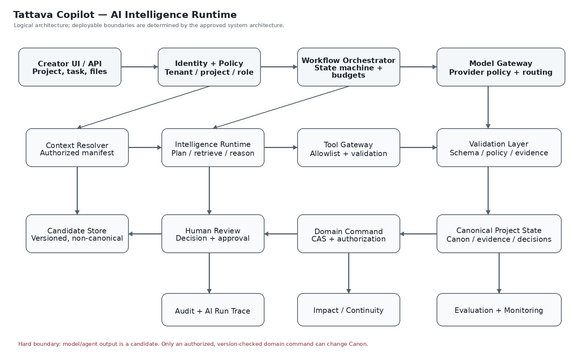
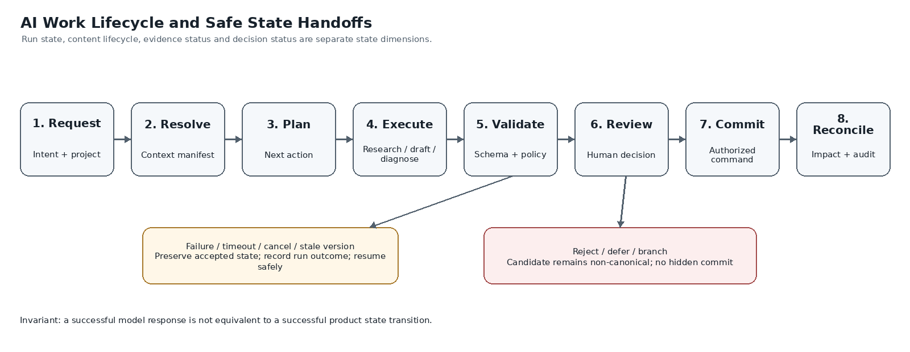
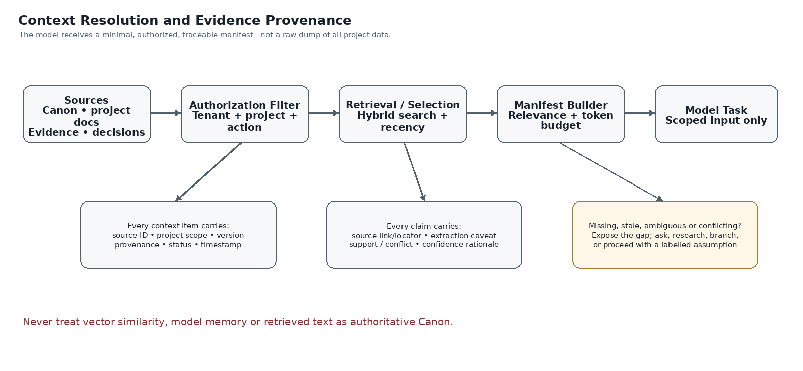
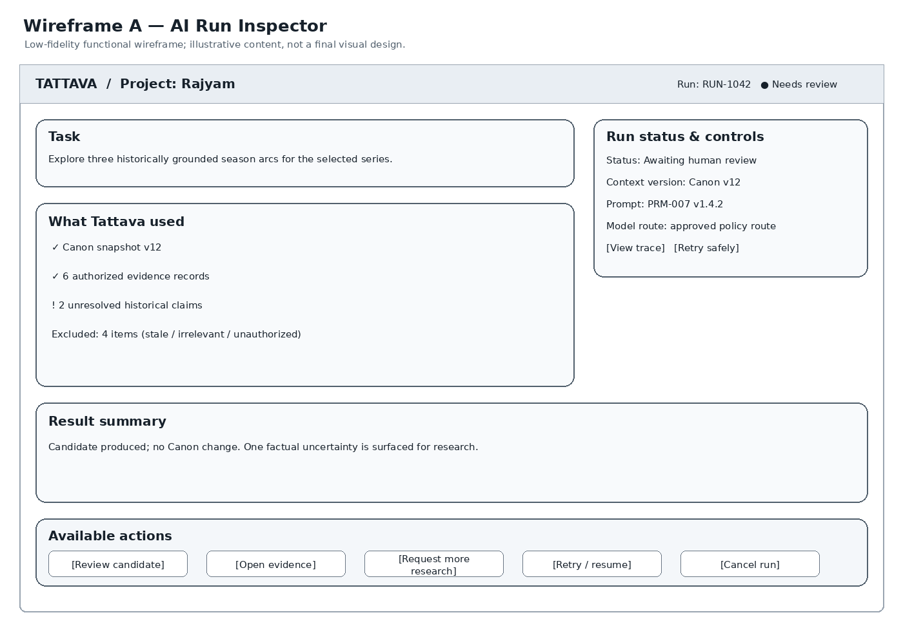
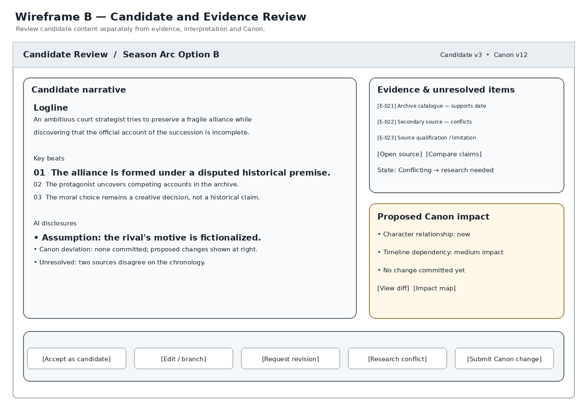
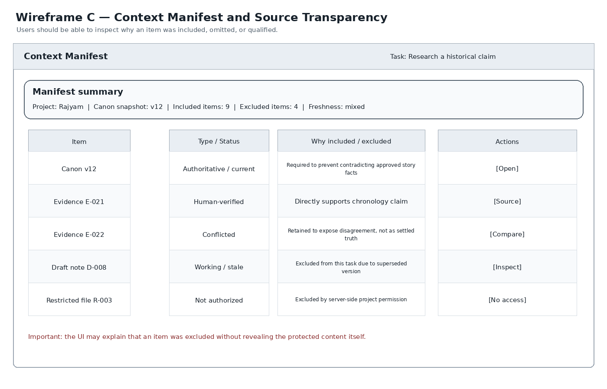

# TATTAVA COPILOT — 02_AI_INTELLIGENCE
## Comprehensive AI-Native Intelligence Specification

**Company:** Tattava Co. / Don Vanzara Showbiz LLP  
**Product baseline:** V1 — Narrative Intelligence  
**Document status:** Refined implementation specification; deployment decisions remain explicitly governed  
**Source of truth:** This Markdown master plus the eight companion specifications in this package.

## 1. Executive contract
Tattava Copilot is a project-centric Narrative Intelligence system. The project is the durable unit of intelligence; conversation is one interaction surface. The system helps creators progress from an input to a Human-Approved Story Development Package through intent understanding, context resolution, research, exploration, narrative generation, validation, human decision, Canon governance and impact reconciliation.

### Non-negotiable invariants
1. Canon is authoritative, typed, versioned, permission-controlled and stored outside model memory, vector indexes and agent scratchpads.
2. Evidence, interpretation, candidate content, creative decision and Canon are distinct.
3. Unknown remains unknown until supplied, appropriately researched/verified, or explicitly accepted as a creative choice by an authorized person.
4. Model output is never Canon by itself.
5. Consequential changes require server-side authorization, explicit approval where policy requires it, expected-version validation and audit.
6. Failed, cancelled, stale or partially completed runs cannot silently mutate authoritative project state.
7. The product optimizes project progress and package readiness—not prompt count, token volume, generation count or agent count.

## 2. Source and decision discipline
Use the current Product Strategy and updated PRD as primary product-intent sources; the BRD supports original business intent and scope history; the approved System Architecture defines system boundaries; the current Experience and Requirements Traceability packages define interaction and test alignment. Where a source is unclear, preserve the uncertainty in the decision register rather than inventing policy or implementation facts. This refinement uses the current AI Intelligence documents as the base; the superseded blueprint is not treated as an authority.

## 3. System context and trust boundaries

The architecture is logical rather than a mandate to deploy separate services. The V1 recommendation remains a modular application core with asynchronous AI workers and a shared Intelligence Runtime. Deterministic application services own identity, authorization, state transitions, schema validation, version checks, approvals, persistence and audit. Models handle interpretation, planning, synthesis, generation and diagnosis within those boundaries.

## 4. End-to-end intelligence lifecycle

1. **Accept request:** authenticate actor, resolve project and intent, create run envelope.
2. **Resolve context:** produce a versioned manifest of authorized Canon, evidence, decisions, artifacts and dependencies.
3. **Assess sufficiency:** classify Known, Unknown, Ambiguous, Assumed, Conflicting, Resolved or Blocked items; ask only material clarifications.
4. **Choose next action:** ask, research, explore, generate, validate, review, or stop safely.
5. **Execute bounded workflow:** invoke the smallest suitable capability and allowed tools under deadlines and budgets.
6. **Validate:** schema, policy, provenance, scope, Canon deviation, output completeness and evidence claims.
7. **Create candidate:** persist versioned non-canonical content with lineage.
8. **Human review:** show candidate, source version, assumptions, conflicts, proposed diff and dependency impact.
9. **Commit if authorized:** deterministic domain command re-checks authority, approval and expected version.
10. **Reconcile:** update audit, dependencies, stale markers, run telemetry and evaluation events; recommend next best action.

## 5. Capability contract

Every capability has a stable ID, purpose, trigger, required context classes, input schema, output schema, allowed tools, forbidden actions, autonomy level, human checkpoint, failure taxonomy, telemetry and evaluation suite. A capability is considered complete only when the output validates, provenance is retained where factual claims are made, unknowns/conflicts are surfaced, errors are recoverable, and its test suite passes.

### Shared request envelope
`tenant_id`, `project_id`, `actor_id`, `action_id`, `run_id`, `capability_id`, `input_refs[]`, `expected_project_version`, `policy_version`, `prompt_version`, `model_route_policy_id`, `deadline`, `budget`, `correlation_id`.

### Shared result envelope
`status`, `candidate_refs[]`, `evidence_refs[]`, `state_items[]`, `assumptions[]`, `unknowns[]`, `conflicts[]`, `warnings[]`, `recommended_next_actions[]`, `validation_results[]`, `source_project_version`, `proposed_changes[]`, `requires_human_review`.

### Core capability groups
- Input and intent understanding.
- Project-state classification and adaptive clarification.
- Context resolution and context transparency.
- Next-best-action recommendation.
- Research planning, retrieval, extraction, provenance, conflict analysis and research-to-story bridge.
- Narrative exploration and candidate generation.
- Character and story-world structuring.
- Format, genre, template and screenplay/dialogue support.
- Continuity, dependency and change-impact analysis.
- Story Development Package assembly and readiness.
- Human decision capture, Canon command preparation and safe recovery.
- Evaluation, feedback, observability and cost telemetry.

## 6. Agent/workflow orchestration

Agents are internal workflow modules, not independent product silos. The orchestrator owns state transitions, sequencing, cancellation, deadlines, retry bounds and handoffs. A model or agent cannot authorize itself, select an unapproved provider, bypass a human checkpoint, or write Canon.

### Logical workflow modules
1. Intent and State Interpreter.
2. Context Planning Coordinator.
3. Research Planner and Evidence Analyst.
4. Narrative Development.
5. Character / Story-World Structurer.
6. Continuity and Change-Impact Analyst.
7. Package Assembly and Readiness.
8. Run Recovery Coordinator.

Each module specifies: supported intents; required context; allowed tools; prohibited tools; schema versions; max steps; deadline and budget; retry/cancellation semantics; idempotency; review checkpoints; failure codes; trace fields; and evaluation suite. Values are configured and measured, not invented in this document.

### Handoff envelope
`run_id`, `parent_run_id`, `project_id`, `capability_id`, `input_refs`, `context_manifest_ref`, `source_version`, `output_schema_version`, `allowed_tool_ids`, `deadline`, `budget_remaining`, `attempt`, `cancellation_token_ref`.

## 7. Prompt system and governance
Prompts are governed configuration—not a security boundary. Every prompt is versioned with ID, semantic version, owner, purpose, model compatibility, input/output schema versions, context requirements, tool policy, data classification, evaluation suite, release status, change rationale, known limitations and rollback version.

Instruction/data hierarchy:
1. Platform safety and system constraints.
2. Tattava stable behaviour and Canon/epistemic rules.
3. Capability instructions and output schema.
4. Authorized task context manifest.
5. Retrieved evidence and tool outputs labelled untrusted with provenance.
6. Current user request and explicit preferences.
7. Output constraints and validation metadata.

Prompt regression suite includes schema conformance, source attribution, unknown/conflict preservation, prompt injection, cross-project isolation, Canon integrity, creative usefulness, latency/cost telemetry and comparison with the approved version. Critical security, provenance and Canon-integrity regressions block release.

## 8. Context resolution and evidence provenance

Context resolution is permission-first and task-specific. The model receives a minimal authorized manifest, not an unrestricted dump of project data. Each item records identity, type, project scope, source/version, status, timestamps, sensitivity, permission decision, relevance rationale, freshness, conflicts and inclusion/exclusion reason. Protected content must not be disclosed when explaining why it was excluded.

### Resolution sequence
1. Authenticate and derive tenant/project scope.
2. Resolve task and minimum context.
3. Fetch authorized Canon snapshot and approved decisions.
4. Retrieve relevant evidence/artifact candidates.
5. Apply permission filtering before model exposure.
6. Rank by relevance, authority, freshness and source quality.
7. Preserve material disagreement; do not average it into false consensus.
8. Deduplicate and build a bounded manifest.
9. Detect missing context, stale state, unknowns and conflicts.
10. Ask, research, proceed with explicit qualification, or block.
11. Re-resolve before a consequential write if project version changes.

Factual claims should carry source IDs and locators, source/publisher where available, URL where applicable, publication and retrieval dates, extraction caveats, source tier/qualification and support/conflict links. Research records are persistent organizational intelligence, not disposable chat output.

## 9. Project Intelligence and Canon
Conversation history is interaction context; run state is execution progress; working memory is temporary scratch; vector indexes are derived retrieval aids; Project Intelligence is durable structured project knowledge; Canon is approved authoritative state. These are not interchangeable.

### Canon write protocol
1. Prepare a typed candidate change set with target IDs and before/after values.
2. Validate schema, scope, authorization and policy.
3. Resolve required reviewer(s) from the configured action/consequence policy.
4. Present diff, rationale, evidence, uncertainty and dependency impact.
5. Bind explicit approval to the exact candidate and source version.
6. At commit, re-check authority, approval and expected version.
7. Commit atomically as a new version or reject as stale.
8. Record actor, approver, run, source references, timestamp and resulting version.
9. Recompute dependency impacts and mark affected artifacts potentially stale.
10. Support audited correction/compensation without silently rewriting history.

### State dimensions
- Epistemic: Known, Unknown, Ambiguous, Assumed, Conflicting, Resolved, Blocked.
- Content lifecycle: Working, Candidate, Reviewed, Approved, Canonical, Deprecated, Locked, Derived.
- Evidence: Discovered, Retrieved, Extracted, Corroborated, Conflicted, Human-verified, Rejected.
- AI run: Queued, Running, Awaiting input, Awaiting approval, Succeeded, Partially succeeded, Failed, Cancelled.
- Decision: Open, Options prepared, Awaiting decision, Accepted, Rejected, Deferred, Superseded.

Do not merge these into one overloaded `status` field.

## 10. Tool contracts and boundaries
Tools have typed schemas, least-privilege allowlists, server-side authorization and audit. Read-only tools, research tools, ingestion tools, analysis tools, candidate-write tools, Canon command tools and administrative tools are separate classes. No arbitrary shell/code execution is exposed to a model. External network access is policy-controlled. Side-effecting operations require idempotency and bounded retries.

### Common tool envelope
`tool_id`, `tool_version`, `run_id`, `actor_id`, `project_id`, `action_scope`, `input_schema_version`, `idempotency_key`, `deadline`, `budget`, `authorization_decision_ref`, `correlation_id`.

### Common tool response
`status`, `result_ref`, `warnings[]`, `source_refs[]`, `retryable`, `retry_after` where known, `partial_result`, `error_code`, `safe_user_message`, `correlation_id`, `side_effect_summary`.

File ingestion preserves original reference, uploader, project scope, detected type, processing version, extraction method, quality warnings, page/segment locators, checksum and access policy. Exact file types, size/page limits, OCR vendor and capacity must be configured and approved.

## 11. Human-in-the-loop and role model
The Producer is the default final project authority. Content Head and Creative Director are parallel content and editorial/narrative authority domains under the Producer, not a forced reporting chain. Writers create and revise candidates; Researchers support evidence; AI is an intelligence/support layer only. The canonical role title is **Content Head**. Do not bind a person's name to that role in the product database.

The exact action-to-role matrix, named approvers, delegation, self-approval and separation-of-duties rules remain configurable and require management approval.

### Decision packet
A consequential review shows candidate; exact diff; rationale; Canon references; evidence and conflicts; assumptions/unknowns; dependencies; reversibility; source version; candidate version; required role(s); and reject/defer/revise/branch outcomes.

### Explicit action semantics
- Accept candidate ≠ Canon approval.
- Edit creates a new candidate version.
- Branch isolates an alternative.
- Request revision creates a follow-up work item.
- Approve Canon change is bound to a specific diff/version.
- Defer preserves state and records an unresolved decision.
- Reject preserves audit history.
- Cancel prevents later background commit from the cancelled run.

## 12. AI Interaction wireframes

These wireframes are intentionally low fidelity and specify functional information hierarchy, not final visual design. The Experience package remains the source for broader UX flows and visual design system. The AI Intelligence wireframes define how the runtime exposes run state, context transparency, evidence conflict, candidate status, proposed impact and recovery.

### Required UI-to-runtime contract
- Run Inspector: status, source project version, prompt version, route policy reference, context manifest reference, steps, warnings, failure code, retry/resume eligibility and cancellation state.
- Candidate Review: candidate version, Canon version used, assumptions, evidence, conflicts, Canon deviations, impact preview and distinct accept/edit/branch/revision/approval actions.
- Context Manifest: included/excluded items, safe exclusion rationale, provenance, freshness, conflict status, source locator and permission-safe detail.
- No screen should imply Canon changed until the server confirms a successful authorized domain command.

## 13. Guardrails, threat model and failure recovery
Treat user input, uploads, OCR, web content, retrieval snippets, model output, handoffs and provider responses as untrusted until validated. Trusted controls are server-side identity/policy enforcement, state machine, validators, secret store, approved tool gateway and persistence—not prompt instructions.

### Mandatory adversarial coverage
- Direct/indirect prompt injection in text, PDFs, OCR, web pages and retrieved documents.
- Cross-tenant/project retrieval, cache, job and export leakage.
- Unauthorized tool call, network access or external side effect.
- Secret/prompt/other-project data exfiltration.
- Fabricated citation, unsupported historical claim, fictional invention labelled as fact.
- Stale approval, stale version, retry duplication, cancellation race and partial failure.
- Provider route inconsistent with data classification or contract.
- Deleted/restricted data retained in derived index/cache/export.
- Unbounded loops, runaway cost, oversized outputs.
- Critical uncertainty/approval/recovery disclosure inaccessible to assistive technology.

### Failure taxonomy and safe behavior
`INPUT_INVALID`, `AUTH_DENIED`, `CONTEXT_INSUFFICIENT`, `POLICY_BLOCKED`, `PROVIDER_UNAVAILABLE`, `OUTPUT_INVALID`, `VERSION_STALE`, `BUDGET_EXCEEDED`, `CANCELLED`, `PARTIAL_SUCCESS`. Failures must preserve authoritative state, show a safe actionable explanation, record correlation IDs and offer only policy-compliant retry/recovery.

### Release blockers
Cross-scope leakage; unauthorized reads/writes; silent Canon mutation; approval bypass; critical prompt injection/tool abuse; fabricated provenance on critical claims; provider-policy breach; inability to audit consequential changes.

## 14. Evaluation, observability and continuous improvement
Every run should record, subject to approved data policy: request/run IDs, project version, capability, prompt/schema version, approved route identifier, tool calls, context manifest, latency by stage, token/cost telemetry, validation results, retry count, failure code, candidate status, human correction/acceptance, and resulting project progress. Avoid logging raw sensitive content unless explicitly authorized and necessary.

### Evaluation layers
1. **Contract tests:** schemas, state transitions, idempotency, authorization, version checks.
2. **Retrieval tests:** relevance, freshness, scope, provenance, exclusion and conflict preservation.
3. **Model tests:** instruction adherence, output quality, uncertainty, factual grounding and format.
4. **Workflow tests:** multi-step completion, cancellation, retries, partial success and recovery.
5. **Human outcome tests:** usefulness, edit burden, approval quality, time-to-package and decision clarity.
6. **Security tests:** injection, leakage, unauthorized tools, provider routing and deletion.
7. **Regression tests:** every prompt/model/policy/retrieval change against an approved baseline.

### KPI alignment
North Star: time from accepted project input to Human-Approved Story Development Package. Supporting measures may include research time, story development time, revision time, hours per project, continuity QA, research QA, creative approval cycle, package completeness and user correction rate. Baselines and target thresholds must be measured and approved; do not invent numeric targets.

## 15. Implementation and verification checklist
- [ ] All capability, agent, prompt and tool contracts are versioned.
- [ ] Authorization is enforced before retrieval and before every side effect.
- [ ] Context manifests include provenance, source version, freshness and exclusions.
- [ ] Canon is separate from candidates, evidence, indexes and model memory.
- [ ] Consequential approvals bind to exact candidate and expected version.
- [ ] Stale version, retries, cancellation and concurrent edits are tested.
- [ ] Prompt injection and cross-project isolation tests pass.
- [ ] Run trace, cost/latency telemetry and audit are available.
- [ ] Failure states provide safe recovery without hidden mutation.
- [ ] Wireframes map to Experience screen/requirement IDs before UI implementation.
- [ ] Package schema and evaluation thresholds have accountable owners.
- [ ] Provider, retention, legal and security decisions are approved before production commitments.

## 16. Decision register — defaults adopted vs decisions requiring approval
| Topic | Adopted implementation default | Still requires approval/evidence |
|---|---|---|
| Model providers | Provider-agnostic Model Gateway | Approved provider list, contracts, residency, subprocessors |
| Autonomy | Assistive; candidate-only generation; no autonomous Canon mutation | Any later autonomy increase and action-level thresholds |
| Permissions | Deny by default; action/resource/consequence authorization | Exact action-to-role matrix, named approvers, delegation |
| Memory | Canon outside model/vector/agent memory; project-scoped intelligence | Retention periods, legal hold, deletion and backup semantics |
| Research | Provenance and conflict preservation; unknowns surfaced | Approved source hierarchy and licensed-source policy |
| Quality | Versioned evaluation suites and release gates | Numerical quality thresholds and pilot baseline |
| Performance | Instrument latency, reliability and cost by stage | SLOs, recovery targets, capacity and cost budgets |
| Ingestion | Validate and quarantine; configurable limits | Exact file formats/limits, OCR and extraction capability |
| Story package | Versioned, readiness-aware package | Final package schema and required fields |
| DVS integration | Bounded, versioned handoff; no deep V1 production-suite coupling assumed | Integration owner, contract and rollout plan |
| Commercial | No pricing assumptions embedded in runtime | Beachhead segment, willingness-to-pay and packaging |

## 17. Companion specification index
1. `01_AI_Capability_Spec.md`
2. `02_Agent_Specifications.md`
3. `03_Prompt_Specifications.md`
4. `04_Context_Specification.md`
5. `05_Memory_Project_Intelligence.md`
6. `06_Tool_Specifications.md`
7. `07_Guardrails.md`
8. `08_Human_in_the_Loop.md`
9. `README.md`

Each companion specification preserves its original content and adds a clearly labelled refinement section. The current Markdown is the editable source of truth; generated DOCX/PDF are publication formats.
