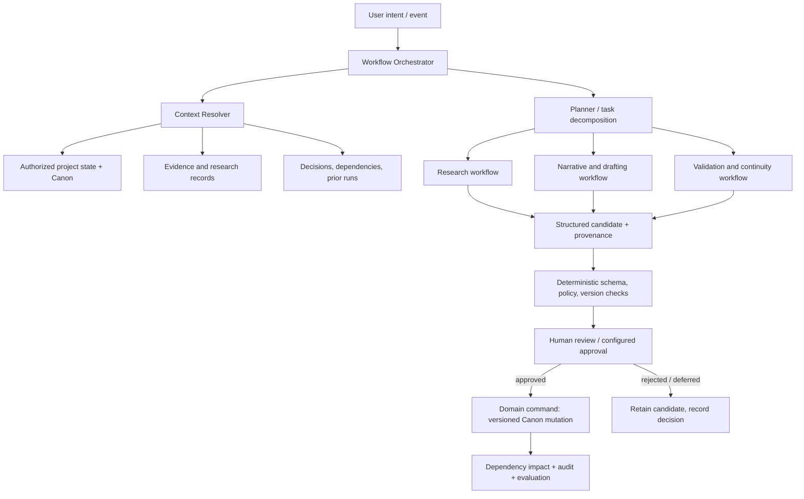
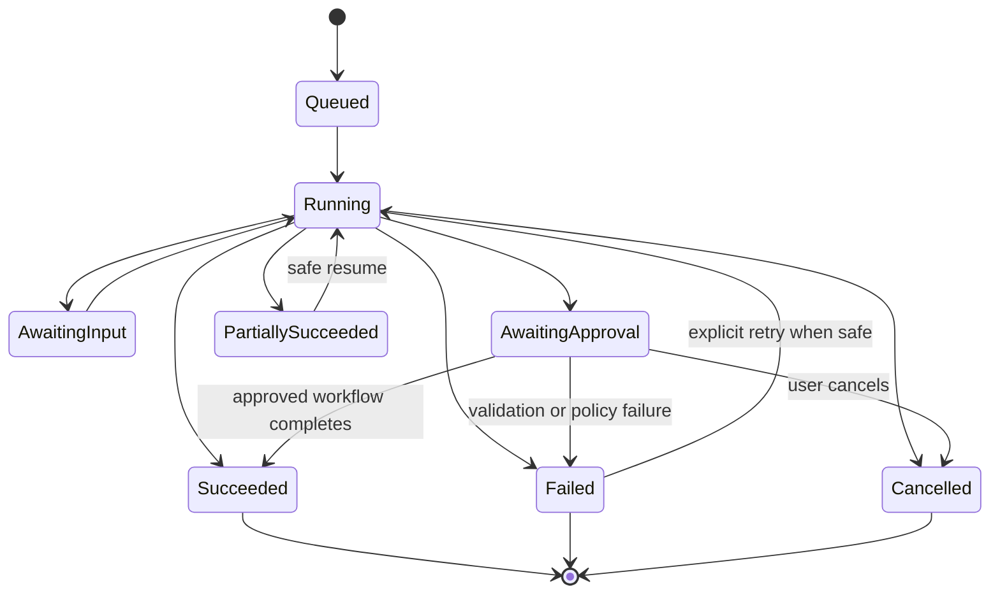

# TATTAVA COPILOT — Agent Specifications
**Document ID:** TAT-AI-AGT-001 · **Baseline:** V1 — Narrative Intelligence · **Status:** Proposed implementation specification aligned to approved architecture

## 1. Design rule
Agents are internal intelligence capabilities, not product silos and not owners of project truth. The experience should expose workflow outcomes and next actions, not require users to select from an “agent directory.” Prefer deterministic services for state transitions, authorization, version checks, approvals, audit and persistence. Use model-driven agents only for tasks requiring interpretation, planning, synthesis, generation or diagnosis.

## 2. Proposed runtime topology

This is a logical workflow, not a commitment to separate deployable services. The approved architecture favors a shared Intelligence Runtime and modular application core; agents may be workflow modules in one runtime.

## 3. Agent registry

| ID | Agent/workflow | Status | Responsibility | Must not do |
|---|---|---|---|---|
| AGT-001 | Intent and State Interpreter | Proposed | Parse request, identify project/task, classify known/unknown/ambiguous/conflicting state and propose clarifications | Create facts, authorize access, mutate Canon |
| AGT-002 | Context Planning Coordinator | Proposed | Request a task-specific context manifest and decide whether context is sufficient | Bypass Context Resolver or directly access unscoped stores |
| AGT-003 | Research Planner and Evidence Analyst | Proposed | Plan queries, use permitted research tools, extract claims, compare sources, retain provenance | Treat model output as evidence, hide disagreement, ignore rights restrictions |
| AGT-004 | Narrative Exploration and Drafting | Proposed | Generate creative alternatives and requested narrative artifacts grounded in Canon/branch | Select the final creative direction or Canonize output |
| AGT-005 | Character and Story-World Structurer | Proposed capability module | Propose typed characters, relationships, world rules and constraints from source material | Overwrite approved entities or infer unstated facts as established |
| AGT-006 | Continuity and Impact Analyst | Proposed | Compare candidate changes with Canon/dependencies and produce impact findings | Resolve trade-offs or apply downstream changes autonomously |
| AGT-007 | Package Assembly Coordinator | Proposed | Select current governed package inputs, check required sections, assemble a versioned review artifact | Declare greenlight or conceal unresolved issues |
| AGT-008 | Evaluation and Run Summarizer | Proposed | Summarize run outcome, validation status, source usage and failure/recovery options | Falsify completion, alter scores, or treat user feedback as automatic training |

The orchestrator is a workflow component, not an autonomous authority. No agent may grant itself permissions or call a Canon mutation path directly.

## 4. Agent execution contract
Every run includes `run_id`, `project_id`, `actor_id`, `actor_role`, `capability_id`, `agent_version`, `prompt_version`, `model_route`, `project_version_snapshot`, `context_manifest_id`, `tool_allowlist`, `autonomy_tier`, `budget_policy_id`, `output_schema_id`, `approval_policy_version`, `started_at`, `terminal_status`, and validation/audit references. Exact database and API field names are implementation contracts to validate, but the semantic fields are required for traceability.

### State machine

Terminal-state meanings must be unambiguous in the UI. “Succeeded” means the requested workflow and required validations completed; it does not mean the human approved its output.

## 5. Handoffs and shared-state rules
1. Orchestrator receives intent and validates project scope/actor.
2. Context Resolver returns only authorized context plus provenance, version and exclusions.
3. Planner chooses the minimum sufficient workflow. It may sequence or parallelize independent read-only research tasks, but parallel writes to the same artifact are not allowed.
4. Research, drafting and diagnosis modules return typed candidates with source references and snapshot versions.
5. Deterministic validators check schema, policy, permissions, branch scope and staleness.
6. Human review is requested when required by consequence, ambiguity, conflicts, or configured approval policy.
7. Only the domain service can commit a canonical mutation after authorization and required approval.
8. Dependency/impact processing, event recording and evaluation follow commit; failures in these downstream tasks must not roll back or corrupt already committed Canon without an explicit compensating transaction.

## 6. Planning and bounded execution
The planner must produce a compact execution plan: goal; subtasks; needed context; tools; dependencies; expected artifacts; review checkpoints; stopping conditions. Use bounded iterations, tool-call budgets, deadlines and cancellation. Exact numeric budgets are operational configuration, to be set from pilot and infrastructure tests; they must exist before production execution.

Stop and escalate when:
- the user’s intent cannot be resolved without a material decision;
- required evidence is inaccessible or conflicts materially;
- a requested action exceeds the actor’s permissions or autonomy tier;
- a tool result is unsafe, malformed or outside expected scope;
- the project version changed in a way that invalidates the candidate;
- a workflow reaches its budget or retry limit;
- the agent cannot explain the provenance of a material factual claim.

## 7. Retry, idempotency and concurrency
Read-only retrieval may be retried under bounded policy. State-changing operations must use idempotency keys or domain-level duplicate protection. A retry must not duplicate external effects or Canon mutations. Candidate generation records the project/artifact snapshot; approval revalidates the snapshot and relevant dependencies. On stale writes, preserve both histories and require refresh/compare/merge. Never silently overwrite.

## 8. Agent memory policy
Agents receive ephemeral task memory only as needed. Persistent project intelligence is read through authorized domain/context APIs; agent scratchpads are disposable and non-authoritative. A summary may be stored only as a derived artifact with lineage and correction path, never as an unqualified replacement for source records or Canon.

## 9. Security and isolation
Authorization is checked before context retrieval and again before each tool/action. Project and tenant filters must apply across relational reads, object storage, search/vector indexes, caches, queued jobs and telemetry views. Retrieved text is untrusted data, not instructions. Agents cannot retrieve “all projects” unless a separately authorized cross-project operation exists and is explicitly in scope.

## 10. Agent evaluation
Test each agent/workflow for task success, grounding, correct state classification, schema validity, tool selection, policy compliance, permission refusal, boundedness, recovery, and Canon preservation. Test orchestration for loops, duplicated subtasks, missing handoffs, lost provenance, conflicting parallel results, cancellation races and stale snapshots. A model’s self-reported confidence is not a substitute for calibrated evaluation.

## 11. Implementation dependencies and open decisions
Engineering must validate whether modules run in-process or in workers and select queue/worker technology. AI/ML must select evaluated model routes behind the Model Gateway. Product/Creative leadership must configure approval policies; Security/Legal must approve provider and retention policies. No vendor, queue, model or numerical run budget is hard-coded here.

## 12. Refinement — agent contracts and orchestration details

### 12.1 Orchestration rule
Use a deterministic workflow state machine to control ordering, permissions, deadlines, retries and mutation. Agent-like workflows may plan or synthesize, but may not decide whether a user is authorized, bypass required approvals, or write Canon. V1 should not require autonomous multi-agent debate to complete routine tasks; the orchestrator may invoke the smallest suitable workflow and return control when a human decision is required.

### 12.2 Agent contract
Each workflow module defines: purpose; supported intents; required context classes; allowed tools; prohibited tools; input/output schema versions; maximum steps; wall-clock deadline; token/cost budget; retry policy; cancellation semantics; idempotency key; human checkpoint; failure codes; observability fields; and evaluation suite. The values are deployment configuration and must be measured rather than fabricated in this document.

### 12.3 Recommended logical workflow modules
1. Intent and State Interpreter — parse the user’s goal and identify unknowns, ambiguity, conflicts and required approvals.
2. Context Planning Coordinator — request a scoped context manifest; cannot query raw stores directly.
3. Research Planner and Evidence Analyst — plan queries, retrieve allowed sources, extract claims and preserve source qualification.
4. Narrative Development — create candidate story artifacts constrained by Canon, format, genre, branch and task.
5. Character / Story-World Structurer — propose typed entities and relationships with source lineage.
6. Continuity and Change-Impact Analyst — compare proposed changes against Canon and dependency graph.
7. Package Assembly and Readiness — assemble a versioned package and report omissions, conflicts and approval state.
8. Run Recovery Coordinator — expose resumable checkpoints and safe retry options; no background commit after cancellation.

### 12.4 Handoff envelope
A workflow handoff contains `run_id`, `parent_run_id`, `project_id`, `capability_id`, `input_refs`, `context_manifest_ref`, `source_version`, `output_schema_version`, `allowed_tool_ids`, `deadline`, `budget_remaining`, `attempt`, and `cancellation_token_ref`. Downstream modules re-check scope and do not trust prior agent prose as authorization.

### 12.5 Concurrency and idempotency
Use an idempotency key for retried side-effecting operations. For concurrent edits, compare `expected_project_version` at commit. If stale, reject the commit, retain the candidate, refresh the manifest and show a diff; do not silently rebase a consequential creative change. Retries must not duplicate evidence records, approvals or Canon versions.
