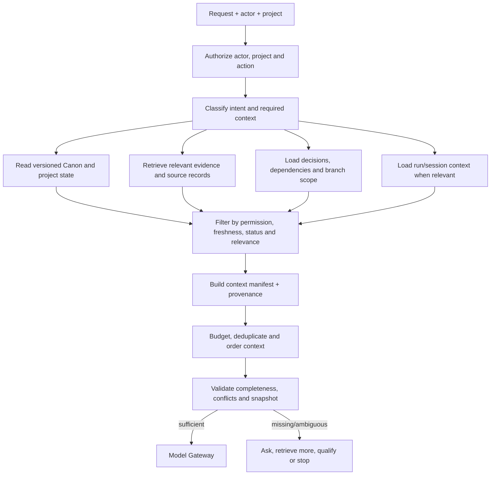

# TATTAVA COPILOT — Context Specification
**Document ID:** TAT-AI-CTX-001 · **Baseline:** V1 — Narrative Intelligence · **Status:** Logical context contract aligned to architecture

## 1. Purpose
The Context Resolver assembles the smallest sufficient, authorized, task-specific view of project intelligence for each AI operation. It prevents “chat history as truth,” keeps Canon separate from evidence and candidates, and makes the model’s grounding inspectable. The logical design is established; concrete retrieval/index technologies remain an engineering choice.

## 2. Context classes

| ID | Class | Authority/use | Freshness and controls |
|---|---|---|---|
| CTX-01 | Current user input | Defines current request and explicit task constraints | Current turn; treated as user instruction only within policy |
| CTX-02 | Project metadata and intent | Project identity, type, format, maturity and goals | Read from authorized project state; versioned |
| CTX-03 | Canonical state | Approved project truth, constraints, entities and decisions | Highest authority for established project truth; version checked |
| CTX-04 | Decision and approval history | Why a choice was made, who approved, status and supersession | Preserve lineage; do not treat superseded decisions as current |
| CTX-05 | Evidence/research records | External or uploaded source claims and provenance | Source- and claim-specific freshness; never auto-promoted to Canon |
| CTX-06 | Candidate artifacts and branches | Alternatives and in-progress work | Isolated by branch and lifecycle status |
| CTX-07 | Dependencies and impact graph | Links affected by changed entities or decisions | Recompute or mark stale after material mutation |
| CTX-08 | Current workflow/run state | Step status, tool outputs, checkpoint and error | Run-scoped; may be resumable but not authoritative project truth |
| CTX-09 | Authorized conversation/session context | Relevant recent interaction and unresolved conversational intent | Use only if relevant; cannot override Canon or project permissions |
| CTX-10 | Derived summaries/indexes | Retrieval acceleration and compact summaries | Derived and reconstructable; retain lineage and source versions |

Persistent user preferences are not assumed as a separate V1 memory class. If later implemented, they require explicit product purpose, visibility, correction/deletion and policy.

## 3. Source precedence
For project truth: **current authorized Canon → approved decision records and versioned project state → relevant project-owned artifacts with their lifecycle status → evidence records with provenance → explicit assumptions → candidate content → conversation/session context → model prior knowledge**. This is not a universal ranking for every task: research tasks may prioritize primary sources for external factual claims, while project Canon remains authoritative for what the project has chosen to establish.

For external factual claims, prefer project-owned authoritative material for the project's own decisions; otherwise use source tiers: official/primary sources; academic/research sources; custodians/domain experts for cultural context; reputable secondary sources; general web for discovery; LLM-generated/unverified material as leads only. Conflicts are preserved and surfaced.

## 4. Context assembly flow

The manifest records which sources were included, excluded, truncated or summarized and why. The model does not choose its own authorization scope.

## 5. Context manifest contract
Required logical fields: manifest ID; project and tenant scope; actor/role; capability; source IDs and versions; source class and authority status; retrieval timestamp; permission decision; relevance rationale; conflict/staleness flags; extraction confidence where relevant; truncation/summarization actions; token/size budget usage; excluded-source reasons; and the project version snapshot. Final field names and persistence implementation are engineering decisions.

## 6. Relevance, freshness and conflicts
- Retrieve by task purpose and dependency links, not merely lexical similarity.
- Apply access controls before retrieval results reach a model; re-check before tool use and state mutation.
- Prefer current approved state over stale summaries. If source version differs from current project state, mark stale or re-resolve.
- A derived summary must cite or link to its source records and version snapshot.
- Do not use one universal freshness interval. Freshness depends on source class and claim volatility; the research policy should define rules by domain.
- When two sources conflict, preserve both, label the conflict and explain whether authority, date, scope or interpretation may explain it.
- If an approved decision supersedes an earlier one, current Canon reflects the latest approved state while history remains available with status.
- Do not let branch-only content leak into active Canon context unless the task explicitly targets that branch.

## 7. Budgeting and truncation
Allocate context budget by task-criticality: core instructions/schema; relevant Canon and constraints; required evidence; decisions/dependencies; optional history/summaries. Never silently truncate critical Canon constraints, permissions, provenance needed to justify material claims, or schema instructions. If the budget cannot hold essential context, narrow scope, retrieve targeted subsets, summarize with lineage, ask the user, or fail safely. Exact token budgets depend on selected model and measured workloads.

## 8. Missing or inaccessible context
- **Missing non-material detail:** proceed with explicit, low-risk assumption if allowed, label it and keep it non-canonical.
- **Missing material creative preference:** ask or provide clearly separated alternatives.
- **Missing factual evidence:** research via approved tools, qualify, or preserve Unknown.
- **Permission denied:** do not reveal that restricted content exists beyond safe error wording.
- **Unavailable source/provider:** show limitation and offer retry or alternate approved source.
- **Contradiction with Canon:** pause consequential generation or produce a clearly marked conflict-aware candidate.
- **Stale version:** refresh and rerun or ask for conflict resolution; do not write from stale state.

## 9. Context contamination controls
All uploaded files, web results, OCR, extracted text, tool outputs and candidate content are untrusted data. Delimit and label them; strip or neutralize tool directives from content; never let retrieved text alter system policy or tool allowlists. Keep project/tenant identifiers attached end-to-end, including caches, indexes, background jobs and evaluation logs. Test indirect injection from PDFs, image OCR and source snippets.

## 10. Validation and acceptance
Deterministic checks: actor/project authorization; source access; branch scope; version consistency; required context classes; manifest provenance; schema presence; critical constraint inclusion; no cross-project IDs. Evaluation checks: retrieval relevance, grounding, stale-context detection, conflict recall, unnecessary context, token/cost efficiency and task success. Critical leakage or unauthorized-context exposure is a release blocker.

## 11. Remaining decisions
Engineering must choose retrieval/index implementation, ranking strategy, model-specific context budgets and cache policy. Security/Legal must approve retention, residency and provider handling. Pilot data must establish relevance/latency/cost thresholds. This document defines the context contract without hard-coding a vendor.

## 12. Refinement — context manifest contract

### 12.1 Context item envelope
A context item should include `item_id`, `item_type`, `tenant_id`, `project_id`, `source_ref`, `source_version`, `content_status`, `epistemic_status`, `evidence_status`, `created_at`, `updated_at`, `valid_time` where applicable, `retrieved_at`, `permission_decision_ref`, `relevance_rationale`, `freshness_status`, `conflict_refs[]`, `sensitivity_class`, and `included_or_excluded_reason`. Protected content is never disclosed merely because its exclusion is explained.

### 12.2 Resolution algorithm
1. Authenticate actor and derive tenant/project scope.
2. Resolve the requested capability and its minimum required context.
3. Fetch authorized Canon snapshot and relevant approved decisions.
4. Retrieve candidates from allowed evidence/document indexes.
5. Apply permission filtering before content is passed to a model; do not rely on post-generation redaction.
6. Rank by task relevance, authority, freshness and source quality; retain contradictory high-relevance sources rather than hiding disagreement.
7. Deduplicate and construct a bounded manifest.
8. Record included and excluded references with safe rationale.
9. Detect missing required context, stale versions, unknowns and conflicts.
10. Ask a material clarification, research, proceed with explicit qualification, or block.
11. Re-resolve before consequential mutation if the project version has changed.

### 12.3 Freshness and conflict policy
Canon version is authoritative for approved creative state; evidence records can be stale, superseded or disputed. New evidence does not silently overwrite Canon. The system should surface source date, retrieval date and disagreement, and offer research or human decision options. Do not collapse multiple sources into a single unsupported “consensus.”

### 12.4 Context transparency acceptance
Users should be able to inspect why an item was included, why an item was excluded (without seeing restricted content), the project version used, source provenance, known omissions and relevant conflicts. QA must test stale context, unauthorized content, conflicting evidence, cache leakage, and re-use of context across projects.
