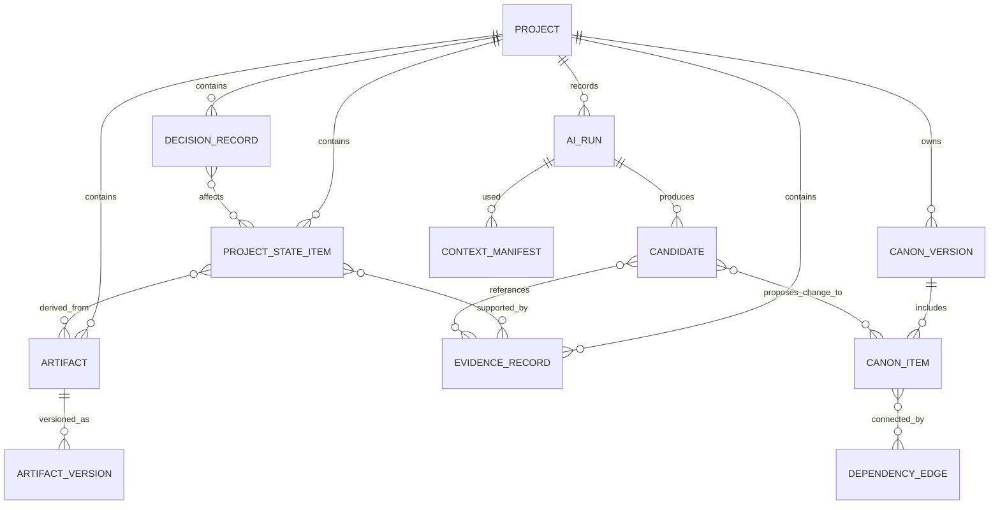

# TATTAVA COPILOT — Memory and Project Intelligence
**Document ID:** TAT-AI-MEM-001 · **Baseline:** V1 — Narrative Intelligence · **Status:** Domain and lifecycle specification

## 1. Core principle
Project Intelligence is the durable, structured, versioned and governed representation of a project's intent, facts, characters, relationships, world rules, research, decisions, artifacts, unresolved questions, dependencies and Canon. It is not equivalent to chat history, a vector database, model memory or an agent scratchpad. Canon is a governed subset of project state representing approved project truth.

## 2. Memory categories and authority

| ID | Category | V1 treatment | Authority and lifecycle |
|---|---|---|---|
| MEM-01 | Canonical memory | Required | Durable, typed, versioned; changes only through authorized domain command and approval |
| MEM-02 | Project Intelligence / working project state | Required | Durable structured state for known/unknown/ambiguous/assumed/conflicting/resolved items; provenance and versioning |
| MEM-03 | Evidence and research memory | Required | Durable source/evidence records separate from interpretation and Canon; source rights/freshness metadata where known |
| MEM-04 | Decision memory | Required | Durable decision record with options, rationale, decision-maker/role, timestamp, status, affected entities and supersession |
| MEM-05 | Artifact/version memory | Required | Original uploads, extracted assets, candidates, reviews, approved artifacts, versions and lineage |
| MEM-06 | Dependency/impact memory | Required | Relationships among entities, decisions, scenes/sections and artifacts; stale impact assessments are marked |
| MEM-07 | Execution memory | Required, run-scoped | Run checkpoints, context manifest, tool results, validation, cost/latency and failure; expires per approved policy |
| MEM-08 | Session/conversation context | Limited and task-relevant | Useful for immediate intent; not a source of truth and not a substitute for durable project state |
| MEM-09 | Persistent personal preferences | Not assumed in V1 | Defer until clear product need, consent, user visibility and deletion/correction contract exist |
| MEM-10 | Search/vector indexes and summaries | Derived infrastructure | Rebuildable indexes/summaries linked to source IDs and versions; never authoritative |

## 3. Conceptual data model

This is a conceptual entity relationship view, not a final database DDL. Relational integrity and transactional domain commands remain the source of durable authority; indexes are projections.

## 4. Core record contracts
- **ProjectStateItem:** stable ID, project scope, item type, content/value, epistemic state, lifecycle state, source/provenance refs, created/updated version, owner, conflict links, confidence rationale where appropriate, visibility and correction status.
- **CanonItem/CanonVersion:** typed value, canonical status, version, approval reference, author/approver role, effective timestamp, source decision, change reason, affected dependencies, prior version reference.
- **EvidenceRecord:** source ID, title, publisher/owner, URL/stable locator, retrieval/access date, excerpt/claim, source tier, extraction method and confidence, corroboration/conflict links, rights/license status where known, project relevance.
- **DecisionRecord:** question, options considered, selected/rejected/deferred option, rationale, decision authority, approval state, timestamp, impacted items, supersedes/superseded-by references.
- **ArtifactVersion:** artifact ID, version, lifecycle state, content hash/reference, source snapshot, branch, creator, review/approval records, derived-from links.
- **DependencyEdge:** source item, target item, relation type, impact semantics, confidence/source, current/stale status, last assessed version.
- **AIRun:** actor and role, project version snapshot, capability/prompt/model route, context manifest, tool calls, output refs, validations, human decisions, terminal status, timing/cost, error and recovery lineage.

Exact physical schemas, identifiers and indexes are engineering implementation work; the semantic contracts above are required.

## 5. Creation and update rules
1. Ingest original material as an immutable source asset where retention policy permits.
2. Extraction, OCR, summaries and entity suggestions are derived assets linked to the original and extraction version.
3. AI-derived facts begin as candidates or evidence-extraction results, never Canon.
4. A human statement can be captured as a project-state item, but material factual/creative state must retain source and lifecycle status; explicit approval is required where policy defines it.
5. A decision record captures both the selected choice and the reason; it does not erase rejected options.
6. Canon mutations use optimistic concurrency, validation, impact preview, authorization and approval. The domain service creates a new version and audit event.
7. Correction creates a traceable update/supersession rather than erasing history invisibly.
8. Duplicate detection may suggest consolidation but must not merge distinct story entities or conflicting claims without review.
9. Derived indexes and summaries are invalidated/rebuilt when source versions change; stale projections are marked and not silently trusted.

## 6. Epistemic discipline
- **Known:** established in the project state with a source or explicit authorized statement.
- **Unknown:** not established; must not be presented as fact.
- **Ambiguous:** more than one plausible interpretation remains.
- **Assumed:** temporary working assumption, visible and non-canonical.
- **Conflicting:** credible project items or sources disagree.
- **Blocked:** progress requires a permission, source, decision or dependency that is unavailable.
- **Resolved:** a previously unresolved item has been resolved by evidence or authorized decision; retain resolution lineage.

Model confidence scores must not be treated as truth labels. “Human-verified” should record who/role and what was verified; it does not mean universal factual certainty.

## 7. Access, isolation, correction and deletion
Enforce tenant/project isolation at domain API, storage, retrieval, index, cache, job, export and observability layers. Access is actor + role + resource + action + consequence; deny by default. Provide correction paths for wrong state and provenance inspection for material claims. Export should preserve readable artifacts plus structured state/lineage/decisions/evidence references/approvals to the extent rights and policy permit.

Retention periods, legal holds, backup deletion timing, residency and provider deletion commitments remain policy decisions. Implement deletion as an authorized, confirmed, audited workflow that cancels jobs, removes or schedules removal of derived indexes/caches, and discloses applicable audit/legal retention exceptions. Do not promise immediate physical erasure without verified infrastructure support.

## 8. What is not memory
- The model's parametric knowledge is not project memory.
- A vector search result is not an authoritative fact.
- An agent scratchpad is not a durable decision.
- A chat transcript is not a substitute for a structured decision or Canon item.
- A generated summary is not the source document.
- A candidate is not Canon.
- An external source being public does not establish reuse rights.

## 9. Validation
Test project isolation, version lineage, correction/supersession, duplicate handling, conflict preservation, derived-index freshness, deleted-project access, retention policy enforcement, branch isolation, stale-run rejection and recovery from failed indexing. Verify every canonical value traces to an authorized approval and prior version. Human feedback may support evaluation datasets only under a defined policy; it does not automatically train a model or mutate memory.

## 13. Refinement — domain model and canonical state rules

### 13.1 Logical entity catalogue
- `Organization` / `Tenant`: security and contractual boundary.
- `User`, `RoleAssignment`, `PermissionPolicy`: actor and effective authority.
- `Project`: durable scope and metadata.
- `ProjectVersion`: immutable version snapshot or equivalent auditable revision marker.
- `CanonEntity`, `CanonRelationship`, `CanonFact`: typed authoritative story-world state.
- `Artifact`, `ArtifactVersion`, `Branch`: working content, candidate versions and isolated alternatives.
- `EvidenceSource`, `EvidenceClaim`, `EvidenceLink`: source provenance, extracted claims and support/conflict links.
- `Decision`, `Approval`, `DecisionRecord`: who decided what, under which authority and against which version.
- `Dependency`, `ImpactFinding`: links between entities/artifacts and predicted downstream effects.
- `AIRun`, `RunStep`, `ToolInvocation`, `PromptVersion`, `ModelRoute`: operational lineage.
- `EvaluationCase`, `EvaluationResult`, `FeedbackEvent`: quality and regression learning under approved data-use policy.
- `AuditEvent`, `RetentionRule`, `DeletionJob`: compliance and lifecycle controls.

### 13.2 Canon write protocol
1. Produce a candidate change set with stable target IDs and before/after values.
2. Validate schema, project scope, authorization and policy.
3. Resolve required reviewers from configurable action/consequence policy.
4. Present diff, rationale, evidence, uncertainty and impact.
5. Collect explicit approval against the exact candidate and source version.
6. At commit, re-check actor permission, approval validity and expected version.
7. Commit atomically as a new version or reject as stale.
8. Record actor, approver, AI run, source refs, prompt/model route metadata allowed by policy, timestamp and resulting version.
9. Recompute dependencies/impact and mark affected artifacts as potentially stale.
10. Support audited correction/compensation; never rewrite history silently.

### 13.3 Memory separation
Conversation history is interaction context; run state is execution progress; working memory is short-lived scratch; retrieval indexes are derived search aids; Project Intelligence is durable structured project knowledge; Canon is authoritative approved state. Only explicit domain commands can move eligible content into Canon. Rebuildable indexes must not become the only copy of authoritative project truth.

### 13.4 Deletion and retention
Implement policy hooks for retention, legal hold, export and deletion, but do not claim a specific retention duration until approved. Deletion must cover primary records, derived indexes, caches, exports and provider-side data where contractually and technically supported; log completion and exceptions. Legal hold and backup expiry semantics require Security/Legal approval.
