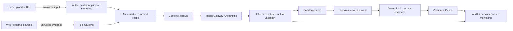

# TATTAVA COPILOT — Guardrails
**Document ID:** TAT-AI-GRD-001 · **Baseline:** V1 — Narrative Intelligence · **Status:** Required controls plus provisional policy decisions

## 1. Guardrail model
Tattava combines a deterministic application core with a probabilistic AI runtime. Security-critical outcomes must be enforced by code, identity, authorization, schema validation, state machines and domain services—not by prompt instructions alone. Model-based classifiers and reviewers can add detection, but cannot replace deterministic controls.

## 2. Trust boundaries

## 3. Risk register

| ID | Threat/failure | Impact | Preventive control | Detection/recovery | Gate |
|---|---|---|---|---|---|
| GRD-001 | Cross-project or cross-tenant leakage | Critical IP/privacy exposure | Enforce scope at API, storage, retrieval, cache, jobs and exports | Adversarial isolation tests; incident response; revoke access and investigate | Hard release blocker |
| GRD-002 | Unauthorized read/write/approval | Unauthorized disclosure or Canon corruption | Server-side action/resource/consequence authorization; deny by default | Audit denied attempts; permission regression suite | Hard release blocker |
| GRD-003 | Silent Canon mutation | Irreversible story-state corruption | Candidate-only AI output; domain-only mutation; approval and version checks | Canon immutability tests, diff/audit review, restore/compensate workflow | Hard release blocker |
| GRD-004 | Prompt injection in uploaded/retrieved content | Data exfiltration, unsafe tool use | Treat all source content as untrusted; tool allowlist; separate instructions/data | Seeded direct/indirect injection tests including PDF/OCR | Hard release blocker |
| GRD-005 | Hallucinated research presented as fact | Creative and reputational harm | Evidence/provenance separation; no LLM-only evidence; unknown preservation | Claim-to-source tests, unsupported-claim review | Hard release blocker for critical claims |
| GRD-006 | Malicious/unsafe tool call | Unauthorized external side effect | Tool gateway, schema validation, least privilege, network/provider allowlist | Tool-call audit, denylist and fuzz tests | Hard release blocker |
| GRD-007 | Sensitive IP routed to disallowed provider | Confidentiality/IP exposure | Model Gateway provider policy by data class; minimum context | Route-policy tests and provider request audit | Hard release blocker |
| GRD-008 | Stale concurrent update overwrites current Canon | Data loss/conflict | Optimistic concurrency, snapshot IDs, explicit merge | Race/concurrency tests; preserve both versions | Hard release blocker |
| GRD-009 | Unbounded agent loop/cost | Cost, latency and service degradation | Run budgets, deadlines, iteration/tool limits, checkpoints and cancellation | Cost/loop telemetry, kill switch, bounded-run tests | Hard release blocker |
| GRD-010 | Incorrect summary/index becomes truth | Drift and bad downstream outputs | Derived data labelled with lineage/version; Canon/domain APIs authoritative | Rebuild and staleness tests | Required |
| GRD-011 | Unsupported or rights-restricted content copied | Legal/reputational risk | Rights metadata where known, limited copying, source links and review | Content sampling and rights review | Policy approval required |
| GRD-012 | Model/provider outage or malformed output | Failed workflow, misleading success | Gateway abstraction, schema validation, bounded retry/fallback | Chaos tests; visible partial/failure state | Required |
| GRD-013 | Feedback treated as model training or Canon | Unintended data use/state change | Explicit governed feedback pipeline; no automatic training or Canon mutation | Data lineage and policy tests | Required |
| GRD-014 | Deletion appears complete while copies remain | Misleading privacy promise | Defined deletion workflow, derived-index/cache cleanup and retention exceptions | Deletion verification; disclose legal/backup exceptions | Policy approval required |
| GRD-015 | Reviewer misunderstands package readiness | Premature greenlight | Separate generated, reviewed and human-approved status; open issues visible | UX acceptance tests and reviewer observation | Required |

## 4. Deterministic controls
- Authenticate every actor and service; authorize every read, write, tool call, export, approval and background job.
- Use project/tenant scoping on all persistent and derived layers.
- Validate schemas, enumerations, resource IDs, file types and size limits before processing.
- Use version checks and domain commands for Canon; no direct model/database mutation.
- Keep audit events for material runs and state transitions; protect audit access and integrity.
- Enforce allowlisted tools, destinations, model routes and data-class policy.
- Apply bounded run budgets, timeouts, cancellation and idempotency.
- Separate Candidate, Evidence, Decision and Canon stores/types.
- Prevent branch and candidate state from contaminating active Canon.
- Ensure exports include only authorized material and respect rights/policy.

## 5. Model-based controls (defence in depth)
Use model-based classification or critique for claim support, uncertainty, conflict detection, sensitive content, injection indicators and output quality only as supplemental signals. These are probabilistic and can miss cases. Their results must be observable, evaluated and never be the only control protecting Canon, access permissions or provider policy.

## 6. Failure response
- **Authorization denied:** stop the action; do not retry with broader access; log safe audit metadata.
- **Prompt injection detected or suspected:** ignore embedded instructions, isolate source content, block unsafe tool proposals and surface review when material.
- **Unsupported factual claim:** remove or qualify it, link supporting source if available, otherwise mark Unknown and propose research.
- **Conflicting evidence:** preserve both claims and escalate when the conflict changes a consequential creative choice.
- **Provider disallowed/unavailable:** route only to an approved fallback or stop; never silently downgrade privacy policy.
- **Stale Canon version:** reject the write and request refresh/compare/merge.
- **Run budget exceeded:** stop further calls and return partial status with completed steps.
- **Deletion/retention uncertainty:** do not claim deletion completed until the governed workflow reports its verified status.

## 7. Release gates and incident handling
Hard gates: project isolation; authorization; Canon integrity; prompt-injection/tool-boundary tests; sensitive-data routing; data-loss/concurrency; audit completeness for consequential actions. A failed hard gate blocks release regardless of creative quality. Incident response should identify scope, preserve relevant audit evidence, stop unsafe workflows, contain access, recover authoritative state and communicate according to approved policy. Named incident roles and response-time commitments require operational ownership.

## 8. Data handling policy defaults
Interim default: project data is private; only minimum necessary task context is sent to a provider; customer content is excluded from provider training wherever contract/configuration supports it; provider-side memory is not authoritative. Highest sensitivity applies to Canon, approvals, unreleased scripts and project IP. These are conservative defaults, not legal or compliance certification. Approved provider list, contract terms, residency, retention, subprocessors, deletion exceptions and backup timelines require Security/Legal/leadership sign-off.

## 9. Validation matrix
Use direct and indirect injection cases; cross-project retrieval attempts; unauthorized export and approval; tool argument fuzzing; malicious file parsing; corrupted/oversized uploads; stale-version races; retries after partial side effects; provider outage; prompt regression; unsupported claims; rights-limited source reuse; and deletion verification. Record dataset version, build, prompt/model route, expected result, observed result, severity and disposition.

## 10. Unresolved decisions
Exact provider/data terms, residency and retention, deletion commitments, incident response SLAs, legal rights policy, numerical risk thresholds and production SLOs remain accountable-owner decisions. Implement safe enforcement and configuration points now; do not claim certification or guaranteed safety.

## 12. Refinement — threat model and release verification

### 12.1 Trust boundaries
Treat browser/client input, uploads, extracted text, external web content, retrieval snippets, model output, agent handoffs and provider responses as untrusted until validated. The trusted computing base is the server-side identity/policy enforcement, domain state machine, schema validators, secret store, approved tool gateway and persistence layer—not prompt instructions.

### 12.2 Abuse and failure cases to test
- Direct and indirect prompt injection in user messages, PDFs, OCR text, web pages and retrieved story documents.
- Cross-tenant and cross-project retrieval/cache/background-job leakage.
- Tool confusion, unauthorized URL fetch, SSRF-like behavior and unexpected external side effects.
- Attempts to exfiltrate prompts, secrets, other projects or restricted evidence.
- Model output that invents citations, confuses fictional invention with factual claims, or labels an assumption as verified.
- Stale approval, stale Canon version, duplicate retry, partial failure and cancellation race.
- Provider routing that violates project data classification or contract constraints.
- Deleted or restricted content remaining in a vector index, cache or export.
- Unbounded agent loops, repeated retries, runaway cost or oversized output.
- Accessibility failure in critical uncertainty/approval/recovery disclosures.

### 12.3 Release gates
**Block release:** cross-scope data leakage; unauthorized reads/writes; silent Canon mutation; approval bypass; critical prompt-injection/tool abuse; fabricated provenance on critical claims; data-routing policy breach; inability to audit consequential changes.
**Require remediation or explicit risk acceptance:** non-critical relevance errors, degraded creative quality, partial extraction, stale non-critical evidence, non-blocking accessibility defects, cost/latency misses against approved SLOs.
Numerical SLOs and quality thresholds must be approved after baseline measurement.

### 12.4 Incident handling
Stop affected route/tool, preserve run and audit evidence, prevent queued writes, revoke or narrow compromised credentials, identify impacted tenants/projects, assess Canon and export integrity, restore or compensate through audited commands, notify accountable owners under approved incident policy, and add a regression case before re-enabling.
