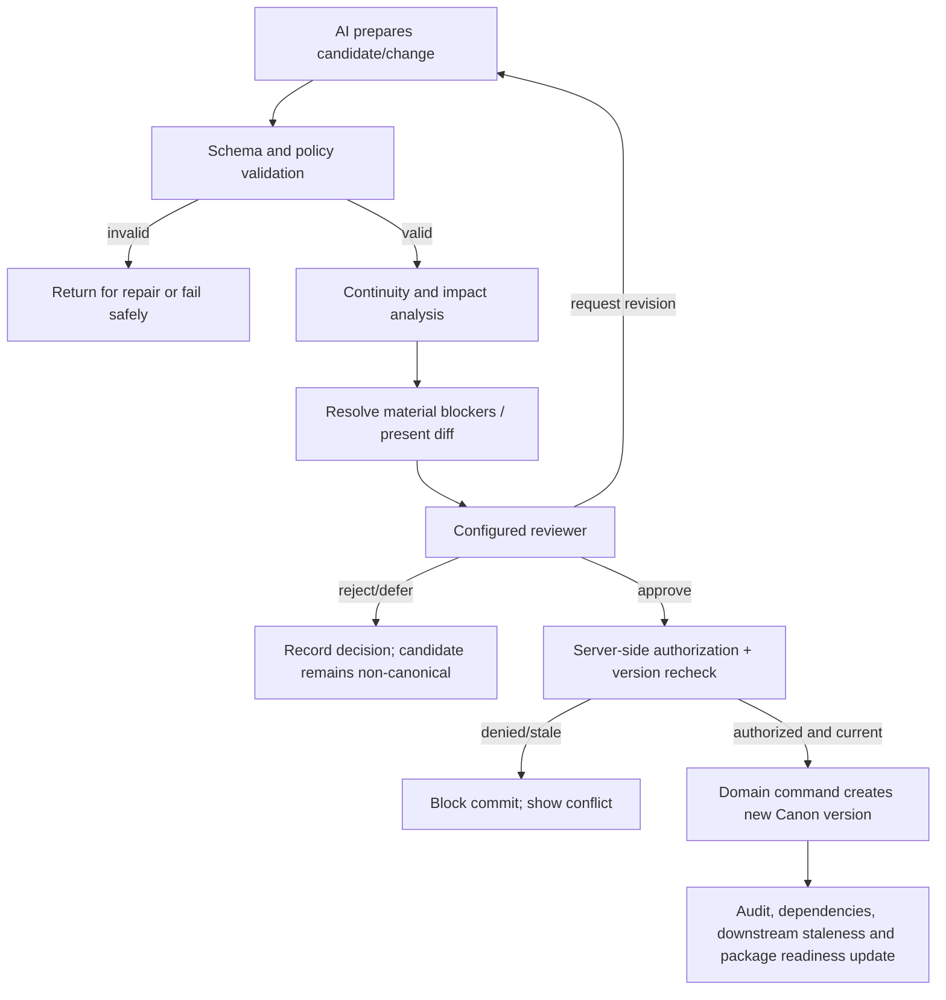

# TATTAVA COPILOT — Human in the Loop
**Document ID:** TAT-AI-HITL-001 · **Baseline:** V1 — Narrative Intelligence · **Status:** Governance and review workflow specification

## 1. Purpose and authority model
Human oversight protects creative ownership, project integrity and accountable decisions. The AI may research, reason, retrieve, compare, draft, diagnose and recommend; it cannot independently approve, greenlight, establish Canon or grant itself permissions.

Role model:
- **Producer:** default final project authority and final package/greenlight authority, subject to explicit project configuration.
- **Content Head:** content oversight and designated review authority where configured.
- **Creative Director:** script, editorial and narrative decision authority where configured.
- **Writer:** create/revise candidates and submit for review; cannot approve their own consequential Canon change by default.
- **Researcher:** discover, extract and present evidence; cannot convert evidence into Canon without configured approval.
- **AI / Tattava:** intelligence and execution support only.

Content Head and Creative Director are parallel authority domains under the Producer, not a forced reporting hierarchy. The canonical role title is **Content Head** only. Exact named approvers, delegation thresholds and separation-of-duties rules are configurable and must be confirmed before production use.

## 2. Review checkpoints

| ID | Checkpoint | Trigger | Reviewer sees | Allowed decisions | Result |
|---|---|---|---|---|---|
| HITL-001 | Intent confirmation | Material ambiguity about requested project/task | Parsed intent, assumptions, unresolved questions, alternatives | Confirm, edit, answer, defer, cancel | Context updated; no Canon mutation |
| HITL-002 | Research conflict review | Conflicting or culturally contested material evidence | Source cards, claims, dates, qualifications and disagreement | Accept finding, request more research, mark unresolved, reject source | Evidence/interpretation state updated; Canon only through separate decision |
| HITL-003 | Candidate review | Generated narrative or structured content | Candidate, Canon references, assumptions, deviations, version snapshot | Accept for next step, edit, branch, reject, request revision | Candidate status updated; not automatically Canon |
| HITL-004 | Consequence/impact review | Proposed material change with dependencies | Diff, affected entities/artifacts, impact findings, stale risks | Proceed to approval, revise, branch, defer, cancel | Review record; no commit until required approval |
| HITL-005 | Canon approval | Change affects authoritative project truth | Before/after diff, rationale, source/evidence, impact, version, required approver | Approve, reject, request revision, defer | Domain command rechecks authorization/version; approval may create new Canon version |
| HITL-006 | Branch merge | Alternative branch proposed for active project | Branch diff, conflicts, affected dependencies, rejected alternatives | Merge approved subset, revise, reject, defer | Explicit merge transaction; Canon unchanged until authorized commit |
| HITL-007 | Package readiness | Story Development Package generated | Current source version, sections, omissions, open questions, approval history | Request changes, mark reviewed, approve milestone if authorized | Package status changes; generation alone is not greenlight |
| HITL-008 | Exception/recovery | Tool failure, stale version, unsupported source or policy block | What succeeded/failed, data preserved, retry risks, alternatives | Retry, resume, refresh, switch approved route, cancel, escalate | Safe recovery action and audit trail |
| HITL-009 | Feedback/quality review | User corrects output or rates usefulness | Candidate/run reference, correction category, privacy notice as applicable | Correct current task, flag evaluation case, dismiss | Immediate correction; future dataset use only under governed policy |

## 3. Approval workflow

## 4. What the reviewer must be shown
For material creative or factual changes, show:
- candidate content and version;
- source/project snapshot used;
- relevant Canon constraints and references;
- new assumptions, unknowns, conflicts and deviations;
- source evidence and provenance for factual claims;
- dependency/impact preview and unresolved impact areas;
- who/what generated it and relevant run/prompt/model version metadata appropriate to the user’s role;
- consequences of each decision and whether it will mutate Canon;
- explicit action labels distinguishing “save candidate,” “submit for review,” “approve Canon change,” and “approve package.”

Avoid dark patterns: do not preselect approval, hide conflicts, equate “continue” with Canonization, or present AI confidence as human authorization.

## 5. Autonomy and escalation rules
- A0 explain and A1 recommend: proceed with authorized context; disclose uncertainty/provenance.
- A2 prepare: draft/research/compare/diagnose; keep output as Candidate/evidence record.
- A3 reversible execution: only explicitly allowlisted, bounded and audited actions; no canonical effects.
- A4 consequential action: human approval by authorized role and deterministic domain commit; never autonomous in V1.

Ask for clarification when missing information materially changes the task. Research or qualify when factual evidence is missing. Escalate when evidence conflict changes a consequential decision, the role policy is absent, an approval is disputed, an action is irreversible, a source’s rights are unclear, or a security/policy block occurs. Stop when no safe permitted route exists.

## 6. Decision records and audit
Record decision ID; project/artifact/version; decision question; options and recommendation; chosen action; rationale; actor/role; approval policy version; timestamp; source/evidence references; affected Canon/dependencies; previous/current version; rejection/defer reason; and supersession. Exact physical schema and audit retention are implementation/policy decisions. The record must be sufficient to explain why project state changed.

## 7. Feedback behaviour
User edits and corrections should affect the current candidate/task and may be recorded as structured feedback. They do not automatically change Canon, persistent preferences, model weights, prompt text or evaluation thresholds. Reuse in evaluation datasets requires a defined purpose, access controls, privacy/retention policy and review. A correction to Canon must use the same governed change workflow as any other Canon mutation.

## 8. Usability and accessibility
Use clear status labels, meaningful diffs, source previews, keyboard-accessible review, focus order, accessible contrast, and non-colour-only state indicators. Keep the reason for a checkpoint concise but inspectable. Reviewers should be able to defer unrelated questions and continue unaffected work where safe. Track review wait time, rework, decision reversals, reviewer workload, approval clarity and frequency of users confusing candidate with Canon.

## 9. Acceptance criteria
- No AI output can independently approve or Canonize.
- Reviewer identity/role and policy are checked server-side at decision time.
- Approval fails if version or relevant dependencies are stale.
- Rejection/defer retains candidate and decision history without Canon mutation.
- Review screen shows evidence, assumptions, conflicts, diff and impact when relevant.
- Package generation clearly distinguishes generated/reviewed/human-approved states.
- Unauthorized reviewer sees no restricted content and cannot perform approval.
- Failed/retried workflows retain audit lineage and do not duplicate mutations.

## 10. Remaining decisions
Management/Producer and Security must approve exact role/action mappings, named approvers, separation-of-duties rules and incident escalation ownership. UX/Product must validate review workload and usability. Numeric reviewer-response or quality thresholds require pilot baselines.

## 11. Refinement — decision UX and approval contracts

### 11.1 Decision packet
For each consequential decision, present: proposed change; exact before/after diff; rationale; relevant Canon references; evidence and conflicts; assumptions and unknowns; affected dependencies; reversibility; source project version; candidate version; required reviewer role(s) resolved by policy; and what happens if the user rejects or defers.

### 11.2 Explicit action semantics
- `Accept candidate`: marks content as accepted for the next workflow step; does not change Canon unless the action explicitly says so and all gates pass.
- `Edit`: creates a new candidate version and preserves prior versions.
- `Branch`: isolates an alternative from the active Canon path.
- `Request revision`: records reviewer feedback and creates a new work item/run.
- `Approve Canon change`: authorizes a specific diff against a specific version; requires commit-time permission/version re-check.
- `Defer`: preserves state and records the unresolved decision.
- `Reject`: records rationale where appropriate; does not delete the audit trail.
- `Cancel`: stops cancellable work and guarantees no later background commit from the cancelled run.

### 11.3 Authority defaults
Producer is the final project authority by default; Content Head and Creative Director represent parallel content and editorial/narrative authority domains; Writers create and revise candidates; Researchers support evidence; AI is never an authority. This is a role model, not a final action-level permission matrix. Named approvers, delegation, self-approval rules and separation of duties remain configurable and require management approval.

### 11.4 Human-review acceptance
A reviewer must be able to tell: what the AI proposes; what is evidence versus interpretation versus invention; what is unknown/conflicted; which Canon version was used; what would change; who must approve; and how to safely reject, defer, revise or branch. Approval must be bound to the exact candidate version, not a mutable screen or general conversation.
