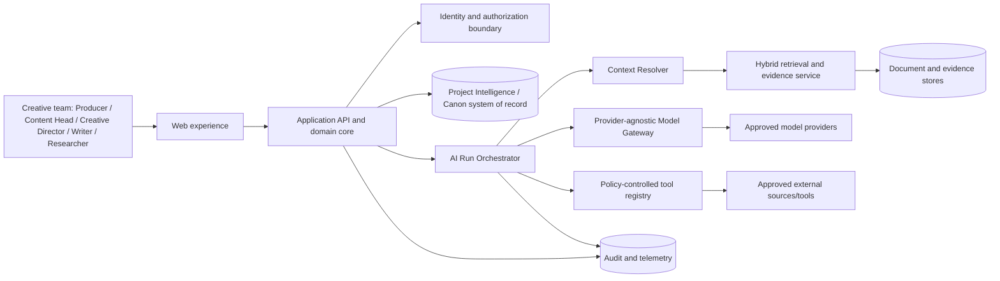
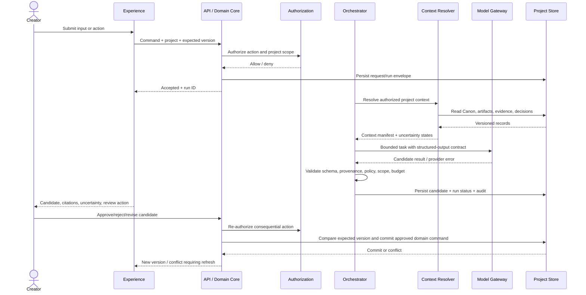
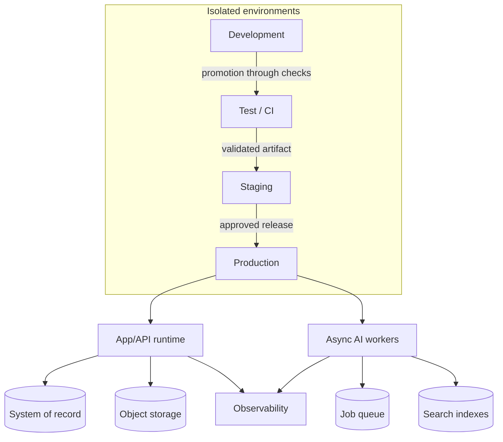

# 03_TECHNICAL — 01_System_Architecture

**Product:** Tattava Copilot | **Company:** Tattava Co. / Don Vanzara Showbiz LLP  
**Baseline:** V1 — Narrative Intelligence | **Status:** Technical specification aligned to approved architecture gates; deployment choices require validation  
**Audience:** Product, Engineering, AI/ML, Data, QA, Security, DevOps/SRE, Creative Operations

## 1. Executive architecture statement

Tattava is a project-centric Narrative Intelligence system composed of a deterministic application core and a probabilistic intelligence runtime. The application core owns identity, authorization, project state, typed Canon, versions, decisions, approvals, dependency records, audit history, and durable artifacts. The intelligence runtime interprets creator intent, resolves context, retrieves evidence, plans bounded workflows, generates candidates, and evaluates outputs. The model is never the system of record and cannot bypass application authorization or governance.

The approved V1 architectural gates are: (1) typed/versioned Canon; (2) L0–L2 autonomy by default, with bounded L3 only where explicitly approved; (3) consequence-based approval; (4) research trust modeled as source → evidence → claim → confidence; and (5) a provider-agnostic Model Gateway with governance controls. Exact cloud/vendor selections, production SLO/RTO/RPO targets, capacity envelope, retention/residency policy, and pilot economics remain validation items.

## Document conventions and authority

This specification is the technical execution baseline for Tattava Copilot V1 — Narrative Intelligence. It is derived from the Product Strategy, consolidated PRD, BRD, approved product scope, approved System Architecture baseline, Requirements Traceability, Experience package, and `02_AI_INTELLIGENCE` specifications available in the working source set.

**Decision labels:** **CONFIRMED** = supported by the source baseline or approved architecture gate; **PROPOSED** = implementation contract recommended here but not evidence of a deployed system; **ASSUMPTION** = working assumption to validate; **OPEN DECISION** = requires an accountable owner; **NOT EVIDENCED** = available materials do not establish the fact. This document does not claim that proposed APIs, tables, cloud resources, integrations, or controls are already implemented.

**Authority and conflict handling:** current Product Strategy and updated PRD govern product intent; approved System Architecture governs the technical baseline and approved architecture gates; AI Intelligence specifications govern AI runtime behaviour; Experience and Traceability packages govern interaction contracts and verification mapping; BRD supports business context and scope history. Where evidence is incomplete, retain an explicit open decision rather than inventing a policy or implementation fact.

**Product invariants:** the project is the primary context; conversation is an interaction surface. Canon is authoritative, typed, versioned, permission-controlled, and stored outside model memory, vector indexes, and agent scratchpads. Evidence, interpretation, candidate content, creative decision, and Canon are distinct. Unknown remains unknown unless supplied, appropriately researched/verified, or explicitly accepted as a creative choice by an authorized person. AI-generated content is non-canonical until governed approval and a deterministic domain command commit it. Failed, cancelled, stale, or partial AI runs must not silently mutate authoritative state. Optimize for project progress and a Human-Approved Story Development Package, not prompt count, token volume, agent count, or generation count.

**Role vocabulary:** Producer; Content Head; Creative Director; Writer; Researcher; AI. Creative Director and Content Head are parallel authority domains under Producer, not a strict reporting chain. Exact action-level permissions and approval routing remain configurable/open until approved. Never infer a person's identity from a role title.

## 2. Scope and non-goals

V1 supports the narrative lifecycle from accepted project input to a Human-Approved Story Development Package: project creation and intake, intent understanding, clarification, persistent Project Intelligence, exploration, research and provenance, character and narrative reasoning, format/genre handling, story development, screenplay/dialogue support, candidate review, decisions, governed Canon, versioning, continuity/dependency impact, auditability, and package assembly.

V1 does not imply autonomous greenlighting, autonomous consequential creative decisions, silent Canon mutation, a production scheduling/finance/cast management suite, generated-video production, or a committed external integration not evidenced in the sources. These are outside the technical contract unless approved through scope governance.

## 3. System context

The diagram is logical, not a mandated microservice deployment. V1 baseline recommends a modular monolith for deterministic domain services plus asynchronous AI workers. Physical separation should follow measured isolation, scaling, or ownership needs—not the diagram alone.

### Trust boundaries

| Boundary | Data crossing | Required control |
|---|---|---|
| Browser → API | User input, session, project identifiers | Authenticated transport, server-side authorization, request validation, CSRF/session controls as applicable |
| API → domain persistence | Project state, Canon, approvals, artifacts | Tenant/project scoping, transactional updates, optimistic concurrency, audit |
| Orchestrator → model provider | Minimized prompt/context and task request | Model Gateway policy, provider allowlist, data-classification policy, timeouts, cost/usage telemetry |
| Retrieval → AI runtime | Authorized chunks, evidence metadata | Access filtering before retrieval results reach model; provenance and project scope retained |
| Tool runtime → external systems | Search/query/tool payloads | Tool allowlist, per-tool schema, outbound network policy, authorization and budget checks |
| External content → AI runtime | Web pages, documents, uploaded files | Treat as untrusted data; isolate instructions from content; prompt-injection defenses |
| AI candidate → Canon command | Proposed patch, rationale, expected version | Human approval where required, server-side authorization, schema validation, version check, atomic commit |

## 4. Logical architecture and component contracts

| Component | Responsibility / inputs | Outputs and state | Dependencies and failure behaviour |
|---|---|---|---|
| Experience layer | Capture arbitrary creator input; show project state, evidence, candidates, approvals, conflicts, impact, run status | User commands, review decisions, visible task state | Must recover from network interruption; no client-side authority for permissions or Canon |
| API edge | Authenticate request, validate envelope, apply limits, route command/query | Typed response or accepted async run | Reject malformed/unauthorized requests; correlation ID on all responses |
| Identity & Policy Enforcement | Resolve actor, tenant, membership, role grants and action policy | Authorization decision and policy context | Fail closed for consequential actions; no model-generated permission decisions |
| Project Domain Core | Project, project membership, state transitions, artifacts, decisions, versions | Durable records and domain events | Transactional integrity; idempotent command semantics where retry is possible |
| Canon Service | Typed Canon entries, revisions, source links, lock/version metadata | Versioned canonical state and diff | Only authorized domain command may mutate; stale writes rejected |
| Context Resolver | Build versioned manifest of permitted Canon, evidence, decisions, artifacts, dependencies | Context manifest and inclusion/exclusion rationale | Context assembly must obey authorization and token/budget limits; partial manifest flagged |
| Retrieval & Evidence | Ingestion, parsing, chunking, metadata filters, lexical/vector/hybrid retrieval, provenance | Ranked authorized evidence with source lineage | Degrade explicitly if index is unavailable; never treat retrieval rank as truth |
| Intelligence Runtime | Choose capability, bounded workflow plan, run state, cancellation and budget enforcement | Candidate outputs, tool results, evaluation record | Bounded steps/time/cost; cancellation prevents commit; partial result labeled |
| Model Gateway | Provider abstraction, model capabilities, routing policy, schema mode, retry policy, telemetry | Normalized model result and provider metadata | Provider-specific adapters hidden from domain layer; no ungoverned fallback |
| Tool Registry / Executor | Declare tools, validate arguments, authorize, execute, normalize results | Typed tool result, status, audit | Deny by default; no arbitrary code/network execution from model output |
| Candidate & Review | Persist non-canonical generated artifacts, compare, collect review outcome | Candidate versions, accepted/rejected/deferred decision | Candidate cannot mutate Canon without separate commit path |
| Dependency / Impact | Track links between Canon/entities/artifacts and compute affected items | Impact preview and stale markers | If dependency graph incomplete, state that impact is partial |
| Audit & Observability | Correlate actor, request, run, provider, tool, versions and decisions | Immutable or tamper-evident audit records and operational telemetry | Sensitive payloads redacted/minimized; logs not substitute for authoritative records |
| Package Assembler | Select eligible artifacts, provenance, approvals and version references | Versioned Story Development Package candidate | Package schema/completeness criteria are an open decision; no false “ready” status |

## 5. Request and AI run lifecycle

A request that may outlive an HTTP interaction returns an accepted run identifier and is tracked independently. Streaming may improve perceived responsiveness but is not the durable record: run state, candidates, and decisions must be persisted. Client disconnect must not be interpreted as successful completion or as authorization to commit.

### Run state machine

`Queued → Running → Awaiting input | Awaiting approval | Succeeded | Partially succeeded | Failed | Cancelled`.
Transitions are server-owned and validated. A run can await input or approval without holding a worker indefinitely. Cancellation is best-effort for external provider calls but must prevent subsequent authoritative commit. Partial completion must identify completed, failed, and skipped steps.

## 6. AI orchestration and autonomy boundaries

The runtime executes a bounded plan rather than granting an agent unrestricted autonomy. Each run envelope should carry: run ID; tenant/project/actor scope; requested capability; input artifact references; context-manifest version; model policy; permitted tools; max steps; deadline; cost/token budget; expected output schema; cancellation state; and audit/correlation IDs.

Autonomy is consequence-sensitive. L0–L2 assistance is the default. Bounded L3 may only be enabled by an explicit approved policy for a specific capability and action. Model outputs may recommend or prepare changes, but the domain core enforces whether an action requires review, approval, or prohibition. The model is not trusted to self-certify policy compliance.

### Output validation pipeline

1. Parse response into the expected schema; reject invalid structured output.
2. Validate required fields, references, size limits and domain invariants.
3. Validate evidence claims against attached provenance; distinguish supported fact from inference and creative proposal.
4. Detect uncertainty, contradiction, missing source, and scope drift.
5. Check for unauthorized tool requests, prompt-injection influence, and prohibited data exposure.
6. Persist as candidate with lineage and validation findings; never commit directly to Canon.
7. Expose blocking and non-blocking warnings to the human reviewer.

## 7. Data and authority boundaries

The authoritative relational/domain store owns project identity, Canon, decision records, versions, permissions, approvals, artifacts metadata, run metadata and audit references. Object/document storage may hold source files and generated package files. Search indexes and vector indexes are derived, rebuildable projections—not authorities. Model context windows, prompt caches, and agent scratchpads are ephemeral and non-authoritative.

Cache rules: never use stale authorization decisions for consequential commands; scope cache keys by tenant/project and relevant version; invalidate or mark stale after canonical changes; do not cache sensitive cross-project retrieval; cached AI outputs remain candidates with their original context lineage.

## 8. Security and governance

- Authenticate every API caller; authorize every object access server-side, including nested artifact and source references.
- Derive tenant/project scope from verified identity and membership, not from untrusted request fields alone.
- Apply least privilege to service identities and tools; outbound network access is allowlisted.
- Store secrets in an approved secret manager; never in source control, prompts, client bundles, logs, or documents.
- Enforce encryption in transit and at rest using the chosen platform's approved controls; exact vendor/configuration is an open implementation decision.
- Treat uploaded documents and retrieved web content as untrusted data. Instructions inside them do not gain system authority.
- Redact sensitive content from telemetry; define access and retention for audit records before production.
- Preserve separation of evidence, interpretation, candidate, decision and Canon.

### Consequential Canon commit contract

A commit request must include candidate ID, action type, expected Canon/project version, actor, and the approved decision reference where applicable. The server re-evaluates current authorization, approval requirement, candidate status, project scope, validation status and version. The mutation occurs atomically with the decision/audit reference. Any failed check rejects the commit without partial Canon changes. Retries must be idempotent or return the already committed result.

## 9. Reliability, scaling and failure behaviour

| Failure | Required behaviour | Recovery path |
|---|---|---|
| Model timeout/provider outage | Mark attempt failed/retryable; do not imply success; apply bounded retry and provider policy | Retry with same logical run and attempt history, or user-visible retry |
| Context/retrieval unavailable | Fail or return explicitly partial result based on capability safety; no ungrounded factual claims presented as sourced | Rebuild/retry retrieval; allow user to proceed only with visible limitation |
| Queue backlog | Apply admission control/backpressure; expose queued status and estimated state, not invented ETA | Scale workers after capacity signal; prioritize by approved policy |
| Duplicate request/retry | Idempotency key or dedupe on command/run identity | Return original result/status rather than duplicate mutation |
| Stale candidate/version conflict | Reject commit and return current version plus diff context | Refresh, recompute impact, request human decision again |
| Tool error/quota exhaustion | Record tool-specific failure; skip only if workflow allows and output remains truthful | Retry according to tool policy, alternate approved tool, or partial result |
| Worker crash | Lease/heartbeat or equivalent recovery; persist checkpoints where useful | Reclaim safe work; prevent duplicate side effects |
| Partial package assembly | Persist package attempt and missing-item list; never label complete | Resume from missing components after dependencies recover |
| Authorization service uncertainty | Fail closed for reads that risk leakage and all consequential writes | Retry or ask operator; record security event |

### Resilience rules

Use bounded timeouts, capped exponential backoff with jitter for retryable transient errors, per-provider concurrency controls, circuit breaking where repeated failures justify it, and dead-letter/reconciliation workflows for exhausted asynchronous jobs. Never retry non-idempotent side effects without a deduplication or idempotency contract. Avoid fallback that silently changes data-handling policy, model capability, or quality profile.

## 10. Deployment model and environment boundaries

**Proposed V1 topology:** modular application deployment; separate worker process pool for asynchronous AI workloads; managed relational database; object/document storage; retrieval indexes; queue; centralized logs/metrics/traces; secret management; and approved model provider endpoints. This is a logical reference topology, not confirmation of a chosen cloud or existing deployed service.

Environment data must be segregated. Production data should not be copied to lower environments unless an approved, minimized, access-controlled process exists. Secrets and provider credentials are environment-specific. Release artifacts should be immutable and traceable to source commit, build, configuration, migrations, prompt/model policy versions and evaluation results.

## 11. Architecture decision register

| ADR | Decision | Status | Rationale / trade-off |
|---|---|---|---|
| ADR-001 | Modular monolith + asynchronous AI workers | Approved baseline | Preserves domain consistency and limits operational overhead while isolating long-running AI work; split services only with evidence |
| ADR-002 | Relational system of record for authoritative domain state | Approved baseline | Transactions, versioning, relational constraints and auditability; object/search stores complement it |
| ADR-003 | Provider-agnostic Model Gateway | Approved baseline | Reduces coupling and centralizes policy/telemetry; abstraction must not erase provider-specific capability differences |
| ADR-004 | Hybrid retrieval | Approved baseline | Combines lexical precision and semantic recall; retrieval remains derived and access-filtered |
| ADR-005 | Canon mutation only through domain commands | Approved baseline | Enforces policy, validation, expected-version checks and atomic audit |
| ADR-006 | Consequence-based approval | Approved baseline | Review intensity matches impact; exact action matrix remains open/configurable |
| ADR-007 | V1 autonomy L0–L2; bounded L3 only explicitly approved | Approved baseline | Prevents unbounded agent action; policy must be enforced outside the model |
| ADR-008 | External content is untrusted | Approved baseline | Mitigates prompt injection and instruction/data confusion |
| ADR-009 | Concrete cloud, database vendor and model providers | Open | Requires architecture/security/procurement validation and data policy |
| ADR-010 | Production SLO, RTO/RPO, capacity and unit economics | Open | Must be set using workload evidence, business tolerance and pilot measurement |

## 12. Architecture traceability and verification

| Traceability area | Technical implementation path | Verification evidence |
|---|---|---|
| FR project intake and persistent intelligence | API/domain core + context resolver + project store | Project created from varied input; context manifest includes permitted state and uncertainty |
| FR research/provenance | Evidence service + source/claim lineage | Every factual research claim presented as supported has resolvable source lineage |
| FR candidate/review/Canon | Candidate service + approval policy + versioned domain command | AI candidate cannot mutate Canon without authorized commit; stale version is rejected |
| FR continuity/impact | Dependency registry + impact computation | Changed entity returns affected linked artifacts or explicitly labels incomplete coverage |
| FR package assembly | Package assembler + eligibility checks | Package reports included, missing, stale and approval-pending components |
| NFR security/isolation | Policy enforcement at API, retrieval and tool boundary | Cross-project access tests fail closed across direct and indirect references |
| NFR observability | Correlation IDs and run records | One request can be traced through API, run, provider/tool attempts, candidate and commit |
| AI evaluation | Versioned test set, rubrics and release gates | Prompt/model/runtime changes have comparable evaluation records; thresholds are approved before enforcing hard gates |

## 13. Open decisions and engineering exit criteria

Before production commitment, accountable owners must resolve: provider allowlist and contractual data terms; data residency/retention/deletion; exact action-level role permissions and approvers; production SLO/RTO/RPO and capacity/cost budgets; research source hierarchy; file formats and size limits; Story Development Package schema/completeness; evaluation datasets and thresholds; DVS integration boundaries; concurrency semantics for collaborative edits; and cloud/vendor selection.

Engineering exit requires: architecture and threat-model review; authorization tests across all object paths; Canon commit concurrency tests; run cancellation and partial-failure tests; retrieval isolation and provenance tests; backup/restore exercise; provider/tool failure tests; migration/rollback rehearsal; AI regression evaluation; operational dashboards/alerts; and an explicit owner for every open launch blocker. Completion is evidenced by test runs and approvals, not by this document's existence.

## References and related specifications

- Product Strategy (current approved strategic baseline).
- Consolidated Product Requirements Document, baseline v1.2.
- Business Requirements Document (business context and scope history).
- `03_Product_Scope.md` (final execution scope baseline).
- `03_TECHNICAL_01_System_Architecture_FINAL.docx` (approved architectural gates and system architecture baseline).
- `02_AI_INTELLIGENCE` comprehensive specification and companion capability, agent, prompt, context, memory, tool, guardrail and human-in-the-loop specifications.
- `01_EXPERIENCE_FINAL` user flows, UX specification, AI interaction specification and design system.
- `Requirements_Traceability/Requirements_Traceability.md` (requirement, gap and proposed test mapping).

The above sources are the traceability basis. Where exact requirement IDs are not repeated inline, implementation teams should resolve them against the traceability baseline before treating a proposed contract as formally approved. This document does not claim implementation or test completion.
