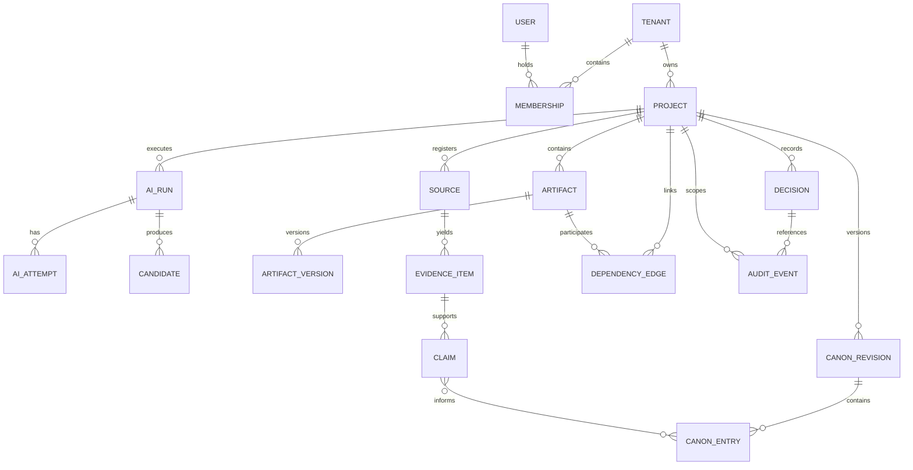
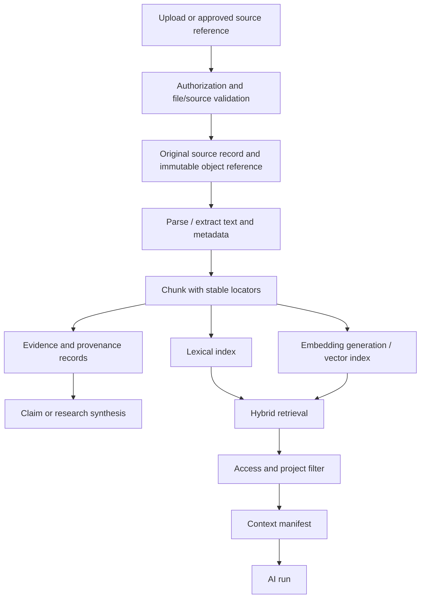

# 03_TECHNICAL — 02_Data_Architecture

**Product:** Tattava Copilot | **Baseline:** V1 — Narrative Intelligence  
**Status:** Logical data model and proposed persistence contracts; not a claim that schemas are deployed

## 1. Purpose and data design principles

This specification defines authoritative data, derived indexes, evidence lineage, project memory, versioning, access boundaries, lifecycle, and recovery requirements. It provides a logical model that engineering can implement using the approved relational-system-of-record direction while preserving flexibility in vendor selection.

## Document conventions and authority

This specification is the technical execution baseline for Tattava Copilot V1 — Narrative Intelligence. It is derived from the Product Strategy, consolidated PRD, BRD, approved product scope, approved System Architecture baseline, Requirements Traceability, Experience package, and `02_AI_INTELLIGENCE` specifications available in the working source set.

**Decision labels:** **CONFIRMED** = supported by the source baseline or approved architecture gate; **PROPOSED** = implementation contract recommended here but not evidence of a deployed system; **ASSUMPTION** = working assumption to validate; **OPEN DECISION** = requires an accountable owner; **NOT EVIDENCED** = available materials do not establish the fact. This document does not claim that proposed APIs, tables, cloud resources, integrations, or controls are already implemented.

**Authority and conflict handling:** current Product Strategy and updated PRD govern product intent; approved System Architecture governs the technical baseline and approved architecture gates; AI Intelligence specifications govern AI runtime behaviour; Experience and Traceability packages govern interaction contracts and verification mapping; BRD supports business context and scope history. Where evidence is incomplete, retain an explicit open decision rather than inventing a policy or implementation fact.

**Product invariants:** the project is the primary context; conversation is an interaction surface. Canon is authoritative, typed, versioned, permission-controlled, and stored outside model memory, vector indexes, and agent scratchpads. Evidence, interpretation, candidate content, creative decision, and Canon are distinct. Unknown remains unknown unless supplied, appropriately researched/verified, or explicitly accepted as a creative choice by an authorized person. AI-generated content is non-canonical until governed approval and a deterministic domain command commit it. Failed, cancelled, stale, or partial AI runs must not silently mutate authoritative state. Optimize for project progress and a Human-Approved Story Development Package, not prompt count, token volume, agent count, or generation count.

**Role vocabulary:** Producer; Content Head; Creative Director; Writer; Researcher; AI. Creative Director and Content Head are parallel authority domains under Producer, not a strict reporting chain. Exact action-level permissions and approval routing remain configurable/open until approved. Never infer a person's identity from a role title.

## 2. Data authority and storage boundaries

| Data class | Authority | Suggested persistence | Can be rebuilt? | Rules |
|---|---|---|---|---|
| Tenant, membership, role grants | Identity/domain authority | Relational records or approved identity system plus local authorization mapping | No, not without source reconciliation | Server-side authorization on every object path |
| Project metadata and state | Domain store | Relational | No | Project is primary context and durable intelligence boundary |
| Canon entries and revisions | Canon domain store | Relational, typed/versioned | No | Only domain commands mutate; never model memory or vector index |
| Decisions and approvals | Decision domain store | Relational | No | Actor, action, target, version, rationale/status and audit lineage |
| Artifacts and candidate versions | Artifact metadata store + object storage for file bodies | Relational metadata + object storage | Metadata no; some derived previews yes | Candidate and canonical state remain distinguishable |
| Source files and extracted text | Document store/object storage | Object storage + metadata | Extraction may be rerun; original must follow retention policy | Preserve source identity and ingestion status |
| Sources, evidence, claims | Evidence domain | Relational metadata + object storage/chunks as needed | Derived extraction may be rerun; human verification records are not disposable | Source → evidence → claim → confidence lineage |
| Context manifests | Run/trace store | Relational or durable JSON record | Rebuild possible only if exact input versions retained | Store version/references, not necessarily full sensitive payload |
| Search/vector index | Derived retrieval projection | Search/vector technology selected later | Yes, from authorized source records | Never source of truth; filter by tenant/project/access before returning results |
| AI run, attempts, tool calls | Run control/observability | Relational operational records + telemetry | Not entirely | Status, policy version, context manifest, budgets and failure state retained per approved policy |
| Evaluation examples/results | Evaluation system | Versioned evaluation dataset/results store | Test result records should be retained for comparison | Remove or minimize production personal/project data unless approved |
| Audit events | Audit domain / protected log store | Append-only or tamper-evident storage pattern | No | Retention and access policy require approval |
| Cache/session/agent scratchpad | Ephemeral store | Cache/runtime memory | Yes | No authority; scoped, short-lived and invalidated on relevant changes |

## 3. Conceptual entity relationship model

This is a conceptual model. Physical table names, key types, normalization, partitioning, and vendor-specific types are implementation decisions. Relationship edges must enforce project/tenant boundaries even when references are indirect.

## 4. Core entity catalog

| Entity | Purpose / required identity | Important fields (logical) | Invariants |
|---|---|---|---|
| Tenant | Company/organizational boundary | tenant_id, name, status, created_at | Every project and actor context is scoped to a tenant or an explicitly approved system-level scope |
| User | Authenticated principal | user_id, identity_provider_subject, status | Authentication subject is unique within the identity integration contract |
| Membership | User's tenant/project participation | membership_id, tenant_id, user_id, project_id nullable, status, grants reference | Role title is not itself a full permission matrix; action policy is evaluated separately |
| Project | Durable intelligence unit | project_id, tenant_id, title, format/genre metadata, lifecycle state, current versions, created_by | Project ID is stable; project data cannot be inferred from client-supplied ID alone |
| CanonRevision | Snapshot/version boundary for approved state | canon_revision_id, project_id, version, parent_revision_id, created_by, created_at, change_summary | Monotonic or otherwise conflict-detectable version sequence; no silent overwrite |
| CanonEntry | Typed approved project fact/choice | canon_entry_id, project_id, type, value/schema reference, epistemic status, lifecycle status, source links, version, lock state | Canon state must be validated against entry type and project scope |
| Artifact | Logical creative/research deliverable | artifact_id, project_id, artifact_type, status, current_version_id, visibility | Saved artifact is not automatically Canonical |
| ArtifactVersion | Immutable version of an artifact | artifact_version_id, artifact_id, parent_version_id, body/object reference, created_by/run_id, schema_version | Versions are append-only or immutable once referenced; replacement creates a new version |
| Candidate | AI or human-proposed change/output | candidate_id, project_id, run_id, target refs, proposed diff, validation status, review status, expected source version | Candidate cannot mutate Canon by existing alone |
| Decision | Human-governed choice | decision_id, project_id, decision_type, target refs, status, actor_id, rationale, decided_at, supersedes_id | Decision provenance and authority must be checkable |
| Source | Source document, webpage, book reference or other source | source_id, project_id, source_type, title, publisher/creator, URL/reference, published date if known, retrieved_at, source tier, content hash | Do not invent missing source metadata; source may be inaccessible or disputed |
| EvidenceItem | Extracted passage/fact/observation | evidence_id, source_id, locator, excerpt/reference, extraction method/version, status, confidence metadata | Evidence is not equivalent to verified truth; retain location/provenance |
| Claim | A claim used in research/story context | claim_id, project_id, claim_text, claim_type, status, confidence representation, evidence links, reviewer status | Supported, inferred, conflicting, unverified and creative claims must remain distinguishable |
| ContextManifest | Reproducible context selection for an AI run | manifest_id, project_id, run_id, version references, selected refs, exclusions/reasons, created_at | Every included item must have been authorized for the actor/run scope |
| AIRun | Logical user-requested AI operation | run_id, tenant_id, project_id, actor_id, capability, state, budgets, policy versions, context_manifest_id, timestamps | State transitions validated server-side; cancelled/failed runs cannot commit |
| AIAttempt | Provider/tool/workflow attempt | attempt_id, run_id, step, provider/model alias, status, latency, usage/cost if available, error class | Secrets and raw sensitive payloads excluded from routine telemetry |
| DependencyEdge | Explicit relationship between entities/artifacts | edge_id, project_id, source_ref, target_ref, relation_type, confidence/completeness | Impact results indicate if graph coverage is incomplete |
| AuditEvent | Trace of consequential and security-relevant actions | event_id, tenant_id, project_id, actor/system identity, action, target, versions, correlation IDs, timestamp, outcome | Append-only/tamper-evident approach recommended; exact retention open |
| Package | Story Development Package assembly/version | package_id, project_id, schema_version, status, included artifact versions, missing/stale list | Completeness must use an approved schema and rule; until approved, status must be qualified |

## 5. State vocabularies and status separation

These dimensions are separate and must not be collapsed into one generic `status` field:

| Dimension | Values from product baseline | Use |
|---|---|---|
| Epistemic status | Known, Unknown, Ambiguous, Assumed, Conflicting, Resolved, Blocked | Describes what is understood about a fact/question |
| Content lifecycle | Working, Candidate, Reviewed, Approved, Canonical, Deprecated, Locked, Derived | Describes an artifact or content item's lifecycle |
| Evidence status | Discovered, Retrieved, Extracted, Corroborated, Conflicted, Human-verified, Rejected | Describes evidence handling state |
| AI run status | Queued, Running, Awaiting input, Awaiting approval, Succeeded, Partially succeeded, Failed, Cancelled | Describes execution state |
| Decision status | Open, Options prepared, Awaiting decision, Accepted, Rejected, Deferred, Superseded | Describes human decision lifecycle |

Use separate typed columns/enums or validated schemas. State transitions require an explicit transition map and audit event. “Approved” content is not necessarily Canonical until committed into the Canon domain; a retrieved source is not “Human-verified” merely because a model summarized it.

## 6. Provenance and trust model

The core lineage is `Source → EvidenceItem → Claim → Candidate/Interpretation → Decision → CanonEntry` where applicable. A claim may have multiple supporting and conflicting evidence items; evidence may support multiple claims. Store source locator and extraction lineage so reviewers can return to the underlying material. Confidence should not be presented as a universal calibrated probability unless the relevant model/measurement has been validated; represent its meaning and method explicitly.

### Provenance fields (proposed logical schema)

| Field | Type / constraint | Rationale |
|---|---|---|
| source_id | Stable opaque identifier | Durable source reference |
| source_uri | URI or controlled locator; nullable when unavailable | Traceability without inventing URLs |
| publisher_or_creator | Text, nullable | Source context |
| retrieved_at | Timestamp, nullable for user-supplied/offline source | Freshness assessment |
| source_tier | Controlled value; taxonomy requires approval | Supports source-quality policy without hard-coding an unapproved hierarchy |
| content_hash | Hash of captured source body where permitted | Detect source changes and deduplicate ingestion |
| evidence_locator | Page, section, paragraph, timestamp, URL fragment or source-specific locator | Human-verifiable traceability |
| extraction_version | Parser/model/prompt pipeline version | Reproducibility |
| claim_status | Supported / inferred / disputed / unverified / creative proposal (proposed vocabulary) | Separates epistemic interpretation |
| human_review | Reviewer and review outcome references | Distinguishes machine extraction from human verification |

Source hierarchy, acceptable evidence thresholds, and when human verification is mandatory remain open decisions. Never equate a retrieval score with truth.

## 7. Ingestion and retrieval data flow

Ingestion must be observable and resumable: Received → Validating → Extracting → Indexing → Ready, with Failed/Partially succeeded states and error details. Original files and normalized derivatives have separate identities. Index refresh and deletion propagation must be tracked. If parsing fails, preserve the source record and failure state; do not claim the document was researched successfully.

## 8. Retrieval, chunking, embeddings and cache policy

Hybrid retrieval is the approved direction, but specific search/vector vendors and embedding models are not selected by this specification. Chunking must preserve source locators, document structure where available, and parent-child relationships for context reconstruction. Chunk sizes/overlap and embedding dimensions are empirical configuration values to benchmark, not universal constants. Index metadata must support tenant, project, source, access, content status, and version filtering.

Authorization filtering must happen before any retrieved content is included in a model context. Post-retrieval filtering alone is insufficient if unauthorized content can influence ranking or intermediate summaries. A retrieval response includes matched references, locators, rank/score metadata with documented meaning, source version, and any conflict/staleness markers. Retrieval cache keys include scope and source/index version; deletion and permission changes invalidate affected entries.

## 9. Transactions, concurrency and versioning

- Use transactional boundaries for approval decision + Canon mutation + revision creation + audit linkage where the chosen datastore supports it.
- Use expected-version/ETag-style optimistic concurrency for canonical changes and artifact updates.
- Candidate generation reads a specific context manifest and source versions; later changes do not rewrite the original run history.
- A stale candidate must be re-evaluated against current Canon and dependencies before it can be accepted.
- Collaborative edit merge policy is an open decision. Until decided, conflicting writes should fail visibly rather than last-write-wins for consequential state.
- Schema changes use forward/backward-compatible migrations where practical; destructive migrations require backup/restore and rollback rehearsal.

## 10. Classification, privacy, retention and deletion

Data classification labels and handling rules should be approved by Security/Legal/leadership before production. At minimum, distinguish public source material, internal project material, sensitive business/creative IP, credentials/secrets, and operational telemetry. These are proposed operational categories, not a declaration of legal classification.

Encryption in transit and at rest, least privilege, auditability, access-controlled exports, and minimized telemetry are required control outcomes. The sources do not establish a retention period, residency commitment, deletion SLA, legal hold process, or external provider training/data-use terms. Those must remain explicit launch blockers until approved.

Deletion must propagate across authoritative records, object storage, extracted text, chunks, lexical/vector indexes, caches, derived summaries, exports where controlled, and provider-side data where contractual/provider controls allow. The system should record a deletion workflow and completion evidence without retaining deleted content in ordinary logs. Legal hold and audit-retention interactions require a policy decision. Backups may age out according to an approved schedule; restoration must reapply deletion tombstones where policy requires.

## 11. Backup, recovery, and migration

The relational system of record, source originals, approved Canon revisions, decisions/approvals, artifact version references, and audit records are critical recovery assets. Indexes and embeddings can generally be rebuilt from retained source data, but their version/configuration and rebuild status should be recorded. Backups must be encrypted and access-controlled; restore tests should verify referential integrity, project isolation, Canon revision history, and deletion-policy handling.

RPO/RTO values are not established in source material. Proposed targets must be assigned by business impact and tested before production commitment. Migration workflow: review schema diff → backup/snapshot → run migration in CI and staging → validate counts/invariants → deploy compatible application → observe → rollback or forward-fix plan. Never treat “backup job succeeded” as proof that restore works.

## 12. Data quality and validation rules

1. Every project-scoped entity has a validated tenant/project scope or a documented system-level exception.
2. Foreign references must resolve within the same permitted project scope unless an explicit sharing contract exists.
3. Canon entries validate against their type/schema version and cannot be committed without expected-version validation.
4. Evidence records retain source and locator lineage when available; missing lineage is explicit, not fabricated.
5. Derived indexes include source/version identity and can be reconciled against authoritative records.
6. AI-generated summaries and claims retain run/candidate lineage and epistemic status.
7. Deletion and access revocation invalidate retrieval/caches and prevent future context assembly.
8. Package assembly references immutable artifact versions and records missing/stale/approval-pending components.

## 13. Data traceability and verification

| Requirement area | Data contract | Verification |
|---|---|---|
| Persistent Project Intelligence | Canon, decisions, artifacts, context manifest | Restart and new conversation retain approved state without relying on chat history |
| Research provenance | Source, evidence, claim lineage | Reviewer can navigate from a displayed claim to source locator and status |
| Canon governance | Revision, candidate, decision, audit event | Unauthorized/stale commit is rejected atomically |
| Project isolation | Tenant/project keys and filtered retrieval | Cross-project direct, search, cache and indirect-reference tests deny access |
| Memory/deletion | Derived index/cache lineage | Deleted/revoked material is excluded from subsequent context assembly and indexes are reconciled |
| Version integrity | Immutable artifact versions and revision references | Historical run and candidate resolve to the original source versions |

## 14. Open data decisions

Approve before production: retention/deletion/legal-hold rules; residency and encryption/key management details; data classification taxonomy; provider data-use terms; research source hierarchy; package schema; project-sharing semantics; collaborative editing/conflict resolution; permitted export formats and limits; file formats/size limits/OCR support; audit retention/access; RPO/RTO; and whether confidence values have calibrated semantics.

## References and related specifications

- Product Strategy (current approved strategic baseline).
- Consolidated Product Requirements Document, baseline v1.2.
- Business Requirements Document (business context and scope history).
- `03_Product_Scope.md` (final execution scope baseline).
- `03_TECHNICAL_01_System_Architecture_FINAL.docx` (approved architectural gates and system architecture baseline).
- `02_AI_INTELLIGENCE` comprehensive specification and companion capability, agent, prompt, context, memory, tool, guardrail and human-in-the-loop specifications.
- `01_EXPERIENCE_FINAL` user flows, UX specification, AI interaction specification and design system.
- `Requirements_Traceability/Requirements_Traceability.md` (requirement, gap and proposed test mapping).

The above sources are the traceability basis. Where exact requirement IDs are not repeated inline, implementation teams should resolve them against the traceability baseline before treating a proposed contract as formally approved. This document does not claim implementation or test completion.
