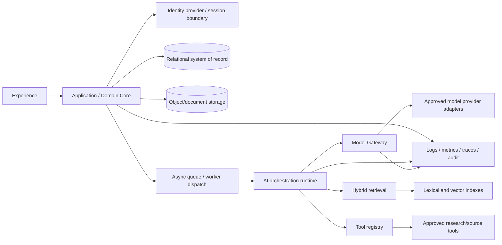
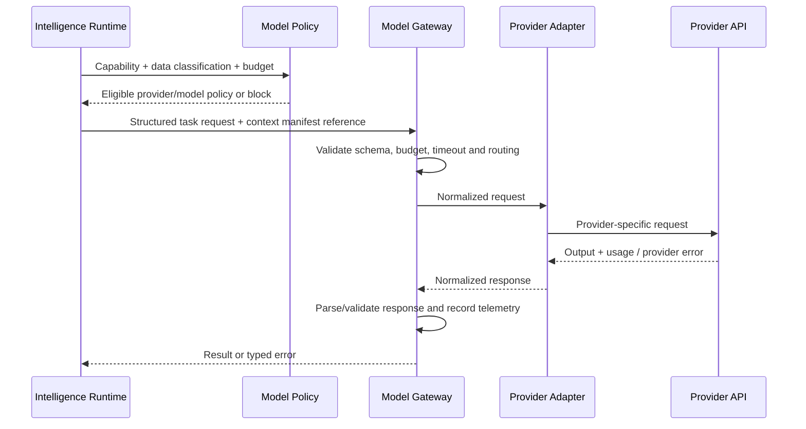

# 03_TECHNICAL — 04_Integration_Specification

**Status:** Integration contracts and controls; external systems are proposed dependency categories unless explicitly approved

## 1. Purpose and integration posture

This document defines how Tattava integrates with identity, model providers, research sources, file processing, persistence, retrieval, observability and future business systems. It distinguishes an architectural seam from an approved vendor integration. The available sources approve a provider-agnostic Model Gateway and hybrid retrieval direction, but do not establish a final cloud vendor, model-provider allowlist, research provider, identity vendor, or external business-system agreement.

## Document conventions and authority

This specification is the technical execution baseline for Tattava Copilot V1 — Narrative Intelligence. It is derived from the Product Strategy, consolidated PRD, BRD, approved product scope, approved System Architecture baseline, Requirements Traceability, Experience package, and `02_AI_INTELLIGENCE` specifications available in the working source set.

**Decision labels:** **CONFIRMED** = supported by the source baseline or approved architecture gate; **PROPOSED** = implementation contract recommended here but not evidence of a deployed system; **ASSUMPTION** = working assumption to validate; **OPEN DECISION** = requires an accountable owner; **NOT EVIDENCED** = available materials do not establish the fact. This document does not claim that proposed APIs, tables, cloud resources, integrations, or controls are already implemented.

**Authority and conflict handling:** current Product Strategy and updated PRD govern product intent; approved System Architecture governs the technical baseline and approved architecture gates; AI Intelligence specifications govern AI runtime behaviour; Experience and Traceability packages govern interaction contracts and verification mapping; BRD supports business context and scope history. Where evidence is incomplete, retain an explicit open decision rather than inventing a policy or implementation fact.

**Product invariants:** the project is the primary context; conversation is an interaction surface. Canon is authoritative, typed, versioned, permission-controlled, and stored outside model memory, vector indexes, and agent scratchpads. Evidence, interpretation, candidate content, creative decision, and Canon are distinct. Unknown remains unknown unless supplied, appropriately researched/verified, or explicitly accepted as a creative choice by an authorized person. AI-generated content is non-canonical until governed approval and a deterministic domain command commit it. Failed, cancelled, stale, or partial AI runs must not silently mutate authoritative state. Optimize for project progress and a Human-Approved Story Development Package, not prompt count, token volume, agent count, or generation count.

**Role vocabulary:** Producer; Content Head; Creative Director; Writer; Researcher; AI. Creative Director and Content Head are parallel authority domains under Producer, not a strict reporting chain. Exact action-level permissions and approval routing remain configurable/open until approved. Never infer a person's identity from a role title.

## 2. Integration landscape

### Integration inventory

| ID | Integration class | Purpose / data flow | Status | Required controls / open dependencies |
|---|---|---|---|---|
| INT-01 | Identity/authentication | Establish actor identity and session; identity → application | Required capability; vendor not evidenced | OIDC/SAML/session mechanism, MFA policy, provisioning/deprovisioning and group/role mapping require confirmation |
| INT-02 | Model providers via Model Gateway | Send minimized task/context; receive model output and usage/error metadata | Gateway approved; providers open | Provider allowlist, contract/data-use terms, region, retention, rate/quota, capabilities, model version pinning and incident escalation |
| INT-03 | Research/search sources | Retrieve source material, metadata and citations | Capability required; exact sources open | Source hierarchy, licensing/terms, robots/access limits, provenance, rate limits, source freshness and fallback |
| INT-04 | File/object storage | Store uploaded originals, generated artifacts and package files | Logical capability; vendor open | Encryption, signed access, malware scanning, versioning, lifecycle and deletion propagation |
| INT-05 | Document extraction/OCR | Extract text and locators from supported formats | Capability conditional on approved file formats | Parser/OCR vendor, file type/size limits, language support, extraction quality and isolated processing |
| INT-06 | Lexical/vector retrieval | Index authorized chunks and return hybrid matches | Hybrid retrieval approved; vendors open | Embedding/model selection, access filters, re-indexing, deletion propagation and evaluation |
| INT-07 | Queue/worker runtime | Dispatch long-running AI jobs and recover safely | Async workers approved baseline | Delivery semantics, leases, deduplication, DLQ, concurrency and worker scaling |
| INT-08 | Observability platform | Logs, metrics, traces, alerts and AI telemetry | Required outcome; vendor open | Redaction, access controls, retention, alert ownership and cost |
| INT-09 | Email/notification service | Optional review or failure notifications | Not confirmed for V1 | Do not implement as assumed requirement; decide triggers, content sensitivity and delivery policy |
| INT-10 | DVS Production Suite / other business tools | Future handoff from Narrative Intelligence to production workflows | Strategic horizon only; exact contract open | Scope, system of record, identifiers, permissions, event/API contracts and ownership need product/engineering agreement |

## 3. Integration principles

1. **Adapters isolate vendor details.** Domain services use stable internal contracts; vendor-specific fields remain inside adapters unless product semantics require them.
2. **Data policy precedes provider selection.** No project content is sent to a provider until the approved policy covers data category, provider, region, retention/training use and contractual terms.
3. **Least privilege and explicit allowlists.** Tool definitions declare purpose, schema, permissions, timeout, budget, side-effect classification and permitted capabilities.
4. **Fail truthfully.** Provider or source failure must not be represented as successful research or complete output. Partial results retain failure details and provenance gaps.
5. **Retry safely.** Retry transient failures only within a bounded policy; idempotency or deduplication is required for side effects.
6. **Preserve lineage.** Each provider/tool attempt links to run ID, policy version, capability, model/tool alias, input/context manifest reference, outcome and telemetry.
7. **No silent fallback downgrade.** Fallback must preserve approved data policy, schema, safety and minimum capability; if not, stop and surface a limitation.

## 4. Model provider integration contract

The Model Gateway owns provider routing, request normalization, structured-output modes, capability metadata, timeouts, usage/cost telemetry, retries, quota management and normalized errors. It must not become an opaque abstraction that hides materially different provider capabilities or policy restrictions.

### Provider capability registry (proposed)

| Attribute | Purpose |
|---|---|
| provider_id / model_alias | Stable internal identity separate from vendor model name |
| allowed_data_classes | Data categories permitted under approved terms |
| supported_modalities | Text/file/image/audio only where actually supported and approved |
| structured_output_mode | Native schema mode, constrained JSON, or validated fallback |
| context_capacity | Versioned capability metadata; do not assume a fixed capacity |
| tool_calling | Whether structured tool calls are supported and under what constraints |
| region / processing_location | Policy control; must be verified contractually |
| retention / training_use_terms | Approved data-handling metadata; unknown blocks use for protected data |
| quota / concurrency | Configured limits and observed usage |
| timeout / retry profile | Provider-specific operational policy |
| cost model | Token/input/output/other billable unit mapping; keep source of price current |
| evaluation profile | Approved task-specific evaluation and model release status |

### Model request sequence

### Fallback policy

Fallback is permitted only when an alternative is pre-approved for the task, data class, quality requirement and cost envelope. The run record identifies each attempt and the reason for switching. Do not send restricted data to a second provider merely because the first provider failed. Do not silently replace a model with one that cannot satisfy the structured-output or safety contract. If no compliant fallback exists, fail or return an explicitly partial result.

## 5. Research and external content integration

Research integrations should return source records and evidence—not just a text summary. Minimum normalized source fields: stable source ID, title, creator/publisher where known, source URL/reference, published date if available, retrieval timestamp, source type, content hash where permitted, accessible locator, retrieval method, and limitations. Evidence should retain a page/section/paragraph/timestamp locator where available.

Research tool output is untrusted. The tool executor validates the URL/domain policy, response size/content type, redirects, timeout, and safe parsing. The system must not execute scripts or follow instructions found in source content. Retrieved material is evidence to assess, not authority over the application or system prompt. Research source hierarchy and licensing/access rules remain open decisions.

### Research integration failure matrix

| Failure | Handling |
|---|---|
| Source timeout or 5xx | Bounded retry with jitter if safe; record unavailable source and continue only if minimum evidence requirements allow |
| Rate limit / quota | Honor provider retry metadata; throttle; do not spin retries |
| Robots/paywall/authentication block | Record access limitation; do not bypass access controls |
| Malformed or unsafe content | Quarantine parser input; mark source failed or partially extracted |
| Conflicting sources | Preserve both lineages and surface conflict; do not average or silently choose one |
| Source changes after retrieval | Retain retrieval/version metadata; refresh as a new source version rather than rewriting historical run evidence |
| Prompt injection | Treat instructions as untrusted content; tool and authorization policy remains external to the model |

## 6. File and document processing integration

File processing is a pipeline, not a single synchronous API call: authorization → upload validation → quarantine/scanning where supported → object persistence → format detection → extraction/OCR → chunking and locator creation → evidence metadata → indexing → readiness. Each step has a durable status and retry policy. Exact formats, size limits, page limits, languages, OCR providers, malware scanning vendor and processing region are open decisions.

Do not expose a file as “ready” until extraction/indexing readiness is known. A source may be stored successfully but not searchable. Preserve original bytes where permitted and separate them from extracted text/derived previews. Do not run macros or active content. Parser workloads should be resource-limited and isolated from the main API process.

## 7. Tool integration contract

Each tool definition must include: tool ID/version, purpose, allowed capabilities, input schema, output schema, authorization requirements, side-effect classification, data classes, timeout, retry profile, budget/cost model, rate limits, outbound destination allowlist, idempotency strategy, audit fields, and human-approval requirements. Tool names and arguments from the model are proposals; the server validates them against the registry before execution.

Tools are classified as read-only, bounded external retrieval, or side-effecting. Side-effecting tools are excluded from default autonomy unless explicitly approved. V1's creative workflow should normally produce candidates and decisions, not execute external business actions.

## 8. Integration observability and operations

Every integration attempt records correlation ID, run ID, integration ID, adapter version, normalized status/error class, latency, retry count, rate-limit signal and cost/usage where available. Payload logging is minimized and redacted. Dashboards should separate provider errors from orchestration errors, validation failures, policy blocks, tool timeouts, quota exhaustion and source-quality failures. Alerts require named operational ownership and actionable runbooks.

## 9. Integration testing strategy

- Contract tests against provider/tool adapter schemas and mocked error variants.
- Sandbox integration tests only after credentials and terms are approved.
- Fault injection for timeouts, 429s, 5xx, malformed outputs, quota exhaustion and connection reset.
- Data policy tests that prove prohibited data classes cannot route to an ineligible provider.
- Provenance tests that prove source IDs/locators survive retrieval, synthesis and candidate display.
- Duplicate/retry tests for idempotency and queue redelivery.
- Deletion/access-revocation tests across provider context assembly, indexes, caches and local persistence.
- Evaluation tests for provider/model changes before rollout.

## 10. Open integration decisions

Provider and model allowlist; provider contractual terms, residency, retention and training use; identity vendor and role mapping; research-source hierarchy and licensing; file formats/limits and extraction/OCR vendor; object storage, database, queue, search/vector and observability vendors; notification needs; tool allowlist; DVS integration scope and ownership; integration quotas/cost budgets; and incident escalation contacts.

## References and related specifications

- Product Strategy (current approved strategic baseline).
- Consolidated Product Requirements Document, baseline v1.2.
- Business Requirements Document (business context and scope history).
- `03_Product_Scope.md` (final execution scope baseline).
- `03_TECHNICAL_01_System_Architecture_FINAL.docx` (approved architectural gates and system architecture baseline).
- `02_AI_INTELLIGENCE` comprehensive specification and companion capability, agent, prompt, context, memory, tool, guardrail and human-in-the-loop specifications.
- `01_EXPERIENCE_FINAL` user flows, UX specification, AI interaction specification and design system.
- `Requirements_Traceability/Requirements_Traceability.md` (requirement, gap and proposed test mapping).

The above sources are the traceability basis. Where exact requirement IDs are not repeated inline, implementation teams should resolve them against the traceability baseline before treating a proposed contract as formally approved. This document does not claim implementation or test completion.
