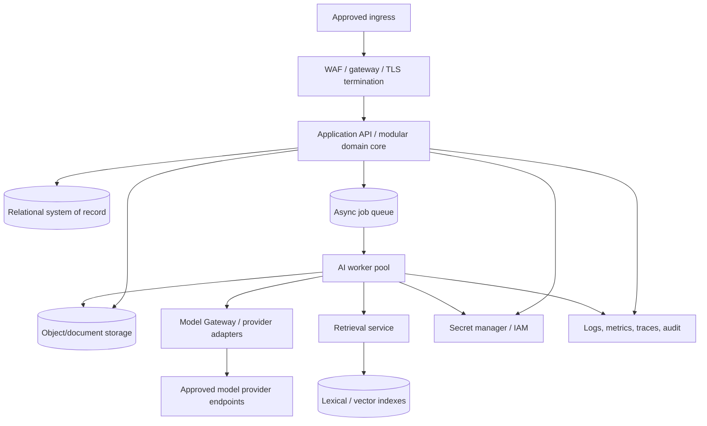
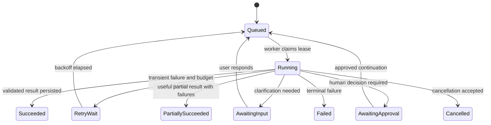

# 03_TECHNICAL — 05_Infrastructure

**Status:** Infrastructure requirements and proposed deployment reference; cloud/provider choices and numerical SLOs remain open

## 1. Purpose and operating model

This document specifies the operational capabilities required to build, deploy, secure, observe, recover and scale Tattava Copilot. It does not assert that a particular cloud account, cluster, database, queue, CI/CD platform or monitoring vendor exists. The approved architecture direction is a modular application core plus asynchronous AI workers, with durable domain state outside the AI runtime and provider-agnostic model access.

## Document conventions and authority

This specification is the technical execution baseline for Tattava Copilot V1 — Narrative Intelligence. It is derived from the Product Strategy, consolidated PRD, BRD, approved product scope, approved System Architecture baseline, Requirements Traceability, Experience package, and `02_AI_INTELLIGENCE` specifications available in the working source set.

**Decision labels:** **CONFIRMED** = supported by the source baseline or approved architecture gate; **PROPOSED** = implementation contract recommended here but not evidence of a deployed system; **ASSUMPTION** = working assumption to validate; **OPEN DECISION** = requires an accountable owner; **NOT EVIDENCED** = available materials do not establish the fact. This document does not claim that proposed APIs, tables, cloud resources, integrations, or controls are already implemented.

**Authority and conflict handling:** current Product Strategy and updated PRD govern product intent; approved System Architecture governs the technical baseline and approved architecture gates; AI Intelligence specifications govern AI runtime behaviour; Experience and Traceability packages govern interaction contracts and verification mapping; BRD supports business context and scope history. Where evidence is incomplete, retain an explicit open decision rather than inventing a policy or implementation fact.

**Product invariants:** the project is the primary context; conversation is an interaction surface. Canon is authoritative, typed, versioned, permission-controlled, and stored outside model memory, vector indexes, and agent scratchpads. Evidence, interpretation, candidate content, creative decision, and Canon are distinct. Unknown remains unknown unless supplied, appropriately researched/verified, or explicitly accepted as a creative choice by an authorized person. AI-generated content is non-canonical until governed approval and a deterministic domain command commit it. Failed, cancelled, stale, or partial AI runs must not silently mutate authoritative state. Optimize for project progress and a Human-Approved Story Development Package, not prompt count, token volume, agent count, or generation count.

**Role vocabulary:** Producer; Content Head; Creative Director; Writer; Researcher; AI. Creative Director and Content Head are parallel authority domains under Producer, not a strict reporting chain. Exact action-level permissions and approval routing remain configurable/open until approved. Never infer a person's identity from a role title.

## 2. Environment strategy

| Environment | Purpose | Data policy | Release expectations |
|---|---|---|---|
| Local development | Fast developer feedback and component testing | Synthetic or minimized fixtures by default; no production secrets in local files | Reproducible setup; mock provider/tool interfaces where possible |
| CI / automated test | Deterministic unit, schema, contract, security and regression checks | Synthetic fixtures; isolated credentials; no unrestricted production data | Every change runs relevant checks and produces test artifacts |
| Shared test / integration | Validate cross-module and sandbox integrations | Synthetic or approved de-identified data; provider credentials scoped to sandbox | Contract and fault-injection tests; stable test data lifecycle |
| Staging / pre-production | Production-like release verification | No production data unless specifically approved and controlled | Migration rehearsal, smoke tests, AI evaluations, security checks, rollback practice |
| Production | Customer/internal production workloads | Approved classification, retention, access and provider policy | Monitored rollout, change record, rollback/forward-fix plan and accountable owner |

Environment boundaries must include credentials, network access, data stores, queues, indexes, object buckets, telemetry and model-provider policy. Environment names alone do not create isolation.

## 3. Proposed logical deployment topology

This is a proposed reference topology. The specific ingress, compute scheduler, managed database, object storage, queue, search engine, secret manager, and observability products require architecture and security selection. Avoid splitting every logical module into a network service until operational evidence justifies the cost.

## 4. Compute, worker and queue requirements

The API path should remain responsive by handing long-running research/generation to asynchronous workers. Worker pools can be separated by capability/resource profile when needed (e.g., document extraction versus model-intensive generation), but queue topology should remain as simple as possible initially.

Required controls: bounded worker concurrency; per-provider/per-tool concurrency; queue age and depth monitoring; job deadlines; lease/heartbeat or equivalent crash recovery; retry limits; dead-letter handling; cancellation propagation; deduplication/idempotency; backpressure; and safe shutdown. Capacity must be measured with representative workloads because provider latency, context size, tool fan-out and document processing can dominate compute requirements.

### Queue lifecycle

A queued job must reference durable inputs and versioned policy. The queue payload should carry identifiers, not large sensitive project documents where possible. Workers reload authorized data at execution time and re-check cancellation, policy and source versions before consequential work.

## 5. Network and security architecture

- Use TLS for external and internal transport where supported by the selected platform; verify certificate management and renewal.
- Restrict public ingress to required endpoints. Databases, queues, object storage and worker control surfaces should not be publicly exposed by default.
- Apply outbound allowlists for model providers and approved research/tool destinations; block arbitrary egress from workers where feasible.
- Use workload/service identities instead of shared long-lived credentials. Separate runtime roles for API, worker, migration job, observability and human operator.
- Keep secrets in an approved secret manager; restrict read access, audit secret access, rotate on schedule and after suspected exposure.
- Enforce tenant/project authorization in application logic even when network or storage policies also isolate workloads.
- Scan dependencies and container/build artifacts; pin and review critical dependencies; produce a software bill of materials where feasible.
- Apply resource quotas and isolation to untrusted document parsing and OCR workloads.
- Define secure administrative access, break-glass procedure, review cadence and audit trail before production.

The precise IAM policy, network topology, encryption keys/KMS, WAF, DDoS and compliance controls depend on the selected provider and threat model. They must be specified in implementation configuration rather than left as generic promises.

## 6. CI/CD and release governance

```mermaid
flowchart LR
  Commit[Code / prompt / schema change] --> Lint[Lint, type and static checks]
  Lint --> Unit[Unit and domain invariant tests]
  Unit --> Contract[API / schema / adapter contract tests]
  Contract --> Security[Dependency, secret and security scans]
  Security --> Eval[AI regression and safety evaluation]
  Eval --> Build[Immutable build artifact]
  Build --> Stage[Deploy to staging]
  Stage --> Smoke[Migration, smoke and integration checks]
  Smoke --> Gate{Approvals and release gates pass?}
  Gate -->|Yes| Canary[Controlled production rollout]
  Gate -->|No| Stop[Block release and report evidence]
  Canary --> Monitor[Health, errors, AI quality and cost monitoring]
  Monitor -->|Regression| Rollback[Rollback or forward-fix]
```

Release artifacts should be traceable to code commit, dependency lockfile, configuration version, database migration, prompt/template versions, model routing policy, tool registry version and evaluation result. A prompt or model change is a production behavior change and requires evaluation appropriate to its risk. Hard AI quality thresholds remain open until datasets, rubrics and targets are approved.

### Required release gates

1. Build, lint, type checks and unit tests pass.
2. Domain invariants and state-transition tests pass, including Canon commit safety.
3. API/schema and integration contract tests pass.
4. Security/dependency/secret scans are reviewed; high-risk unresolved findings block release according to approved policy.
5. AI regression suite reports versioned outcomes; release is blocked on approved hard gates, otherwise exceptions are documented and approved.
6. Migration is tested against a representative staging snapshot/fixture and rollback/forward-fix is documented.
7. Observability, dashboards, alerts and runbooks are ready for the changed path.
8. Owner approves rollout; rollback criteria and communication path are defined.

## 7. Configuration and secrets management

Configuration should be separated from code and grouped by environment. Use typed configuration with startup validation for required values and safe defaults only where safe. Critical configuration includes provider eligibility, model aliases, budgets, timeout/retry profiles, tool allowlists, queue concurrency, file limits, retention policies, and feature/capability gates. Policy-affecting configuration changes require versioning and audit.

Never place secrets in source code, prompts, issue trackers, screenshots, sample JSON, telemetry, or generated documentation. Secret rotation must support staged rollout where possible; stale/invalid provider credentials should produce a typed operational failure and alert, not an endless retry loop.

## 8. Observability and AI operations

Use correlated structured logs, metrics and distributed traces across API → run → context → retrieval → provider/tool → candidate → review/commit. A run record should capture state transitions, durations, attempt counts, provider/model alias and version where available, policy/prompt/schema versions, token/usage/cost metadata where provided, retrieval references/quality signals, validation findings, tool outcomes, cancellation, and final result status.

### Dashboard domains

| Dashboard | Core signals | Audience / action |
|---|---|---|
| Service health | Request rate, latency, error rate, saturation, dependency health | On-call identifies system degradation |
| Queue/worker | Queue depth/age, active workers, retries, DLQ, job duration, cancellation | Operations adjusts capacity or investigates stuck runs |
| AI provider | Latency, timeouts, 429/5xx, usage/cost, schema failure, fallback rate | AI/platform owner assesses provider reliability and spend |
| Retrieval/evidence | Retrieval latency, empty-result rate, source freshness, parsing/index failures, provenance completeness | Data/AI team improves retrieval and evidence quality |
| Product outcome | Time to package, human acceptance/revision/rejection, package readiness and quality measures | Product leadership evaluates value; thresholds require approval |
| Governance/security | Access denials, cross-scope test signals, Canon commit conflicts, approval bypass attempts, suspicious tool calls | Security/engineering investigates policy violations |
| Cost | Cost per run/capability/project, retries, tokens/usage, expensive tool fan-out | Product/finance/engineering optimize unit economics |

Do not log full prompts, source documents, creative IP or personal data by default. Use redaction, sampled diagnostics and access-controlled secure debugging. Retention and access policy for telemetry is an open decision.

## 9. Performance, capacity, availability and cost

The sources do not provide approved numerical SLO, RTO/RPO, concurrency, latency or cost limits. These must not be represented as committed guarantees. Engineering should establish baselines using representative workload profiles: short clarification, project context resolution, research fan-out, long-form narrative generation, large document ingestion, candidate review and package assembly.

### Measurement plan

- Measure API p50/p95/p99 latency separately for synchronous commands and async acceptance/polling.
- Measure time-to-first-progress, total run duration, queue wait, provider time, retrieval time, tool time and validation time.
- Measure success/partial/failure/cancel rates by capability and dependency.
- Measure cost per run and cost per accepted/approved package, not only average token usage.
- Measure queue saturation and worker utilization under concurrency and provider throttling.
- Test failure behavior under provider outage, queue delay, database pressure, retrieval outage and partial object storage failure.
- Propose SLO and budgets from business tolerance, measured pilot results and operational cost, then obtain explicit approval.

### Cost controls

Use per-run budgets, maximum steps, maximum tool calls, context budgets, provider eligibility and bounded retries. Use retrieval and context minimization to avoid sending irrelevant project material. Cache only when scope/version safety is clear. Record cost attribution by tenant/project/capability under approved privacy rules. Hard stops should return explicit budget exhaustion and partial status rather than silently degrade or loop.

## 10. Backup, disaster recovery and business continuity

Critical assets: authoritative project state and Canon revisions, decision/approval records, artifact metadata/version references, source originals subject to retention, audit records, and configuration/policy history required to interpret state. Search indexes and embeddings are derived but may be costly to rebuild; retain reconstruction recipes and monitor rebuild status.

Recovery design must define backup frequency, point-in-time recovery if supported, encryption, isolated backup access, retention, cross-region strategy if approved, restore order, deletion tombstone handling, and owner responsibilities. Exact RPO/RTO and region strategy are open decisions. A recovery exercise must verify restored records, project isolation, version lineage, and ability to rebuild indexes and resume or safely fail queued runs.

### Incident response lifecycle

Detect → triage/severity → contain → preserve evidence → communicate to accountable stakeholders → mitigate/restore → validate data integrity and authorization → document root cause → remediate → review action completion. Security/privacy incidents follow the approved incident policy and legal obligations as determined by accountable owners; this document does not invent notification deadlines.

## 11. Scaling and graceful degradation

Scale the API and worker pools independently when supported by workload evidence. Apply per-provider concurrency limits and queue backpressure. Retrieval and document parsing may need independent capacity controls. Avoid retry storms through jitter, caps, circuit breakers and queue admission control.

Graceful degradation examples:
- If a model provider is unavailable, preserve project state and allow non-AI navigation/review; mark AI actions unavailable.
- If retrieval is unavailable, do not present generated factual claims as grounded; allow only explicitly labeled non-research work if policy permits.
- If telemetry backend is degraded, continue only if required audit events can be durably preserved; otherwise block consequential changes according to policy.
- If indexing is behind, mark documents as processing/stale and exclude them from claims of complete context.
- If a run is partial, preserve valid candidate fragments and missing-step explanations without falsely declaring success.

## 12. Infrastructure validation and traceability

| Area | Verification requirement |
|---|---|
| Environment isolation | Credentials/data/queues/indexes are segregated; cross-environment access tests fail |
| Deployment | Reproducible artifact, staged promotion, smoke test and rollback/forward-fix evidence |
| Security | Secret scanning, dependency scanning, least-privilege review, outbound allowlist and access tests |
| Worker reliability | Crash/restart, duplicate delivery, cancellation, DLQ and backpressure tests |
| Observability | End-to-end correlation across API, run, provider/tool, candidate and commit |
| Recovery | Restore rehearsal verifies Canon/version/audit integrity and index rebuild path |
| AI quality | Prompt/model/routing changes run versioned evaluations and produce comparable results |
| Cost | Run-level usage/cost attribution, budget exhaustion and retry caps tested |

## 13. Infrastructure open decisions

Cloud/region and service vendor selection; identity and secret manager; database and backup design; queue and worker runtime; search/vector technology; observability platform; CI/CD and IaC tools; numerical SLO/RTO/RPO/capacity/cost budgets; alert/on-call ownership; retention/residency/deletion policy; provider contracts; incident severity and communication policy; and rollout/rollback thresholds.

## References and related specifications

- Product Strategy (current approved strategic baseline).
- Consolidated Product Requirements Document, baseline v1.2.
- Business Requirements Document (business context and scope history).
- `03_Product_Scope.md` (final execution scope baseline).
- `03_TECHNICAL_01_System_Architecture_FINAL.docx` (approved architectural gates and system architecture baseline).
- `02_AI_INTELLIGENCE` comprehensive specification and companion capability, agent, prompt, context, memory, tool, guardrail and human-in-the-loop specifications.
- `01_EXPERIENCE_FINAL` user flows, UX specification, AI interaction specification and design system.
- `Requirements_Traceability/Requirements_Traceability.md` (requirement, gap and proposed test mapping).

The above sources are the traceability basis. Where exact requirement IDs are not repeated inline, implementation teams should resolve them against the traceability baseline before treating a proposed contract as formally approved. This document does not claim implementation or test completion.
