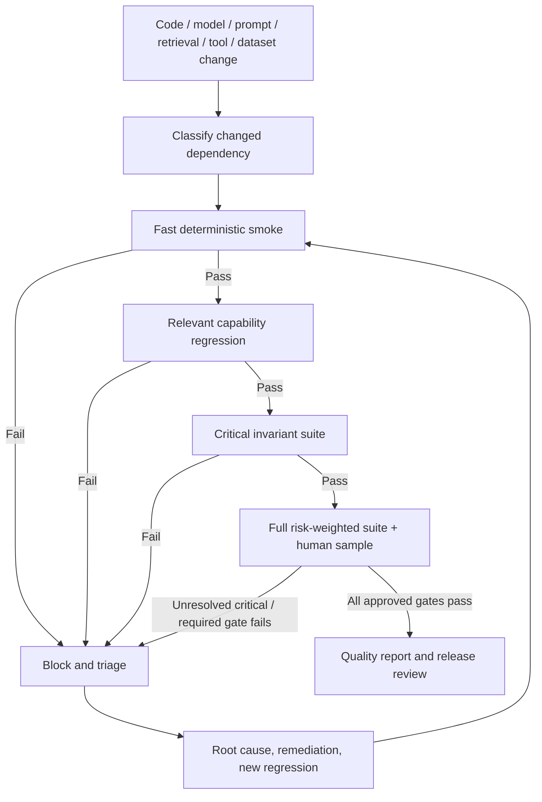

# 04 — Regression Suite

**Status:** Proposed suite manifest and operating procedure. Tests have not been executed by this document.  
**Primary purpose:** Detect regressions introduced by application, model, prompt, context, retrieval, memory, tool, dataset, evaluator, or infrastructure changes.

## 1. Suite design

Use layered suites to control feedback time while preserving hard release invariants. The fast smoke suite is small and deterministic; capability suites target changed components; the full suite covers cross-capability workflows, adversarial cases, fault injection and human-scored quality samples. Every release candidate runs all critical invariant checks, regardless of which component changed.

## 2. Regression suite inventory

| Suite ID | Suite | Cases | Trigger | Core assertions | Gate |
| --- | --- | --- | --- | --- | --- |
| REG-01 | Smoke / project entry | EV-001;EV-002;EV-003 | Every relevant PR/build; full release | Project create, intent, uncertainty state, clarification | Blocking for state corruption or false fact |
| REG-02 | Context and Story Brain | EV-004;EV-005;EV-006;EV-021 | Context resolver, retrieval, memory or prompt changes | Authorized context manifest, project isolation, current Canon preference | Zero leakage; critical failures block |
| REG-03 | Research and grounding | EV-007;EV-008;EV-009 | Research provider, retrieval, chunking, prompt changes | Provenance, conflicts, claim support, research-to-story separation | Fabricated consequential fact blocks |
| REG-04 | Narrative task quality | EV-010;EV-011 | Model/prompt/agent/format changes | Character consistency, brief/format adherence, reviewer rubric | No high-severity score 0; gate pending approval |
| REG-05 | Canon / approval / branch invariants | EV-012;EV-013;EV-014;EV-015;EV-029 | Every build and release candidate | No unauthorized mutation; branch isolation; optimistic concurrency; audit | Blocking suite; 100% deterministic pass |
| REG-06 | Package and continuity | EV-016;EV-017;EV-030 | Package schema, dependency graph, continuity changes | Readiness blockers, impact traceability, partial status | No false ready/approved state |
| REG-07 | Security / privacy / injection | EV-005;EV-019;EV-023;EV-025 | Every release; provider/tool/access-policy change | Tenant/project isolation, injection, provider gate, deletion propagation | Zero known critical failures |
| REG-08 | Reliability / recovery / observability | EV-018;EV-022;EV-024 | Async worker, retry, queue, logging, run-state changes | Timeout, quota, partial success, audit completeness | No state corruption; visible recoverable failure |
| REG-09 | Cost / latency / reproducibility | EV-026;EV-027;EV-028 | Model/provider/config changes and periodic baseline | Usage attribution, latency decomposition, repeated trial analysis | Baseline and budget must be approved before numeric gate |
| REG-10 | Full end-to-end release suite | EV-001–EV-030 | Before release candidate approval | Cross-capability workflow plus all critical invariant tests | No unresolved critical blocker; report all unrun cases |

## 3. Trigger-to-suite mapping

| Change type | Required suites | Additional checks |
|---|---|---|
| UI-only copy/layout | Smoke + affected UX tests | Accessibility and state clarity; do not rerun model benchmark unless prompt/behaviour changed. |
| Domain model/API/schema | Smoke + schema/state + critical invariants + affected end-to-end | Migration/compatibility and stale-version tests. |
| Model/provider version | Smoke + relevant capability suites + full critical suite + graded comparison | Record pricing/limits, output distribution, latency/cost and data-use policy. |
| Prompt/agent/orchestration | Relevant capability + tool + uncertainty + safety + critical suite | Compare task-specific rubrics and failure clusters. |
| Retrieval/chunking/embedding/index | Retrieval/context/research + isolation + grounding + critical suite | Permission filters, recall/precision labels, stale-index/deletion tests. |
| Memory/Canon/branch logic | Memory + state integrity + concurrency + audit + critical suite | Never accept an aggregate quality score as substitute for invariants. |
| Tool/integration change | Tool contract + quota/timeout/partial failure + privacy gates | Idempotency, retry budget, circuit-breaker and provider policy. |
| Dataset/rubric/evaluator change | Harness self-tests + calibration set + regression comparison | Report old/new evaluator version and any comparability break. |
| Infrastructure/queue/worker | Smoke + async recovery + load/concurrency + observability | Queue backlog, cancellation, retry storms, isolation and backup/restore where relevant. |

## 4. Baseline and comparison rules

A valid baseline is an identified, reproducible run bundle: application build; model/provider; prompt/config; retrieval/index; tool adapters; dataset and rubric versions; evaluator version; environment; run timestamp; results and adjudication. “Latest run” is not automatically the baseline. Baseline promotion requires owner review and a note explaining why it is representative.

For comparable versions, run the same cases under the same fixtures. Prefer paired case-level comparisons. Report changed cases, not only aggregate delta. Use confidence intervals or repeated trials where stochastic variance could change the decision. If provider/model behavior changes materially, mark comparability limitations rather than implying a clean apples-to-apples comparison.

### Non-negotiable regression rules

- Any known critical authorization, cross-project leakage, prompt-injection privilege bypass, privacy breach, or unauthorized Canon mutation blocks the candidate.
- A failed required schema, state transition, audit link or expected-version assertion blocks the candidate.
- A quality gain cannot offset a critical safety/security loss.
- Missing/failed evaluator execution is not a pass. A flaky case is not silently removed from the denominator.
- Quarantine requires evidence, owner, reason, expiry/review date and alternative coverage. Critical security cases cannot be casually quarantined.
- Changes to thresholds/rubrics require versioning and impact analysis; never retune the gate after observing a failure without recording the policy change.

## 5. Flakiness and repeated runs

Classify variability as expected model stochasticity, unstable external dependency, test fixture defect, evaluator disagreement, race condition, or product nondeterminism. For high-risk probabilistic cases, repeat trials with pinned configuration and report trial count/distribution. For deterministic invariants, any reproducible failure is a fail; non-reproducibility does not erase the incident. Keep separate case count and trial count.

Quarantine process: mark `QUARANTINED`; preserve failing and passing run IDs; create a defect; identify affected gate; define replacement coverage; obtain QA and relevant owner approval; set a review deadline; restore or retire with change log. Do not include quarantined tests in pass denominators without showing exclusion count.

## 6. Failure triage and release process

1. **Detect:** retain exact run bundle and failing assertion/output evidence.
2. **Classify:** assign error taxonomy from framework; severity based on user/project harm and invariant breached.
3. **Contain:** block release, disable affected capability/provider, or restrict pilot as appropriate; do not silently degrade into unsafe behaviour.
4. **Diagnose:** reproduce with pinned dependencies; isolate app, context, retrieval, model/prompt, tool, evaluator or infrastructure layer.
5. **Fix:** update implementation or policy; document trade-offs and affected requirements.
6. **Regress:** rerun original case, nearby variants and critical suite; add a new case for novel failure mode.
7. **Review:** update report, baseline, owner and residual risk; only authorized governance roles can accept non-critical residual risk.

## 7. Run record schema

`regression_run.json` is a template, not a run result. Each execution record should include run ID, timestamp, environment, commit/build, model/provider, prompt, retrieval index, tool versions, dataset version, suite IDs, case/trial counts, status counts, metric summary, critical failures, skipped/quarantined cases with reasons, artifact references, evaluator version, baseline run ID, decision and approver. Sensitive output should be access-controlled or referenced rather than copied into broad logs.

## 8. Release decision template

| Gate | Result | Evidence | Owner | Decision |
|---|---|---|---|---|
| Critical security/privacy/Canon invariants | NOT RUN | Link to required suite run | Security / Engineering / QA | BLOCKED until evidence |
| Core deterministic contracts | NOT RUN | Contract-test run | Engineering / QA | BLOCKED until evidence |
| Core capability quality | NOT RUN | Dataset + rubric results | Product / AI / domain reviewer | Pending approved thresholds |
| Regression delta vs valid baseline | UNAVAILABLE | Baseline run ID required | QA / AI | No trend claim possible |
| Latency/cost budget | NOT ESTABLISHED | Representative telemetry required | Engineering / Product / Finance | Instrument and approve budget |
| Outstanding blockers and waivers | NOT ASSESSED | Defect/decision register | Accountable owners | No release approval implied |

## 9. Implementation plan

Recommended order: (1) deterministic Canon/auth/isolation/schema tests; (2) durable run/test-result schema and artifact storage; (3) golden case loader and versioned fixture setup; (4) context/retrieval/tool trace capture; (5) rubric workflow and adjudication; (6) baseline comparison/report generation; (7) CI triggers and release gate enforcement; (8) production feedback intake with privacy review. Do not claim the suite is automated until the harness and CI evidence exist.
