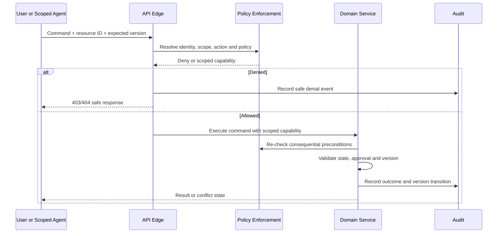

# Access Control Specification — Tattava Copilot

**Product:** Tattava Copilot | **Company:** Tattava Co. / Don Vanzara Showbiz LLP  
**Baseline:** V1 — Narrative Intelligence | **Version:** 1.0 | **Status:** Proposed enforceable policy model; action grants require accountable approval

## 1. Purpose and access-control model

Tattava needs project-level control over confidential creative work and consequential creative decisions. Use a **hybrid RBAC + ABAC** model: RBAC supplies role grants; ABAC constrains access by organization membership, project membership, resource scope, lifecycle state, branch, sensitivity, action consequence, approval state, and current version. RBAC alone is insufficient because a role does not imply access to every project or every action. Client UI hiding is usability only; authorization must be enforced server-side at every read/write/execution boundary.

**Safe default:** deny any action not explicitly granted by the approved policy. A role label is not a permission. The AI runtime is not a human role and receives no independent authority. Every tool call is re-authorized at execution time against the initiating actor, project scope, task capability and tool policy.

## 2. Confirmed role vocabulary and authority constraints

| Role | Confirmed product meaning | Safe policy baseline pending action-level approval |
|---|---|---|
| Producer | Final project authority; final approval/greenlight | May be granted final project decisions only through approved action matrix; no assumed platform-admin power |
| Content Head | Content oversight | Content-domain review/oversight only where explicitly granted |
| Creative Director | Script/editorial authority | Creative/script review and decisions only where explicitly granted |
| Writer | Creative execution | Create/edit working drafts and candidates within assigned project/branch; no implicit final approval |
| Researcher | Research/evidence support | Create research/evidence artifacts; no implicit Canon approval |
| AI | Intelligence/support layer, not authority | No independent user identity, approval, greenlight, or Canon-write grant; acts only via scoped tools under human policy |
| Platform administrator/operator | Operational role, not a creative authority | Infrastructure support only; project content access requires separately approved break-glass procedure and audit |

Producer remains final project authority. Content Head and Creative Director are parallel authority domains under Producer, not a strict reporting chain. Do not map these titles into a fixed reporting hierarchy. Exact action-level permissions, delegation and approval routing remain an open business decision; this document provides a conservative default matrix to avoid ambiguous access during implementation.

## 3. Authorization decision inputs

Every decision should evaluate: authenticated subject; active organization; active membership; project membership; role grants; resource organization/project/branch; action; resource sensitivity; lifecycle state; consequence class; current policy version; expected resource version; approval evidence; delegation validity; and request origin/session risk where available. Only trusted server-side values may supply identity and grants. Request-supplied project IDs are selectors, not proof of authorization.



## 4. Role-permission matrix (conservative proposal)

Legend: **A** = allow within authorized project/resource scope; **C** = conditional on explicit action grant, assigned project and policy; **R** = review/approval only if assigned; **D** = deny by default; **N/A** = not a human role. This table is a proposed safe baseline, not final management-approved policy.

| Action | Producer | Content Head | Creative Director | Writer | Researcher | AI/service |
|---|---:|---:|---:|---:|---:|---:|
| View project home and permitted artifacts | C | C | C | C | C | Scoped only |
| Create project | C | C | C | C | C | D unless explicit system workflow |
| Edit own working draft/candidate | C | C | C | C | C for research artifacts | Candidate output only |
| Read Canon | C | C | C | C | C | Minimal scoped context only |
| Propose Canon change | C | C | C | C | C | Candidate patch only |
| Commit Canon change | C; required approval path | C only if explicitly delegated for content action | C only if explicitly delegated for script/editorial action | D by default | D by default | D — never independently |
| Approve final package/greenlight | C; final authority | D unless explicit delegated authority | D unless explicit delegated authority | D | D | D |
| Review content-domain artifact | C | C | C | C for own work | C for evidence quality | Advisory only |
| Manage membership/role grants | C only via approved admin workflow | D | D | D | D | D |
| Export project package | C | C | C | C only if granted | C only if granted | No independent export |
| Access audit/security records | C for own project actions per policy | C limited | C limited | C limited | C limited | Write scoped events; no broad read |
| Manage provider/secret configuration | D; separate platform admin needed | D | D | D | D | D |

**Implementation rule:** conditional entries are denied until the action-level matrix is explicitly approved. This is the safe resolution for incomplete role decisions; it avoids inventing grants while allowing policy configuration to be completed without changing architecture.

## 5. Resource-action-policy matrix

| Resource | Read | Create | Update | Delete/archive | Approve/commit | Export/share |
|---|---|---|---|---|---|---|
| Organization/workspace | Active member + organization policy | Explicit workspace-admin grant | Admin grant + audit | Admin grant + lifecycle/retention policy | N/A | Explicit grant |
| Project metadata | Project member | Project creation grant | Project member + field policy | Owner/admin policy; confirm lifecycle | N/A | Project export grant |
| Canon entry/revision | Project scope + resource policy | Candidate/command workflow only | Domain command + expected version | Never direct delete; governed deprecation/archive | Explicit consequence-based approval | Reauthorize each export |
| Candidate/branch | Branch membership + project scope | Capability grant | Candidate owner/editor policy | Archive/reject workflow | Candidate acceptance is not automatically Canon commit | Export only if allowed |
| Research/evidence | Project scope + source rights | Research capability | Versioned source/evidence update | Governed lifecycle | Human verification only where required | Preserve source/provenance restrictions |
| Conversation/run/context manifest | Project scope + sensitivity | Authorized request | Append/version run state | Retention/deletion policy | Approval state recorded separately | Avoid raw context export unless explicitly allowed |
| Tool/integration | Task scope + tool policy | Platform configuration | Approved config workflow | Platform admin | Consequential side effects require separate approval | D by default |
| Audit/security events | Restricted audit permission | System-generated only | Append-only semantics | Policy-controlled retention; no normal user delete | N/A | Restricted export only |
| Memory/summary/index | Inherited source scope | Approved derived-data pipeline | Versioned rebuild | Deletion propagation | Never a Canon commit path | Inherit source policy |

## 6. Enforcement requirements

| ID | Enforcement point | Requirement | Failure behavior |
|---|---|---|---|
| IAM-001 | API edge and every domain handler | Authenticate actor; resolve organization from trusted claims; authorize resource/action | Fail closed; return safe denial |
| IAM-002 | Persistence/query layer | Scope every query by organization and project; prohibit unscoped list/read helpers for tenant data | Deny or empty safe response; alert on missing scope |
| IAM-003 | Retrieval/context resolver | Apply authorization filters before chunks enter context; include scope in cache keys | Block retrieval if filter cannot be enforced |
| IAM-004 | Agent orchestrator | Bind run to initiating actor, project, allowed capabilities and policy version | Stop or re-authorize if grant changed |
| IAM-005 | Tool gateway | Authorize each call immediately before execution; validate destination and arguments | Deny; no automatic broadened retry |
| IAM-006 | Canon service | Separate candidate and Canon command; approval, schema and expected version checked transactionally | Reject stale/unauthorized command; preserve Canon |
| IAM-007 | Background workers | Validate signed job scope and re-resolve current membership/policy | Cancel or deny if revoked/expired |
| IAM-008 | Export service | Reauthorize at export creation and download; manifest records included artifacts | Deny or exclude unauthorized content |
| IAM-009 | Admin/role management | Least privilege; separate operational access from creative project authority; log grants/revocations | Reject unapproved grant; alert on privileged change |
| IAM-010 | Audit service | Record allow/deny and consequential transitions with minimal safe metadata | Do not allow audit outage to silently erase required record; block critical mutation if durable audit requirement cannot be met |
| IAM-011 | Session lifecycle | Expiration, revocation, secure cookie/token handling, CSRF protection as applicable; re-auth for sensitive actions recommended | Re-auth or deny |
| IAM-012 | Policy change propagation | Policy version included in run/capability; sensitive queued actions re-check current policy | Cancel or reauthorize stale work |

## 7. Authorization pseudocode

```text
can(actor, action, resource, request_context):
  assert actor is authenticated and active
  scope = resolve_resource_scope(resource)
  if scope is unknown: return DENY
  if actor.organization != scope.organization: return DENY
  if not active_membership(actor, scope.organization): return DENY
  if scope.project and not project_membership(actor, scope.project): return DENY
  grants = load_explicit_grants(actor, scope, action)
  attributes = {sensitivity, lifecycle, branch, consequence, policy_version}
  if grants do not explicitly permit action under attributes: return DENY
  if action is consequential:
    require current policy version
    require required approver(s) and valid approval references
    require expected version matches current version
  return ALLOW(scoped capability with expiry and permitted operation list)
```

For AI execution: `tool_allowed = can(initiating_actor, tool_action, target_resource, current_context) AND tool_is_allowlisted AND arguments_validate AND budget_available`. Never accept a model-supplied actor, role, organization, approval, or permission result as trusted.

## 8. API contract guidance (proposed, not deployed endpoints)

Sensitive operations should use command-style contracts and explicit expected versions. Example only:

```json
{
  "project_id": "prj_example",
  "candidate_id": "cand_example",
  "expected_canon_version": 12,
  "approval_id": "apr_example",
  "idempotency_key": "client-generated-unique-value"
}
```

Proposed successful response:

```json
{
  "status": "committed",
  "canon_version": 13,
  "audit_event_id": "aud_example",
  "correlation_id": "req_example"
}
```

Proposed denied response must not reveal whether an inaccessible resource exists:

```json
{
  "error": {
    "code": "ACCESS_DENIED",
    "message": "The requested action is not permitted.",
    "correlation_id": "req_example"
  }
}
```

Use 401 for missing/invalid authentication where appropriate; use a consistent 403 or privacy-preserving 404 for unauthorized resources; use 409 for stale version/concurrency conflicts; use 422 for structurally valid but domain-invalid commands; use 429 for configured rate limits. These are proposed API semantics and must align with the final API specification. Never include sensitive resource details in errors.

## 9. Delegation, revocation, service identities and break-glass

Delegation must be explicit, scoped, time-bounded, revocable, and auditable. A delegated grant cannot exceed the delegator’s own authority. Revocation takes effect on the next authorization check; queued work must re-check before sensitive actions. Service identities receive narrowly scoped permissions for a defined purpose, rotate credentials, and must not impersonate users. The initiating human remains attributable in audit events.

Break-glass access is disabled until an approved procedure exists. If enabled, require a documented incident/ticket, narrow duration and scope, strong authentication, alerting, complete audit, post-event review, and prompt revocation. Platform administration must not imply blanket creative-content access.

## 10. Access-control test catalogue

| Test ID | Scenario | Expected result | Priority |
|---|---|---|---|
| IAM-T001 | Anonymous request to private project | Reject authentication | P0 |
| IAM-T002 | Authenticated user guesses another project ID | Deny without resource disclosure | P0 |
| IAM-T003 | User has organization membership but not project membership | Deny project content access | P0 |
| IAM-T004 | Writer calls final approval/greenlight action without grant | Deny; no state change | P0 |
| IAM-T005 | AI agent attempts Canon commit directly | Deny; only candidate/domain command path allowed | P0 |
| IAM-T006 | Tool call executes after user permission revoked | Re-check and deny | P0 |
| IAM-T007 | Retrieval query omits project filter | Query rejected by guard/helper; no content returned | P0 |
| IAM-T008 | Cache key collision between projects | No cross-scope cache hit | P0 |
| IAM-T009 | Background job uses forged project scope | Reject invalid scope signature/authorization | P0 |
| IAM-T010 | Stale approval or Canon version | 409/conflict; preserve current state | P0 |
| IAM-T011 | Export is downloaded after access revocation | Reauthorize; deny | P0 |
| IAM-T012 | User tries to grant a role beyond their authority | Deny and audit | P0 |
| IAM-T013 | Break-glass access used without approved incident context | Deny | P1 |
| IAM-T014 | Audit event read by unauthorized project member | Deny | P1 |
| IAM-T015 | Session revoked while run is queued | Run re-checks policy before next sensitive step | P0 |

## 11. Implementation backlog and release gates

| ID | Priority | Work item | Acceptance evidence |
|---|---|---|---|
| IAM-B01 | P0 | Identity + scoped authorization middleware and resource policy helpers | IAM-T001–T003 pass; coverage review of every resource handler |
| IAM-B02 | P0 | Project/tenant scoping for database, retrieval, cache and export | IAM-T002/7/8/11 pass; isolation review |
| IAM-B03 | P0 | Explicit role/action matrix approved and configured | Signed business/security decision; all unlisted actions deny |
| IAM-B04 | P0 | Canon command, approval references and version preconditions | IAM-T004/5/10 pass; audit proof |
| IAM-B05 | P0 | Reauthorization for tools, jobs and long-running runs | IAM-T006/9/15 pass |
| IAM-B06 | P0 | Audit events for access and consequential actions | Sampled trace from request to state transition; restricted access tested |
| IAM-B07 | P1 | Delegation, role reviews and privileged access workflows | Review evidence and revocation tests |
| IAM-B08 | P1 | Break-glass and incident access workflow | Approved procedure and tabletop before enablement |

**Release blockers:** cross-project/tenant leakage; unauthorized read/write/export; approval bypass; AI tool action without authorization; stale Canon overwrite; missing audit trail for consequential mutation. A business owner may not waive legal or security obligations by informal approval; any residual risk must be documented by the designated authority.

## 12. Open decisions resolved with safe defaults

- **Role ambiguity:** deny all action-level grants not yet approved; use the matrix as a review artifact, not an implicit grant.
- **Producer/Content Head/Creative Director boundaries:** preserve Producer as final project authority and keep Content Head and Creative Director as parallel authority domains; configure each action separately.
- **Identity vendor and MFA:** provider-neutral contract; recommend MFA for privileged roles and re-authentication for consequential actions; Platform/Security chooses mechanism.
- **Admin access:** separate platform operations from creative project authority; break-glass disabled until approved.
- **Error semantics:** use safe 403/404 patterns and 409 for stale state unless existing API contracts establish otherwise.

## 13. References and limitations

Aligned with PRD role/decision-right requirements, System Architecture Identity & Policy Enforcement and Canon service, AI Tool Specifications and Guardrails, Human-in-the-Loop, Experience and Requirements Traceability. The source baseline does not contain an approved final role-action matrix, deployed identity provider, endpoint inventory, session configuration, or authorization test results. All controls are specifications until implementation evidence is recorded.
