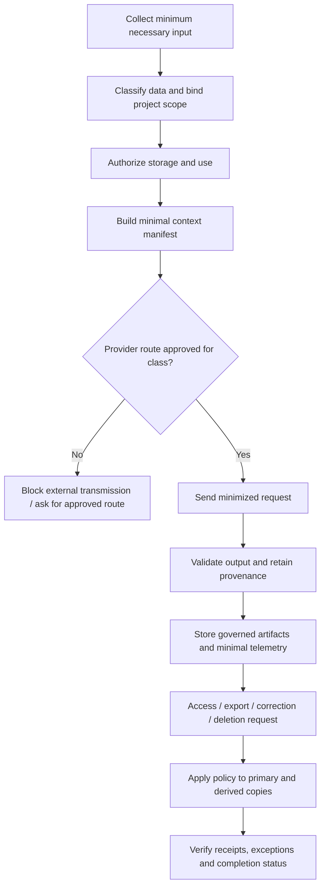

# Privacy Engineering Specification — Tattava Copilot

**Product:** Tattava Copilot | **Company:** Tattava Co. / Don Vanzara Showbiz LLP  
**Baseline:** V1 — Narrative Intelligence | **Version:** 1.0 | **Status:** Proposed implementation baseline; legal and provider decisions remain open

## 1. Purpose and privacy position

Tattava processes confidential creative work and project intelligence. Privacy engineering must therefore cover not only account details but also unreleased scripts, story concepts, research, prompts, outputs, embeddings, project memory, telemetry, exports, and backups. A derivative representation remains governed by the source material’s access scope and sensitivity. The system must not make unsupported promises about provider retention, residency, training use, deletion timelines, or regulatory compliance.

**Conservative defaults:** collect only data needed for a declared product operation; keep project content private to its authorized project scope; do not send restricted project content to a model/tool provider until that provider and data route are approved; do not use project content for provider training where contract/configuration can prevent it; exclude raw creative content and secrets from operational logs by default; make deletion status evidence-based and disclose exceptions; keep provider memory and vector indexes non-authoritative. These are proposed controls, not statements about existing vendor terms or legal basis.

## 2. Scope and governance

This specification covers collection, use, context assembly, external processing, persistence, search/indexing, sharing/export, retention, deletion, backups, audit, telemetry and incident handling. Product and technical sources confirm project isolation, provenance, data security, role-based access, auditable decisions, and provider abstraction. They do not establish applicable legal regimes, lawful basis, consent requirements, data residency, retention periods, subprocessors, or contractual provider guarantees. Privacy/Legal must make those determinations before launch in relevant jurisdictions.

Data subject rights and legal obligations depend on the actual people, data, locations and business arrangements involved. Do not assume that all creative project data is personal data, nor that none of it is. Provide technical capabilities for access, correction, export and deletion where appropriate, but expose them under an approved policy and workflow.

## 3. Data inventory and classification

| Data category | Examples / purpose | Default class | Access and processing | Retention/deletion rule |
|---|---|---|---|---|
| Account and identity | User ID, membership, role grants, session metadata | Confidential | Identity/security services only; minimal in logs | Policy to be approved; retain only as necessary for account and audit needs |
| Organization/project metadata | Project title, format, genre, membership, status | Confidential | Project-scoped; authorized members | Delete/archive according to approved project lifecycle |
| Canon and creative IP | Approved facts, characters, world rules, story decisions, scripts | Restricted project IP | Authorized project roles; provider transmission requires route approval | No fixed duration assumed; deletion must propagate to governed copies subject to approved exceptions |
| Candidate content and branches | Drafts, alternatives, rejected/deferred candidates | Restricted project IP | Project and branch scoped; never implicitly canonical | Retain according to approved project/version policy |
| Research source and evidence | URLs, excerpts, source metadata, claims, confidence, retrieval time | Confidential/restricted depending on source | Project-scoped; respect source rights and provider terms | Preserve provenance while permitted; remove or restrict derived content as required |
| Uploaded files and extracted text | PDF/doc/text, OCR output, parsed chunks | Inherit source class | Secure ingestion and project-scoped retrieval | Deletion must cover originals, extracted text, chunks, caches and indexes |
| Prompts, context manifests, model outputs | Input, assembled context, completion, citations | Inherit most sensitive included data | Minimize before external transmission; access-controlled run history | Retention policy open; content logging off by default unless specifically approved |
| Embeddings and retrieval indexes | Vector representation, chunk IDs, metadata | Inherit source class | Same scope filters as source; no independent authority | Delete/rebuild affected vectors when source is deleted/restricted |
| Memory and summaries | Project summaries, continuity state, extracted facts | Inherit source class; derived label | Project-scoped; versioned and provenance-linked | Invalidate/recompute on source changes; deletion propagation required |
| Audit and security events | Actor, action, resource, version, outcome, correlation ID | Security-sensitive | Restricted access; no secrets/raw content by default | Retention and integrity requirements need approval |
| Usage/quality telemetry | Latency, token count, cost, evaluator scores, error codes | Pseudonymous/confidential where linkable | Aggregate when possible; access limited | Retention and aggregation rules need approval |
| Exports and backups | Story package, archive, recovery copies | Inherit included content | Reauthorize exports; backup access restricted | Governed by deletion, backup expiry and legal hold policy |
| Provider-side data | Prompt/context/output processed externally | Inherit transmitted data | Approved route only; terms must be verified | Contract-specific; cannot claim deletion until evidenced |

## 4. Privacy lifecycle and control points

Privacy controls belong at collection, context resolution, Model Gateway, tool gateway, persistence, telemetry, export and deletion—not only in a privacy notice. Any operation that combines projects must require an explicit supported business purpose and permission; V1 default is no cross-project context.

## 5. Privacy control requirements

| ID | Objective and enforcement | Required behavior / failure handling | Evidence / status |
|---|---|---|---|
| PRIV-001 | Data minimization at context resolver and Model Gateway | Include only task-relevant, authorized fields; omit unrelated projects and secrets; if minimization cannot be verified for a restricted route, block send | Context manifest and route audit / Proposed |
| PRIV-002 | Data classification at ingestion and persistence | Label source and derived data with project scope, sensitivity, provenance and lifecycle state; unknown classification receives conservative restricted handling | Schema and test evidence / Proposed |
| PRIV-003 | Provider approval and data terms | Provider route is enabled only after Security/Privacy/Legal approve training use, retention, subprocessors, region, deletion and contract terms | Approved provider register / Open decision |
| PRIV-004 | No silent training or secondary use | Do not treat feedback, prompts or project artifacts as permission for model training; any secondary use needs separate policy and explicit approval | Configuration, contract and data-flow evidence / Proposed |
| PRIV-005 | Content-safe telemetry | No credentials, raw prompt/context/script by default; use event IDs, sizes, status, timings, token/cost metadata and redacted error codes | Log sampling and automated secret tests / Proposed |
| PRIV-006 | Project-scoped retrieval and memory | Filter before content reaches model; derived summaries/embeddings inherit source scope; no cross-project retrieval by default | Isolation tests / Confirmed requirement; implementation unverified |
| PRIV-007 | User transparency | Explain when AI processing/external research is used, show relevant sources and status, and make uncertainty/partial failure visible | UX tests and copy review / Proposed |
| PRIV-008 | Export and portability | Reauthorize at request and download; include only allowed project artifacts; provide machine-readable export where approved | Export manifest and access tests / Proposed |
| PRIV-009 | Correction and source updates | Corrections update authoritative records through governed workflows; mark dependent summaries/indexes stale and rebuild them; preserve audit lineage | Version and dependency tests / Proposed |
| PRIV-010 | Deletion orchestration | Track primary records, files, extracted text, chunks, embeddings, caches, summaries, exports and provider copies; expose pending/complete/exception states | Per-store deletion receipts / Proposed; policy open |
| PRIV-011 | Backup and legal-hold handling | Do not promise immediate purge from immutable backups; document restore-time deletion replay and approved exceptions | Backup/restore test and approved policy / Open decision |
| PRIV-012 | Encryption and secret handling | Require encrypted transport and storage using platform-supported controls; secrets in managed secret store; exact algorithms/vendor are platform decisions | Configuration evidence / Proposed |
| PRIV-013 | Subprocessor and cross-border review | No provider is approved merely because an API is technically available; map data flow, region and subprocessor terms before activation | Vendor register and sign-off / Open decision |
| PRIV-014 | Privacy incident handling | Contain route, identify affected data/projects/providers, preserve minimum evidence, execute approved notification process | Runbook/tabletop evidence / Proposed |

## 6. Data subject and project lifecycle workflows

### 6.1 Access and export
A request must first authenticate the requester and establish the scope of authority. Export only data the requester is authorized to receive; do not include other project members’ private account data, credentials, hidden system prompts, internal secrets, or unauthorized branches. Record export requester, scope, artifact manifest, time, and result. If the request is broader than current policy can safely satisfy, return a clear partial/blocked state and route for review rather than over-disclose.

### 6.2 Correction
Corrections to project facts, metadata, or Canon must follow domain-specific authorization and versioning. A correction to a source should not silently rewrite prior creative decisions. Record the correction, mark derived claims and summaries as potentially stale, and present impact for review where consequential.

### 6.3 Deletion
Recommended workflow: validate request and scope; check approved retention/legal-hold policy; mark deletion pending and prevent new use; delete primary artifacts; propagate deletion to extracted text, chunks, embeddings, caches, memory, search indexes and exports where technically possible; request provider-side deletion where contractual controls support it; record receipts and exceptions; handle backups according to approved expiry/replay policy; report complete only when all required targets are verified or policy explicitly permits a documented exception. If any target is unavailable, report **Partially completed / Pending verification**, not complete. A tombstone should prevent deleted data from being reintroduced during reindex or backup restore.

### 6.4 Retention and archive
No numeric retention period is established by source evidence. Implement configurable policy hooks by data category and lifecycle state, but do not activate arbitrary deletion windows. Before production, Privacy/Legal must approve retention for project artifacts, user records, audit events, telemetry, provider-side data, backups and legal holds. When policy is absent, avoid irreversible automatic deletion and block any feature that depends on an unapproved promise.

## 7. External AI processing contract

The Model Gateway should evaluate each request using data classification, project policy, provider approval, region/contract configuration, task type and minimization rules. The route decision should be auditable without logging the full prompt. A fallback is allowed only when the alternative provider is independently approved for the same data class and task; otherwise stop and return a provider-unavailable/route-blocked state. Do not lower data protection to improve availability.

Provider approval checklist: contract and data-processing terms reviewed; model training use documented; prompt/output retention documented; deletion capability and exceptions documented; processing region and transfers reviewed; subprocessors identified; security controls assessed; rate/cost limits known; incident contact and change-notification process known. These facts must be evidenced per provider and model route.

## 8. Privacy test plan

| Test ID | Scenario | Expected result | Priority |
|---|---|---|---|
| PRIV-T001 | Context assembly includes a resource from another project | Block before model invocation; record safe denial | P0 |
| PRIV-T002 | Restricted project has no approved provider route | No external request; task marked blocked/awaiting policy | P0 |
| PRIV-T003 | Logs inspect synthetic script text, token, password and API key | Secrets absent; sensitive content absent by default | P0 |
| PRIV-T004 | Delete a file with extracted text, chunks, vectors and summaries | Each copy has a deletion/rebuild receipt or explicit exception | P1/P0 if false completion |
| PRIV-T005 | Provider outage triggers fallback | Fallback only if same-class route approved | P0 |
| PRIV-T006 | User exports project with unauthorized branch | Unauthorized branch excluded or export denied | P0 |
| PRIV-T007 | Correction changes a research source | Dependent claims marked stale and re-evaluated | P1 |
| PRIV-T008 | Backup restored after deletion | Deletion tombstone is replayed before restored data becomes queryable | P1 |
| PRIV-T009 | Privacy request made by non-member | Deny or route to approved identity-verification process | P0 |
| PRIV-T010 | Provider contract/route status revoked | New transmissions stop; queued runs recheck approval | P0 |
| PRIV-T011 | Telemetry dashboard grants broad access | Restricted fields remain inaccessible; access is audited | P1 |
| PRIV-T012 | Partial deletion due to unavailable index/provider | Report pending/partial with affected stores; never claim full completion | P0 |

## 9. Privacy incident and operational evidence

For suspected exposure, stop the relevant provider/tool route, pause queued runs, identify affected projects and data copies, preserve minimal audit evidence, revoke credentials where needed, assess exports and downstream derived artifacts, and follow approved legal/contractual notification policy. Do not invent notification windows; Legal/Privacy must determine obligations based on facts and applicable law.

Required evidence: data inventory; data-flow map; provider approval register; configuration snapshots; context-minimization test results; access/export/deletion audit records; backup restore test; log redaction checks; privacy incident tabletop; and documented approvals for retention, residency and external processing.

## 10. Open decisions with safe interim resolutions

| Open question | Safe interim resolution | Accountable decision |
|---|---|---|
| Legal basis, consent, applicable laws? | Do not assert compliance or a legal basis; inventory data and purposes, then obtain counsel review before production | Legal/Privacy |
| Retention durations? | No hard-coded product promise; configurable policy; prevent false deletion completion | Privacy + Business owner |
| Provider retention/training/region? | Provider route disabled for restricted content until documented and approved | Security + Privacy + Legal |
| Backups and legal holds? | Preserve controlled recovery capability; deletion tombstone replay; no claim of immediate backup purge | Platform + Legal |
| Export/correction/deletion scope? | Implement scoped workflows and receipts; activate user-facing commitments only after policy approval | Product + Privacy |
| Data residency? | Do not assume a region; block routes that lack approved processing location | Platform + Legal |

## 11. References and limitations

Derived from the PRD’s privacy/security/governance and recovery requirements, System Architecture trust boundaries and Model Gateway, AI Guardrails, Memory/Project Intelligence, Human-in-the-Loop, Experience and Requirements Traceability. No provider contracts, legal analysis, retention schedule, deployed privacy evidence or data-subject request process were supplied. This document is an engineering specification, not legal advice or a compliance certification.
