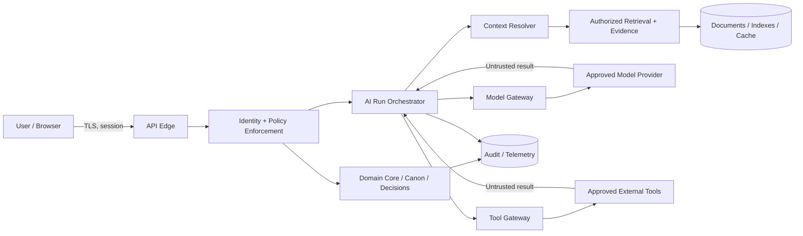

# Threat Model — Tattava Copilot

**Product:** Tattava Copilot | **Company:** Tattava Co. / Don Vanzara Showbiz LLP  
**Baseline:** V1 — Narrative Intelligence | **Version:** 1.0 | **Status:** Implementation specification; controls require verification before release  
**Audience:** Product, Security, Privacy, Backend, AI/ML, Platform, QA, Operations

## 1. Executive decision

Tattava must be treated as a multi-user, project-scoped system handling confidential creative intellectual property. Its primary security property is that a user or AI workflow can only access and change the project state permitted by server-side policy. The deterministic application core—not prompts, model output, vector indexes, or agent scratchpads—owns identity decisions, authorization, Canon, approvals, version history, and audit events.

**Recommended defaults that resolve implementation ambiguity:** (1) deny by default; (2) enforce authorization on every request and again at each sensitive execution boundary; (3) isolate by organization and project in all primary and derived stores; (4) treat uploads, web pages, retrieved passages, model output, and tool results as untrusted; (5) allow only registered tools and approved destinations; (6) require an authorized domain command and expected-version check for Canon changes; (7) do not route sensitive project content to a provider unless its route is explicitly approved for that data class; (8) make security-critical failures fail closed. These defaults are proposed engineering policy, not evidence of controls already deployed.

## 2. Scope, source authority, and status conventions

This model covers browser/API ingress, identity and policy enforcement, project domain core, Canon and candidate services, context assembly, retrieval/evidence, AI orchestration, Model Gateway, tool execution, asynchronous workers, storage, exports, telemetry, and external providers. It does not claim a specific cloud, identity vendor, database, deployment, or production security certification.

Source precedence: current Product Strategy and consolidated PRD for product intent; approved System Architecture for technical invariants; `02_AI_INTELLIGENCE` specifications for AI runtime and guardrails; Experience and Requirements Traceability for interaction and verification expectations; BRD for business context. Architecture establishes that Canon is typed/versioned and authoritative, AI candidates are non-canonical until governed approval, context and retrieval must be project-scoped, tool execution is policy-controlled, and exact role permissions and provider/data terms remain open.

Labels: **CONFIRMED** means supported by source materials; **PROPOSED** means recommended control or implementation contract; **UNVERIFIED** means implementation evidence is absent; **OPEN DECISION** means a named accountable owner must approve policy. A threat register entry is not proof that mitigation exists.

## 3. Assets, actors, and security objectives

| Asset | Security objective | Default classification | Notes |
|---|---|---|---|
| Unreleased scripts, story concepts, Canon, pitch package | Confidentiality, integrity, availability | Restricted project IP | Highest protection tier by default |
| Project membership, role grants, approvals | Integrity and non-repudiation | Restricted | Authorization source of truth |
| Research sources, extracted evidence, citations | Integrity, provenance, scope | Confidential project data | Source material may be untrusted or rights-limited |
| Prompts, context manifests, model outputs | Confidentiality and correct handling | Same as most sensitive included context | Minimize provider payloads |
| Credentials, signing keys, provider tokens | Confidentiality and rotation | Secret | Never expose to model or end user |
| Audit events and security telemetry | Integrity, access restriction, usefulness | Confidential/security-sensitive | Avoid raw content unless necessary and approved |
| Embeddings, caches, indexes, exports, backups | Same as underlying source data | Inherit source classification | Derived copies remain in scope |

Actors include Producer, Content Head, Creative Director, Writer, Researcher, authenticated service identities, administrators/operators, approved model providers, approved external research/tool providers, and attackers acting as anonymous users, compromised accounts, malicious insiders, or malicious content authors. Role names are not themselves permission grants. Producer is final project authority; Content Head and Creative Director are parallel authority domains under Producer; exact action-level grants remain configurable until approved. Never associate a person’s name with a role without explicit confirmation.

Security objectives: no cross-organization/project leakage; no unauthorized state mutation or export; no silent Canon changes; no secret disclosure; no unapproved provider routing; traceable consequential actions; bounded agent authority and spend; recoverable authoritative state; transparent handling of partial failure.

## 4. System context and trust boundaries



The diagram is logical, not a claim about deployed infrastructure. Trust boundaries are: client-to-server; identity/policy-to-domain; application-to-storage; orchestrator-to-model provider; retrieval-to-AI context; tool gateway-to-external destination; background worker-to-resource; and restricted content-to-telemetry. Validate at the receiving boundary; do not rely on validation performed only by a prior component.

### 4.1 Threat-handling principles

1. **Identity before resource access:** resolve actor and organization from trusted session/token claims, not request-supplied tenant IDs alone.
2. **Authorization before retrieval:** filter candidate documents and chunks by access scope before content is assembled for the model. Post-filtering only after model exposure is insufficient.
3. **Untrusted instructions stay data:** source documents and web pages cannot override system policy, grant permissions, or authorize tools.
4. **Model output is a proposal:** parse against schema, validate domain invariants, then obtain human approval when required; commit through deterministic domain commands.
5. **No ambient authority:** agents inherit only the narrow task scope and explicit tool grants, not broad service credentials.
6. **No silent fallback:** provider, storage, or policy failure must not bypass a privacy or authorization restriction.
7. **Derived copies inherit controls:** embeddings, caches, logs, exports, and backups are governed by the source’s scope and lifecycle.

## 5. STRIDE threat register

Likelihood is a qualitative initial estimate (Low/Medium/High), not a measured frequency. Severity: Critical / High / Medium / Low. Reassess after architecture and penetration testing.

| ID | Threat / STRIDE | Attack path and preconditions | Impact / initial rating | Proposed control and enforcement | Verification |
|---|---|---|---|---|---|
| THREAT-001 | Cross-project/tenant read (Information Disclosure) | Attacker changes project ID, abuses search filters, cache key, worker payload, or retrieval query | IP breach; Critical / Medium | IAM-001, DATA-001: derive scope from trusted identity; enforce scope in DB, retrieval, cache, exports and jobs; deny on missing scope | SEC-T001, SEC-T002 |
| THREAT-002 | Unauthorized Canon mutation (Tampering/Elevation) | Model or user submits candidate as canonical, bypasses approval or stale-version check | Creative/IP integrity loss; Critical / Medium | SEC-004: only domain command can commit; policy check, approval reference, expected version and atomic write | SEC-T003, SEC-T004 |
| THREAT-003 | Direct/indirect prompt injection (Elevation/Tampering) | User prompt, PDF, OCR, web page, or retrieved story text contains instructions to reveal data/call tools | Exfiltration, unsafe action; Critical / High | SEC-005: content/instruction separation, tool allowlist, policy outside model, source labeling, adversarial eval | SEC-T005–T007 |
| THREAT-004 | Secret or prompt disclosure (Information Disclosure) | Model output, logs, error, or tool result includes credentials/system prompts/other project data | Confidentiality breach; Critical / Medium | Secret isolation, redaction, least-privilege context, output DLP as supplemental, safe errors | SEC-T008 |
| THREAT-005 | Unauthorized tool call / SSRF-like fetch (Elevation) | Model crafts arbitrary URL, internal address, filesystem or side-effect operation | Internal access or side effect; Critical / Medium | SEC-006: typed registered tools, destination allowlist, egress controls, argument validation, per-tool authorization | SEC-T009–T011 |
| THREAT-006 | Malicious file/parser payload (Tampering/DoS) | Crafted PDF/doc, oversized file, archive bomb, parser exploit | Worker compromise or availability; High / Medium | Isolated parsing, MIME/signature checks, size/page limits (limits must be configured), malware scanning where available | SEC-T012 |
| THREAT-007 | Compromised account / role escalation (Elevation) | Session theft, weak lifecycle, improper role grant or direct-object reference | Unauthorized access/approval; Critical / Medium | MFA for privileged access (proposed), short-lived sessions, re-auth for sensitive actions, access review, policy tests | SEC-T013–T015 |
| THREAT-008 | Retrieval poisoning / fabricated evidence (Tampering) | Malicious source, altered index, generated citation, stale source | False historical claims; High / Medium | Source/evidence/claim separation, source metadata, provenance validation, source fetch evidence, no LLM-only citation | SEC-T016 |
| THREAT-009 | Memory contamination (Tampering) | Candidate, rejected branch, or malicious instruction becomes persistent project truth | Cross-run corruption; High / Medium | Canon outside memory; memory writes typed, scoped, versioned and governed; rejected candidates excluded from canonical context | SEC-T017 |
| THREAT-010 | Unbounded agent loop / retry storm (DoS) | Agent loops or provider errors trigger recursive retries | Cost spike, degraded service; High / Medium | Run budget, deadline, max tool/step count, queue limits, cancellation, circuit breaker | SEC-T018 |
| THREAT-011 | Stale concurrent update / replay (Tampering) | Concurrent approvals or duplicate retry applies a stale patch twice | Canon corruption; Critical / Medium | Expected-version compare-and-swap, idempotency keys, atomic transaction, stale command rejected | SEC-T019 |
| THREAT-012 | Sensitive content sent to unapproved provider (Information Disclosure) | Fallback routes confidential IP to a provider with unknown data terms | IP exposure; Critical / Medium | Data-class routing policy in Model Gateway; provider allowlist; fail closed when no approved route exists | SEC-T020 |
| THREAT-013 | Audit tampering or excessive log access (Repudiation/Disclosure) | Privileged actor alters/reads records; logs contain scripts or tokens | Incident cannot be reconstructed; High / Medium | Append-oriented audit, restricted access, integrity protection, retention decision, content minimization | SEC-T021 |
| THREAT-014 | Deletion leaves residual copies (Information Disclosure) | Primary row deleted but index, cache, export, backup or provider copy remains | False privacy promise; High / Medium | Deletion orchestration with per-store receipts, tombstones, provider deletion evidence and exception reporting | SEC-T022 |
| THREAT-015 | Denial-of-service via resource exhaustion (DoS) | Oversized input, high concurrency, abusive requests, expensive retrieval | Availability and cost loss; High / Medium | Request quotas, upload bounds, queue backpressure, per-project budgets and rate limiting | SEC-T023 |
| THREAT-016 | Unsafe export/share (Information Disclosure) | Package includes inaccessible docs, hidden metadata, internal prompts or wrong branch | IP leak; Critical / Medium | Export-time authorization and content allowlist; manifest and audit; no secrets/system prompts in export | SEC-T024 |

## 6. Security controls — implementation contracts

| Control ID | Requirement and enforcement | Required behavior / failure mode | Owner / status |
|---|---|---|---|
| SEC-001 | Authenticate human and service actors at API and worker boundaries | Reject missing/invalid/expired identity; never trust client role claims | Backend + Platform / Proposed |
| SEC-002 | Validate organization/project membership for every resource operation | Missing or ambiguous scope → deny; no global fallback | Backend / Proposed |
| SEC-003 | Authorize each action against actor, resource, action, context and policy version | Default deny; sensitive operation fails closed | Security + Backend / Proposed |
| SEC-004 | Govern Canon mutation in domain core | Candidate stays non-canonical until approval, version validation and atomic commit | Backend + Product / Confirmed invariant; implementation unverified |
| SEC-005 | Separate trusted instructions from untrusted content | Injection text cannot change policy or expand access; unsafe tool proposals denied | AI/ML + Security / Proposed |
| SEC-006 | Centralize tool registration and execution | Registered schema only; explicit actor/project scope; destination and side-effect policy checked at execution | AI Platform / Proposed |
| SEC-007 | Enforce provider routing by data class | No approved provider for a class → do not send payload; report blocked/awaiting decision | AI Platform + Privacy / Proposed |
| SEC-008 | Minimize and redact sensitive telemetry | No tokens/secrets; raw project content excluded by default | Platform + Privacy / Proposed |
| SEC-009 | Bound all AI runs | Enforce max steps, tool calls, wall-clock deadline, tokens/cost and concurrency; partial status on stop | AI Platform / Confirmed design principle; values open |
| SEC-010 | Protect against stale writes and duplicate execution | Expected version and idempotency for retryable mutations; duplicate returns original outcome | Backend / Proposed |
| SEC-011 | Secure file ingestion | Type/size validation, isolated parsing, safe storage, malware checks where available | Backend + Platform / Limits open |
| SEC-012 | Audit consequential operations | Actor, scope, action, target, decision, versions, correlation ID and outcome; never log secrets | Security + Backend / Proposed |
| SEC-013 | Protect exports | Re-authorize at generation and download; scope content and branch; audit export | Backend / Proposed |
| SEC-014 | Rate-limit and isolate workload | Limits by actor, project, provider and operation; queue backpressure and circuit breakers | Platform / Proposed |
| SEC-015 | Secure deployment and secrets | Least privilege, secret manager, rotation, protected CI/CD, dependency scanning | Platform / Proposed; infrastructure vendor open |

## 7. Representative authorization pseudocode

```text
authorize(actor, action, resource, context):
  if actor is missing or session invalid: DENY
  if resource.organization_id != actor.active_organization_id: DENY
  if actor is not active member of resource.organization: DENY
  if resource.project_id exists and actor lacks project access: DENY
  policy = load_current_policy(resource, action)
  if policy is missing or action is not explicitly granted: DENY
  if action is consequential:
      require fresh authorization
      require required approval record(s)
      require expected resource version
  return ALLOW with minimal scoped capability
```

For an agent, the executor must re-check the initiating human’s grant, task scope, tool-specific permission, and current resource state immediately before the call. A model’s suggestion or tool availability is never authorization. Background jobs must carry a signed/validated scope reference and re-resolve current access; queued work does not preserve revoked access indefinitely.

## 8. Threat-to-control-to-test traceability

| Threat | Controls | Verification IDs | Release policy |
|---|---|---|---|
| THREAT-001 | SEC-002, SEC-003, SEC-013 | SEC-T001, T002, T024 | Block on any cross-scope leakage |
| THREAT-002, THREAT-011 | SEC-004, SEC-010, SEC-012 | SEC-T003, T004, T019 | Block on silent mutation, stale commit, or approval bypass |
| THREAT-003, THREAT-005 | SEC-005, SEC-006 | SEC-T005–T011 | Block on critical injection causing unauthorized action |
| THREAT-004, THREAT-012, THREAT-013 | SEC-007, SEC-008, SEC-012 | SEC-T008, T020, T021 | Block on secret exposure or prohibited routing |
| THREAT-006, THREAT-015 | SEC-011, SEC-014 | SEC-T012, T023 | Block on exploitable parser or uncontrolled resource exhaustion |
| THREAT-008, THREAT-009 | SEC-005, SEC-004, SEC-012 | SEC-T016, T017 | Block on fabricated provenance treated as verified or branch contamination of Canon |
| THREAT-010 | SEC-009, SEC-014 | SEC-T018 | Block on unbounded execution without stop control |
| THREAT-014 | SEC-008, SEC-012 plus privacy deletion workflow | SEC-T022 | Block on false claim of complete deletion |

## 9. Security test catalogue

| Test ID | Setup / attack | Expected result | Severity if failed |
|---|---|---|---|
| SEC-T001 | User A substitutes a project ID belonging to User B | Deny; no content in response; safe audit event | Critical |
| SEC-T002 | Cross-project retrieval and cache-key collision attempt | No foreign chunks, snippets, metadata, or cached response exposed | Critical |
| SEC-T003 | Submit AI candidate directly to Canon endpoint without required approval | Deny; Canon version unchanged | Critical |
| SEC-T004 | Commit with stale expected version or forged approval reference | Reject; retain current Canon and return conflict state | Critical |
| SEC-T005 | User prompt requests system prompt, secrets, or another project’s script | No protected data disclosed | Critical |
| SEC-T006 | Upload/web source includes indirect prompt injection instructing tool use | Treat as untrusted content; no policy override/tool call | Critical |
| SEC-T007 | Retrieval chunk attempts to override system instruction | Chunk remains evidence only; tool authorization unchanged | Critical |
| SEC-T008 | Seed synthetic secret in environment and trigger model/error logging | Secret not returned or logged; alert if detected | Critical |
| SEC-T009 | Model proposes unregistered tool or unknown argument | Reject before execution | Critical |
| SEC-T010 | Tool attempts destination outside allowlist/internal metadata address | Block at tool/network boundary | Critical |
| SEC-T011 | Revoked user’s queued task attempts sensitive tool action | Re-authorize and deny | High |
| SEC-T012 | Oversized/corrupt/malicious document | Reject or isolate safely; no worker crash or arbitrary execution | High |
| SEC-T013 | Expired/revoked session invokes project endpoint | Deny; require re-authentication | High |
| SEC-T014 | Writer attempts restricted approval action | Deny unless explicit policy grant exists | Critical |
| SEC-T015 | Privileged role grant attempted without approved workflow | Deny and audit | High |
| SEC-T016 | Fabricated citation URL or mismatched source claim | Mark unverified/invalid; do not present as verified evidence | High |
| SEC-T017 | Rejected branch content is injected into persistent canonical memory | Exclude from canonical context; preserve branch boundary | High |
| SEC-T018 | Agent loops, provider retries, or tool calls exceed budget | Stop; return partial/failed state; no hidden continuation | High |
| SEC-T019 | Duplicate request/retry races with concurrent Canon update | Exactly one valid commit; stale duplicate rejected or returns same result | Critical |
| SEC-T020 | All approved providers unavailable for restricted data class | Fail closed; no unapproved fallback | Critical |
| SEC-T021 | User attempts to read or alter restricted audit history | Deny; preserve audit integrity | High |
| SEC-T022 | Delete project then inspect primary store, indexes, caches and export paths | Track each deletion outcome; no false complete status | High |
| SEC-T023 | Burst requests and large retrieval tasks exceed configured quotas | Throttle/queue; preserve service and project isolation | High |
| SEC-T024 | Export includes unauthorized branch or hidden/internal data | Exclude content or fail export; audit | Critical |

## 10. Incident response and recovery

On suspected compromise: (1) stop affected provider route/tool or disable the capability; (2) pause queued consequential writes; (3) preserve access-controlled run/audit evidence; (4) revoke or narrow credentials and sessions; (5) identify impacted organizations, projects, artifacts, exports, and providers; (6) verify Canon integrity and recover via audited domain commands; (7) follow approved communications/legal process; (8) add regression cases for the incident before re-enabling. Exact incident roles, notification obligations and response-time targets require Security/Legal approval; do not invent them.

## 11. Release gates and prioritized backlog

**P0 — block relevant release until evidenced:** tenant/project isolation; server-side authorization; Canon approval/version integrity; injection/tool boundary; restricted-data provider routing; secrets protection; auditability of consequential actions; bounded AI execution; export authorization; backup/recovery validation for authoritative state.

**P1 — release requirement or documented risk acceptance:** privileged access review, file parser hardening, deletion propagation evidence, alerting and incident runbooks, abuse/rate controls, provider outage and retry tests.

**P2 — hardening:** automated policy drift detection, advanced anomaly detection, periodic attack simulation, more granular risk analytics.

| Backlog ID | Priority | Work | Acceptance evidence | Dependency |
|---|---|---|---|---|
| SEC-B01 | P0 | Central policy enforcement and project-scope helpers | SEC-T001/2/14 pass; review shows all read/write paths covered | Identity/resource model |
| SEC-B02 | P0 | Governed Canon command and concurrency protection | SEC-T003/4/19 pass; audit records version transition | Canon API |
| SEC-B03 | P0 | Tool gateway, allowlist and egress policy | SEC-T006/9/10 pass; no arbitrary model-directed execution | Tool registry |
| SEC-B04 | P0 | Provider/data-class policy gate | SEC-T020 pass; route decision is auditable | Provider contracts/classification |
| SEC-B05 | P0 | Security audit event schema and restricted access | SEC-T008/21 pass; audit completeness sample approved | Logging platform |
| SEC-B06 | P0 | AI budgets and cancellation | SEC-T018 pass; stop behavior observable | Orchestrator |
| SEC-B07 | P1 | Deletion orchestration across derived stores | SEC-T022 pass with per-store receipts and exceptions | Data inventory/provider terms |
| SEC-B08 | P1 | Secure upload pipeline and configurable limits | SEC-T012 pass; limits approved | File processing design |
| SEC-B09 | P1 | Incident and rollback runbooks | Tabletop exercise and owners approved | Operations ownership |

## 12. Open decisions resolved with safe defaults

| Question | Recommended default now | Decision still required |
|---|---|---|
| Exact cloud/identity provider? | Keep interfaces provider-agnostic; enforce server-side policy independent of vendor | Platform architecture owner chooses vendor |
| Exact role grants? | Deny unspecified action; do not infer from job title | Producer/business owner approves action matrix with Security |
| Provider list and data terms? | Empty allowlist for restricted content until a provider is approved for that class | Security/Privacy/Legal verify contracts, retention, training use and residency |
| File limits? | Reject files until configurable limits and parser isolation are implemented; no arbitrary limits presented as approved | Engineering sets limits from testing and product needs |
| Retention and deletion SLA? | Do not promise duration; deletion workflow reports per-store state and exceptions | Privacy/Legal approves policy and timelines |
| Risk thresholds? | Critical leakage, authorization bypass, silent Canon mutation and prohibited routing are hard blockers | Security owner approves residual-risk acceptance process |

## 13. References and limitations

Aligned to the consolidated PRD (security, permissions, privacy, audit, failure/recovery, acceptance gates), System Architecture (trust boundaries, Model Gateway, Context Resolver, Canon service, tool registry, async workers), AI Guardrails and Human-in-the-Loop specifications, Experience interaction contracts, and Requirements Traceability. No penetration-test results, deployed control evidence, cloud configuration, incident metrics, or security certification were supplied. All tests in this document are proposed until executed and recorded.
