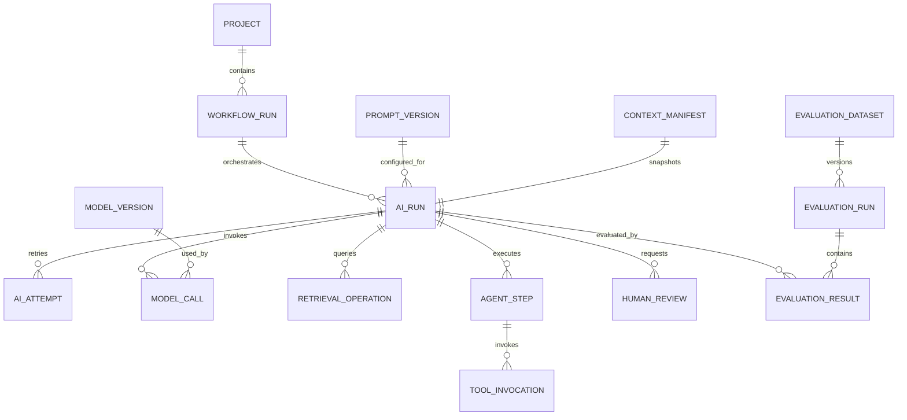

# Tattava Copilot — AI Metrics & Observability Data Platform

**Document ID:** ANA-AIM-001  
**Version:** 1.0  
**Status:** Proposed implementation specification; no production metrics claimed  
**Scope:** AI runs, model calls, retrieval, agent/workflow steps, tool execution, human review, evaluation and safety observability

## 1. Measurement principles

Tattava's AI is workflow intelligence, not a collection of independent agents. The orchestrator owns state transitions, sequencing, cancellation, deadlines, retry bounds and handoffs. A model or agent cannot authorize itself, choose an unapproved provider, bypass a human checkpoint or write Canon. Analytics must capture these constraints as deterministic events and must not equate fluent output with success.

Separate four evidence classes:

1. **Operational telemetry:** status, latency, usage, errors, retries, provider alias and version.
2. **Workflow outcome:** task reached expected state; candidate created; human decision; approved package.
3. **Quality evaluation:** versioned rubric/dataset/evaluator result with uncertainty and provenance.
4. **Safety/security evidence:** policy decisions, unauthorized attempts, project-isolation failures and Canon integrity events. Critical failures are hard gates, not averageable scores.

## 2. AI observability entity model

### Required logical entities

| Entity | Grain / key | Important fields | Invariant |
|---|---|---|---|
| `workflow_run` | One product workflow execution / `workflow_id` | project, workflow type/version, trigger, start/terminal times, outcome | Workflow status is distinct from individual AI run status |
| `ai_run` | One orchestrated AI task / `ai_run_id` | parent run, capability ID/version, policy version, context manifest ID/hash, status, timestamps | Run does not equal human approval or Canon commit |
| `ai_attempt` | One execution attempt / `attempt_id` | run, attempt number, retry parent, reason, status, timing | Retries are separate attempts, not duplicate successful tasks |
| `model_call` | One gateway call / `model_call_id` | run, provider/model alias/version, request/response timing, tokens if provided, estimated/actual cost status | No raw prompt/response in ordinary telemetry |
| `agent_step` | One orchestrator-defined step / `step_id` | run, capability, step type, parent step, state, order | Agent labels are internal logical boundaries, not necessarily microservices |
| `retrieval_operation` | One retrieval operation / `retrieval_id` | run, index/version, filter/policy version, result count, latency, reference/hash list | Only authorized project scope can be queried |
| `tool_invocation` | One attempted tool / `tool_call_id` | run/step, tool/version, allowlist policy, authorization outcome, result status, duration | Authorization denial distinct from tool runtime failure |
| `human_review` | One review request/decision / `review_id` | target/version, required role domain, request/decision times, outcome code | Role names do not hard-code action grants; permission is policy-based |
| `context_manifest` | One immutable context selection / `manifest_id` | authorized references/version IDs, exclusions and reasons, hash, policy version | No copied content required in telemetry; preserve reproducibility safely |
| `evaluation_run` | One evaluation batch / `evaluation_run_id` | dataset version, build, model/prompt/retrieval/tool versions, evaluator version, config | Reproducibility requires version attribution |
| `evaluation_result` | One case × evaluator result / composite key | case ID, label, metric, score/result, uncertainty, adjudication state | Unrun is not pass; safety failures cannot be averaged away |

## 3. Correlation, lifecycle and terminal outcomes

Propagate `organization_id`, `project_id`, `workflow_id`, `ai_run_id`, `parent_run_id`, `attempt_id`, `model_call_id`, `tool_call_id`, `request_id` and `trace_id` only where applicable. All are opaque identifiers; identifiers must not encode names or story titles.

Recommended run state vocabulary, aligned to architecture: `queued`, `running`, `awaiting_input`, `awaiting_approval`, `succeeded`, `partially_succeeded`, `failed`, `cancelled`. Use explicit transition validation. A run terminal state records whether expected outputs exist and validate; do not label partial success as success.

Error classes should be controlled enums, for example: `validation`, `authorization`, `context_unavailable`, `provider_timeout`, `provider_rate_limit`, `provider_error`, `tool_error`, `retrieval_error`, `schema_error`, `budget_exceeded`, `cancelled`, `version_conflict`, `safety_block`, `unknown`. Keep provider raw error text out of broad analytics tables unless redacted and approved.

## 4. AI metric catalogue

| ID | Metric | Formula | Grain / dimensions | Method / limitation |
|---|---|---|---|---|
| AIM-001 | Workflow task completion | Runs with expected terminal success / eligible started runs | Workflow type/version, project cohort, model/prompt versions | Define eligible starts; separate cancelled, partial, policy-blocked and infrastructure failures |
| AIM-002 | End-to-end latency | terminal timestamp − start timestamp | Run; p50/p75/p95 by workflow/status | Event-time, UTC; report user-wait/approval intervals separately if measured |
| AIM-003 | Component latency | completion − start for model/retrieval/tool/step | Component and version | Do not sum parallel spans as if serial; trace span relationships |
| AIM-004 | Cost per run | Sum attributable model + tool/provider cost for run | Run, workflow, provider/model, currency/pricing version | Distinguish actual, estimated, unavailable; cost allocation coverage shown |
| AIM-005 | Cost per successful task | Attributable costs / successful tasks | Workflow cohort | Include failed-run costs in numerator where attributable; disclose denominator |
| AIM-006 | Token usage | Input/output tokens reported by provider | Model call/run | Null means unavailable, not zero; token metadata may differ by provider |
| AIM-007 | Retry rate | Runs with retry ≥1 / eligible runs | Workflow/model/provider/error class | Retries may be successful recovery; pair with recovery and cost metrics |
| AIM-008 | Tool success | Successful tool invocations / attempted invocations | Tool type/version | Authorization denials separately classified; success does not imply safe outcome |
| AIM-009 | Retrieval relevance | Relevant retrieved items / sampled retrieved items, under approved rubric | Query/case/index version | Requires labeled sample; retrieval count alone is not relevance |
| AIM-010 | Context sufficiency | Cases where required context was present and valid / evaluated cases | Capability and project type | Versioned rubric; missing context is distinct from model reasoning error |
| AIM-011 | Grounded claim coverage | Claims requiring evidence with valid linked provenance / sampled claims requiring evidence | Output/capability/evaluator version | Need human adjudication; links alone do not prove claim correctness |
| AIM-012 | Instruction adherence | Evaluation cases passing versioned instruction rubric / evaluated cases | Capability/model/prompt version | Automated judge requires calibration and sampled human review |
| AIM-013 | Output schema validity | Outputs passing deterministic schema validation / outputs requiring schema | Capability/output schema version | Deterministic check; exclude pre-generation failures explicitly |
| AIM-014 | Human acceptance | Explicit accepted candidate decisions / explicit accept-or-reject decisions | Candidate type, workflow, version | Not a pure model-quality score; affected by user/role/task difficulty |
| AIM-015 | Meaningful edit rate | Reviewed outputs requiring substantive human change / reviewed outputs | Output type and rubric | Define substantive edit; autosaves/formatting excluded |
| AIM-016 | Safety event rate | Confirmed policy violations / eligible runs, plus absolute critical count | Policy code, workflow/version | Must report raw counts; zero observed is not proof of zero risk |
| AIM-017 | Authorization denial rate | Denied tool/action attempts / authorization decisions | Tool/action class | Denials can indicate healthy enforcement; investigate spikes, not minimize blindly |
| AIM-018 | Human escalation rate | Runs routed to required human review / eligible runs | Capability, reason code | Escalation may be correct behavior; pair with resolution time and outcome |
| AIM-019 | Fallback rate | Runs using approved fallback / eligible runs | Provider/model/policy version | Fallback reason and approved route recorded; never silently route to unapproved provider |
| AIM-020 | Evaluation regression | Current version metric − approved baseline metric, with uncertainty | Dataset/case cohort/version | Compare same dataset/config; predefine release thresholds and minimum sample sizes |

Targets for latency, cost, quality and retry rate are **TBD** until representative telemetry and stakeholder-approved budgets exist. The evaluation framework's critical safety principle is non-compensatory: cross-project leakage, unauthorized action or silent Canon mutation blocks release regardless of average scores.

## 5. Quality measurement and uncertainty

### Evaluation method hierarchy

1. Deterministic checks first: permissions, Canon writes, schema, required fields, version conflicts, run-state transitions, required provenance structure and project isolation.
2. Automated evaluators for scalable rubric dimensions only after calibration against human labels.
3. Human review for narrative usefulness, evidence correctness, continuity defect validity, consequential interpretation and ambiguous safety cases.
4. Adjudication for disagreements on critical or high-impact cases; preserve annotator/evaluator versions and disagreement state.

Do not present model confidence as a calibrated probability unless validated. For rates, include numerator, denominator and interval where useful. Small samples are exploratory. For model/prompt comparisons, keep dataset version, sampling policy, context-manifest rules and evaluator version constant or disclose the differences.

### Evaluation dataset contract

Each dataset version records: dataset ID/version, case ID, source/provenance, project type/complexity tags, consent/policy basis, label schema/version, labeler role, adjudication state, creation date, exclusions and approved use. Do not automatically turn production projects, feedback, prompts or generated stories into benchmark/training data. Use synthetic, curated, expert-authored or explicitly approved data according to policy.

Evaluation results record application build, model/provider alias/version, prompt version, retrieval/index version, tool versions, context manifest hash, evaluator version, test parameters, metric result, error class, timestamp and access-controlled output reference/hash where permitted.

## 6. Sampling strategy

- Keep deterministic safety/security suites unsampled for required release checks.
- Sample routine low-risk production telemetry by workflow and version only after confirming sampling will not bias rare failures; preserve unsampled aggregate counters where feasible.
- Oversample rare high-risk cases for evaluation while separately reporting production prevalence. Do not present oversampled evaluation frequency as production incident rate.
- Stratify by capability, project type, context complexity, provider/model, prompt version and retrieval version when lawful and sample sizes permit.
- Record sampling probability and method so weighted estimates can be computed where needed.
- Redact/de-identify and obtain approval before adding real production failures to a golden dataset.

## 7. Privacy-safe diagnostics

**Default deny for raw content logging.** Ordinary telemetry should store metadata, identifiers, versions, status codes, token counts, durations, cost, hashes and access-controlled references. Raw prompts, outputs, retrieved content, script/dialogue, source documents and personal data require a documented purpose, approved access policy, retention rule, redaction, provider policy and audit trail. If diagnostic content is not approved, fail closed and use metadata-only diagnostics.

A restricted diagnostic workflow, if approved, must include: incident/ticket ID; authorized requester and approver; project/tenant scope; minimum content slice; redaction; short expiry; access logging; export restrictions; deletion evidence. No provider-side persistent project memory; Tattava remains authoritative over Project Intelligence. Provider training/use, retention, residency and subprocessors remain approval gates.

## 8. Operational dashboards and alerts

| Dashboard | Primary audience | Signals | Alert conditions |
|---|---|---|---|
| AI Run Health | AI/Engineering | run status, latency p50/p95, error class, retries, queue age | proposed: sustained failure/latency/backlog threshold after baseline |
| Model & Provider Health | AI/Platform | provider errors, rate limits, timeout, fallback, usage/cost | unapproved provider route is critical; spend/latency budget TBD |
| Retrieval & Context | AI/KM | retrieval latency, result count, context-manifest completeness, authorization filtering | unauthorized context is critical; relevance alerts require labeled baseline |
| Tool Safety & Reliability | Engineering/Security | invocation outcomes, denied actions, allowlist version, retry | any confirmed unauthorized tool execution is critical |
| AI Quality & Regression | AI/Creative/QA | versioned evaluation dimensions, regression, sample size, adjudication | release gate regression; no unrun metric displayed as pass |
| Human Review & Outcome | Product/Content/Creative | candidate acceptance, rejection, review wait, escalation | avoid punitive individual productivity ranking; thresholds TBD |
| Cost & Unit Economics | Engineering/Finance/Product | token/call cost, tool cost, cost/run, cost/approved package, attribution coverage | budget limits must be approved; estimates labeled |

## 9. Release gates and failure semantics

- No known critical cross-project leakage, unauthorized action/tool execution, approval bypass or silent Canon mutation in required release suite.
- All P0/core workflows have normal, negative/edge and recovery tests before release.
- Model/prompt/retrieval/tool/context changes trigger the appropriate regression suite; critical security, provenance and Canon regressions block release.
- Missing telemetry is itself a quality gap; it must not be interpreted as success.
- Provider fallback only to approved routes; if no compliant route is available, fail closed or request human intervention.
- Cancelled, stale, partial and failed runs do not mutate Canon. A stale candidate must be re-evaluated against current Canon and dependencies before acceptance.
- Numeric cost/latency SLOs follow baseline and explicit approval; do not invent them.

## 10. Implementation backlog

| Task ID | Priority | Work | Dependencies | Acceptance criteria |
|---|---|---|---|---|
| AIM-T001 | P0 | Persist run/attempt lifecycle with correlation IDs | Orchestrator state model | Every AI run has start, terminal status or explicit still-running state; parent-child trace works |
| AIM-T002 | P0 | Add metadata-only model gateway telemetry | Provider abstraction | Model alias/version, status, latency and available usage recorded; raw content excluded |
| AIM-T003 | P0 | Instrument retrieval and context manifest metadata | Retrieval/context services | Index/version, policy version, result count and manifest hash linked to run |
| AIM-T004 | P0 | Instrument tool authorization and execution outcomes | Tool gateway/IAM | Denial distinct from runtime error; allowlist/policy version captured |
| AIM-T005 | P0 | Link human decisions and Canon commands to AI candidates | Candidate/decision/Canon domains | Candidate-to-decision-to-revision trace is queryable; no success event on failed commit |
| AIM-T006 | P0 | Implement evaluation-run/result schema | Evaluation harness | Dataset/build/model/prompt/evaluator versions are recorded; unrun status is explicit |
| AIM-T007 | P1 | Add calibrated quality evaluators and adjudication workflow | Golden dataset and domain reviewers | Agreement/calibration reported; rubric versions retained |
| AIM-T008 | P1 | Cost allocation and pricing-version model | Provider usage/cost metadata | Actual/estimated/unavailable separated; coverage shown |
| AIM-T009 | P1 | AI observability dashboards and alerts | Validated marts | Dashboards expose denominators, freshness, sample sizes and alert state |
| AIM-T010 | P1 | Regression release gate integration | CI/evaluation runner | Required tests block release on critical regression; report is reproducible |

## 11. Acceptance tests

| Test ID | Scenario | Expected result |
|---|---|---|
| TEST-AI-001 | Run succeeds with valid output | Run terminal success recorded; no implied approval/Canon mutation |
| TEST-AI-002 | Run partially succeeds | `partially_succeeded`; missing outputs enumerated by code |
| TEST-AI-003 | Provider timeout followed by retry | Attempts linked; retry count and total latency/cost correct |
| TEST-AI-004 | Model usage metadata missing | Usage/cost marked unavailable, never zero by assumption |
| TEST-AI-005 | Tool authorization denied | Denial event emitted; tool not executed |
| TEST-AI-006 | Provider route not approved | No request sent; policy event and safe failure recorded |
| TEST-AI-007 | Stale candidate submitted for approval | Version conflict/re-evaluation required; no Canon mutation |
| TEST-AI-008 | Raw prompt appears in ordinary telemetry | Block/redact and emit privacy control signal |
| TEST-AI-009 | Evaluation case not executed | Status `Not Run`; excluded from pass denominator and visibly reported |
| TEST-AI-010 | Model/prompt version changes | Evaluation attribution changes; comparison only against compatible baseline |
| TEST-AI-011 | Evaluator disagrees with human labels | Disagreement/calibration recorded; no unqualified quality claim |
| TEST-AI-012 | Critical project-isolation test fails | Release blocked; no average score can override |
| TEST-AI-013 | Run cancelled mid-tool operation | Cancellation propagated; no subsequent unauthorized step or Canon write |
| TEST-AI-014 | Replay telemetry | Metrics remain idempotent and retain source/replay lineage |

## 12. Open decisions

- Provider/model usage metadata availability and cost pricing source.
- Exact production sampling rates and minimum sample sizes.
- Approved content-level diagnostic workflow and retention.
- Golden dataset governance, annotation budget and named adjudicators.
- Numeric latency/cost budgets and alert routing/on-call ownership.
- Evaluator calibration acceptance thresholds.
- Provider contracts, training/data-use, residency, retention and subprocessor approvals.
