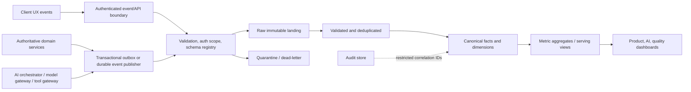

# Tattava Copilot — Event Tracking & Data Contracts

**Document ID:** ANA-EVT-001  
**Version:** 1.0  
**Status:** Proposed contract; deployment status unknown  
**Scope:** Product lifecycle, governed creative workflow, AI orchestration, human decisions, data quality and audit-linked telemetry

## 1. Contract principles

Telemetry exists to measure project progress, reliability, quality and safety. It must not become a shadow content store. Canon is authoritative, typed, versioned and permission-controlled; AI output remains a candidate until governed approval and deterministic commit. Events must preserve these distinctions.

### Source precedence and status labels

The updated PRD/Product Strategy define outcomes and workflows; approved System/Data Architecture defines entities and system-of-record boundaries; AI specifications define runs/tools/context; Evaluation and Security/Privacy documents define evaluation and privacy constraints. This package proposes event names and schemas; it does not assert existing production instrumentation or selected infrastructure.

Use these labels in implementation tickets: **Confirmed invariant**, **Proposed contract**, **Open decision**. Do not log raw prompts, outputs, retrieved text, story content, credentials or personal data in ordinary telemetry by default.

## 2. Event taxonomy and naming

Use lowercase dotted names: `<domain>.<object>_<past-tense-action>` where practical, e.g. `project.input_accepted`, `candidate.created`, `package.approval_recorded`, `ai.run_completed`. Names describe a completed fact, not a button label. Events are immutable facts; corrections are new correction/compensation records, not silent edits to historical raw rows.

Domains: `identity`, `organization`, `project`, `artifact`, `evidence`, `candidate`, `decision`, `canon`, `workflow`, `ai`, `model`, `retrieval`, `tool`, `review`, `package`, `evaluation`, `security`, `pipeline`.

## 3. Common event envelope

The fields below are candidates, not mandatory universal identifiers. Require only fields applicable to an event and enforce conditional requirements in schema validation.

| Field | Type | Requirement / semantics |
|---|---|---|
| `event_id` | UUID/opaque ID | Required; stable idempotency identity across retries |
| `event_name` | string | Required; registry-controlled name |
| `event_version` | integer | Required; version of event-specific payload contract |
| `schema_version` | string | Required; envelope schema version |
| `occurred_at` | RFC 3339 timestamp | Required; event time from authoritative source where available |
| `received_at` | RFC 3339 timestamp | Ingestion-added; not trusted from client |
| `actor_type` | enum | `user`, `service`, `system`, `external_provider`, `unknown` |
| `actor_id` | opaque ID/null | Conditional; avoid direct identifiers in analytics marts |
| `organization_id` | opaque ID | Required for tenant-scoped events; server-derived, never trusted from client alone |
| `workspace_id` | opaque ID/null | Conditional if workspace concept exists |
| `project_id` | opaque ID/null | Required for project-scoped events; no project content in ID |
| `session_id` | opaque ID/null | Optional; not a substitute for user/project identity |
| `workflow_id` | opaque ID/null | Required for workflow events where a workflow exists |
| `conversation_id` | opaque ID/null | Optional correlation only; conversation is not project system of record |
| `ai_run_id` | opaque ID/null | Required for AI-run events and child AI telemetry |
| `agent_run_id` | opaque ID/null | Optional child execution correlation |
| `parent_run_id` | opaque ID/null | Parent-child lineage for retries/delegation |
| `model_call_id` | opaque ID/null | Required for model-call-level telemetry |
| `tool_call_id` | opaque ID/null | Required for tool invocation telemetry |
| `request_id` / `trace_id` | opaque IDs | Propagate across service and async boundaries |
| `environment` | enum | `development`, `test`, `staging`, `production` |
| `source_service` | string | Registry-controlled producer service |
| `tenant_scope_version` | string/null | Optional policy/context version for authorization investigations |
| `payload` | object | Event-specific, schema-validated, data-minimized fields |
| `data_classification` | enum | e.g. `operational`, `confidential_project_metadata`, `restricted_security`; approved taxonomy required |
| `privacy_purpose` | string/enum | Purpose code where needed; no free-text personal data |

Server must overwrite `received_at`, validate tenant/project scope against authenticated context, and reject or quarantine impossible identifier combinations. Client-provided `organization_id`/`project_id` are hints only until server authorization succeeds.

### Representative JSON Schema (envelope)

```json
{
  "$schema": "https://json-schema.org/draft/2020-12/schema",
  "$id": "tattava.analytics.event-envelope.v1.json",
  "type": "object",
  "required": ["event_id", "event_name", "event_version", "schema_version", "occurred_at", "environment", "source_service", "actor_type", "payload"],
  "properties": {
    "event_id": {"type": "string", "minLength": 1},
    "event_name": {"type": "string", "pattern": "^[a-z]+(\\.[a-z]+_[a-z]+)+$"},
    "event_version": {"type": "integer", "minimum": 1},
    "schema_version": {"type": "string"},
    "occurred_at": {"type": "string", "format": "date-time"},
    "received_at": {"type": "string", "format": "date-time"},
    "actor_type": {"enum": ["user", "service", "system", "external_provider", "unknown"]},
    "organization_id": {"type": ["string", "null"]},
    "project_id": {"type": ["string", "null"]},
    "workflow_id": {"type": ["string", "null"]},
    "ai_run_id": {"type": ["string", "null"]},
    "request_id": {"type": ["string", "null"]},
    "trace_id": {"type": ["string", "null"]},
    "environment": {"enum": ["development", "test", "staging", "production"]},
    "source_service": {"type": "string"},
    "payload": {"type": "object"}
  },
  "additionalProperties": false
}
```

Implementation note: a production schema should include every approved envelope field and per-event `$defs`; the shortened example above illustrates contract style, not a complete deployment registry.

## 4. Event catalogue

| ID | Event | Authoritative emission point | Required identifiers / payload | KPI or purpose | Classification |
|---|---|---|---|---|---|
| EVT-001 | `project.created` | Project domain service after commit | org, project, creator actor type, project type enum | adoption/cohort | Project metadata |
| EVT-002 | `project.input_accepted` | Server validates initial input and accepts project start | project, accepted input reference/version, acceptance policy version | NSM start | Confidential metadata; no input text |
| EVT-003 | `workflow.started` | Orchestrator persists run state | project, workflow, workflow type/version, trigger source | workflow funnel | Operational metadata |
| EVT-004 | `workflow.completed` | Orchestrator terminal transition | workflow, terminal status, started/terminal timestamps, outcome code | completion/latency | Operational metadata |
| EVT-005 | `artifact.created` | Artifact service commit | project, artifact ID/type/version/status | artifact usage | Confidential metadata |
| EVT-006 | `candidate.created` | Candidate service persists AI/human candidate | project, candidate ID/type, run ID nullable, source type, target version | useful candidate/rework | Confidential metadata |
| EVT-007 | `candidate.decision_recorded` | Decision service persists explicit accept/reject/defer | candidate, decision, actor role, decision timestamp, rationale code | acceptance/rework | Restricted metadata; no rationale free text by default |
| EVT-008 | `canon.revision_committed` | Canon domain command transaction | project, revision ID, parent version, command ID, authorized actor type, result | integrity/audit | Restricted security/creative metadata |
| EVT-009 | `package.completeness_validated` | Package validator | project, package/version, template version, completeness result, missing-section codes | KPI-006 | Confidential metadata |
| EVT-010 | `package.approval_recorded` | Approval service after authorization and validation | project, package/version, approver role, approval policy version, outcome | NSM terminal | Restricted decision metadata |
| EVT-011 | `ai.run_started` | AI orchestrator run record | run, workflow, project, capability ID/version, policy version | AI funnel | Operational metadata |
| EVT-012 | `ai.run_completed` | Orchestrator terminal state persisted | run, terminal status, duration, error class, output reference/hash only | success/latency | Operational metadata |
| EVT-013 | `model.call_completed` | Model gateway after response/error | model call, run, provider/model alias, version if available, latency, token usage, status, cost estimate provenance | AI cost/latency | Restricted operational metadata |
| EVT-014 | `retrieval.completed` | Retrieval service after query execution | run, index/version, result count, latency, filter/policy version, content refs/hashes only | retrieval observability | Restricted metadata |
| EVT-015 | `tool.invocation_completed` | Tool gateway after allowlist/auth check and execution | tool call, run, tool name/version, authorization result, status, duration, error class | tool reliability/security | Restricted operational metadata |
| EVT-016 | `ai.retry_scheduled` | Orchestrator records retry decision | run, attempt, parent attempt, reason code, retry budget remaining | retry/recovery | Operational metadata |
| EVT-017 | `review.requested` | Review/approval workflow service | project, target ID/version, required role domain, request timestamp | approval wait | Confidential metadata |
| EVT-018 | `review.decision_recorded` | Review service | target/version, decision, role domain, timestamps, decision code | acceptance/approval | Restricted metadata |
| EVT-019 | `evaluation.completed` | Evaluation harness persists result | evaluation run, dataset/version, case ID, build/model/prompt/retrieval versions, metric IDs, result status | AI quality/regression | Restricted evaluation metadata |
| EVT-020 | `security.policy_event_recorded` | Authorization/policy enforcement point | policy code, actor type, target reference, decision, correlation ID | security release gate | Restricted; access limited |
| EVT-021 | `pipeline.quality_check_failed` | Data quality runner | check ID/version, model/table, severity, observed value, threshold version | data reliability | Operational metadata |

Event payloads should prefer enums, stable references, version IDs and hashes over content. Event contracts must explicitly state whether the event is a business fact, operational observation or diagnostic signal; these are not interchangeable.

## 5. Example payloads

### `package.approval_recorded`

```json
{
  "event_id": "evt_opaque_123",
  "event_name": "package.approval_recorded",
  "event_version": 1,
  "schema_version": "1.0.0",
  "occurred_at": "2026-10-06T09:30:00Z",
  "actor_type": "user",
  "organization_id": "org_opaque_1",
  "project_id": "prj_opaque_7",
  "environment": "production",
  "source_service": "approval-service",
  "payload": {
    "package_version_id": "pkgv_opaque_9",
    "approval_outcome": "approved",
    "approver_role_domain": "project_authority",
    "completeness_status": "complete",
    "approval_policy_version": "approval-policy-1",
    "command_id": "cmd_opaque_4"
  }
}
```

The sample IDs are illustrative. The event is emitted only after server-side authorization and the approval transaction succeed. Do not include the package contents or approver's direct identity in general analytics marts.

### `ai.run_completed`

```json
{
  "event_id": "evt_opaque_456",
  "event_name": "ai.run_completed",
  "event_version": 1,
  "schema_version": "1.0.0",
  "occurred_at": "2026-10-06T09:31:12Z",
  "actor_type": "system",
  "organization_id": "org_opaque_1",
  "project_id": "prj_opaque_7",
  "workflow_id": "wf_opaque_3",
  "ai_run_id": "run_opaque_5",
  "trace_id": "trace_opaque_8",
  "environment": "production",
  "source_service": "ai-orchestrator",
  "payload": {
    "capability_id": "CAP-RESEARCH-SYNTHESIS",
    "capability_version": "1.2.0",
    "terminal_status": "succeeded",
    "duration_ms": 72100,
    "error_class": null,
    "output_reference": "artifact_opaque_11",
    "policy_version": "ai-policy-1"
  }
}
```

## 6. Delivery and ingestion architecture



### Recommended delivery semantics

- **Business events:** emit from authoritative server-side domain services. Where supported, use transactional outbox to couple domain commit and event publication; otherwise use durable retryable publisher and reconciliation.
- **Client events:** accept only for interaction diagnostics that cannot be derived server-side. Authenticate, rate-limit, validate, and never trust client-provided tenant/project scope. Do not use client events for approval, Canon mutation or security authorization facts.
- **Transport:** start with durable batch/micro-batch unless a documented operational use case requires streaming. Security alerts may need a separate low-latency path. Actual broker/warehouse choice remains open.
- **Delivery:** assume at-least-once. Exactly-once end-to-end is not claimed. Use stable `event_id`, producer idempotency key, and idempotent warehouse merges.
- **Ordering:** use `occurred_at`, server sequence/version and entity version where relevant; do not assume global event ordering. Enforce expected-version checks for Canon/package commits.
- **Retries:** exponential backoff with jitter, bounded attempts, and retry classification. Permanent schema/authorization failures go to quarantine; transient network/provider failures retry within policy.
- **Dead letter:** retain minimal payload/reference plus error code and replay metadata; restrict access and apply retention policy. Do not create a raw-content graveyard.
- **Replay:** replay only authorized immutable events with a replay ID and transformation version; deduplicate by event identity. Corrections use governed compensating records.
- **Clock skew:** record server receive time and source type. Flag implausible client timestamps; do not rewrite authoritative server timestamps.
- **Backpressure:** producers must not block consequential user transactions indefinitely. Outbox lag and backlog age are monitored; business-state correctness cannot depend on analytics warehouse availability.

## 7. Schema evolution and contract governance

- Schema registry or version-controlled schema repository is required before production event growth. Registry technology is TBD.
- Additive optional fields are normally backward-compatible; changing type/meaning, renaming, removing, changing enum semantics or event grain requires a new event version or migration plan.
- Consumers must tolerate unknown optional fields but reject invalid required fields.
- Deprecation requires owner, replacement, consumer inventory, dual-publish period where needed, backfill/compatibility decision, dashboard impact, and removal date approval.
- Contract tests run in CI against producers, schemas and downstream models. Breaking changes block release unless migration is approved.
- Every event definition includes: purpose, trigger, emission point, required/optional fields, permitted values, sample, KPI mapping, classification, owner, version and failure handling.

## 8. Privacy, security and access

- Never log raw prompts, outputs, retrieved content, scripts, story bible content, personal data, secrets or provider payloads by default.
- For debugging, use content references/hashes, redacted excerpts only when explicitly approved, scoped access, time-limited access and an auditable reason.
- Tenant/project scope is server-derived and validated. Derived telemetry, caches, indexes and exports inherit the original scope.
- Restrict security and authorization event access; dashboard aggregates must not reveal another project's existence or activity.
- Provider/model identifiers, token counts and cost may be recorded only if available and policy-approved; never assume provider usage metadata is complete.
- Retention, residency, deletion SLA, legal hold and provider-side retention are unresolved policy decisions and must be approved before production commitments.

## 9. Data quality and monitoring rules

| Check ID | Rule | Severity | Default response |
|---|---|---|---|
| DQ-EVT-001 | Required envelope fields valid | Critical for authoritative business event | Quarantine; alert producer owner; no silent drop |
| DQ-EVT-002 | Event ID uniqueness within deduplication scope | High | Idempotent merge; count duplicates; investigate spike |
| DQ-EVT-003 | Project/org association matches authorized server context | Critical | Reject/quarantine; security incident workflow if leakage suspected |
| DQ-EVT-004 | State transition is valid for event domain | Critical for Canon/approval events | Reject; reconcile with system of record |
| DQ-EVT-005 | Unknown event name/version | High | Quarantine and alert schema owner |
| DQ-EVT-006 | Missing AI correlation IDs for AI events | High | Quarantine or mark uncorrelated by explicit policy; alert owner |
| DQ-EVT-007 | Late-arrival distribution exceeds approved threshold | Medium/high after baseline | Reprocess affected event-time partitions; investigate source clock/queue |
| DQ-EVT-008 | Payload contains prohibited content field | Critical | Block ingestion, redact where safe, security/privacy incident review |

Thresholds and alert destinations are proposed and require baseline/owner approval. A data-quality check failure must not silently turn into a zero metric.

## 10. Acceptance tests

| Test ID | Scenario | Expected result |
|---|---|---|
| TEST-001 | Valid server event | Schema accepted; immutable raw record and lineage written |
| TEST-002 | Duplicate delivery with same event ID | One logical event after dedup; duplicate counter increments |
| TEST-003 | Same event ID with conflicting payload | Quarantine and alert; never last-write-wins silently |
| TEST-004 | Client submits another project's ID | Server rejects scope mismatch; security event correlated |
| TEST-005 | Missing required field / invalid enum | Quarantine with field-level error; no serving-model propagation |
| TEST-006 | Additive optional schema field | Compatible consumer continues to parse |
| TEST-007 | Breaking schema change | CI contract test fails until migration approved |
| TEST-008 | Late event arrives after partition close | Idempotent backfill updates event-time metric and records reprocessing version |
| TEST-009 | Replaying raw events | Serving tables remain logically idempotent |
| TEST-010 | AI event has no run ID | Rejected/quarantined unless event contract explicitly permits null |
| TEST-011 | Raw prompt included in telemetry payload | Ingestion policy blocks or redacts and emits privacy alert |
| TEST-012 | Canon commit fails expected-version check | No `canon.revision_committed` success event; failure recorded separately |
| TEST-013 | Approval UI succeeds but server transaction fails | No authoritative approval event emitted |
| TEST-014 | Dead-letter replay | Requires authorization, replay ID, same dedup key, and audit trail |
| TEST-015 | Tenant deletion requested | Deletion workflow propagates to permitted analytics copies; completion only after evidence |
| TEST-016 | Warehouse unavailable | Domain operations remain correct; outbox/backlog recovers without duplicate metric effect |

## 11. Open implementation decisions

- Event transport/broker and warehouse technology.
- Schema registry implementation and owner.
- Client analytics SDK and consent/notice requirements, if any.
- Approved retention and deletion propagation across raw events, backups and provider records.
- Event-volume and latency estimates needed for capacity planning.
- Alert destination/on-call ownership and operational SLAs.
- Exact work-time instrumentation method and whether any user-facing tracking notice is required.
- Data classification taxonomy and content-level diagnostic exception workflow.
