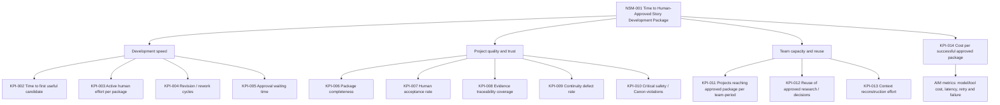

# Tattava Copilot — KPI Tree & Metric Data Models

**Document ID:** ANA-KPI-001  
**Version:** 1.0  
**Status:** Proposed implementation specification; not evidence of deployed instrumentation  
**Scope:** V1 Narrative Intelligence / Human-Approved Story Development Package  
**Owners:** Product (metric meaning), Data/Analytics (definitions and models), Engineering (source events), Creative/Content (quality rubrics), Security/Privacy (data handling)

## 1. Purpose and decision context

This document converts the product outcome into measurable, reproducible metrics. Tattava is a project-centric Narrative Intelligence system: the project is the durable unit of intelligence, while conversation is an interaction surface. Analytics must measure project progress, quality, reuse and trust—not prompts, tokens, agent count, or generation volume as proxies for value.

### Source precedence

1. Updated Product Strategy and current PRD govern product intent and success outcomes.
2. Approved System/Data Architecture governs system-of-record boundaries and technical invariants.
3. AI Intelligence specifications govern run, context, tool and human-review semantics.
4. Evaluation and Security/Privacy documents govern evaluation evidence, telemetry minimization and release blockers.
5. BRD provides business context and scope history.

If sources disagree, preserve the conflict in a decision log; do not silently redefine the product. This document is a proposed analytics contract, not a claim that metrics or pipelines are deployed.

## 2. North Star Metric

**NSM-001 — Time from accepted project input to Human-Approved Story Development Package.** This is supported by the updated PRD and is the V1 operational definition. It is not equivalent to readiness for physical production.

- **Definition:** elapsed time between a valid starting input being accepted and a designated human authority approving a package version that meets agreed completeness criteria.
- **Primary formula:** `approved_at_utc - accepted_input_at_utc`.
- **Unit / grain:** hours per eligible project-package approval; project is the primary entity.
- **Report:** median and p75/p90 across completed packages, plus the distribution and count. Do not average only successful fast cases without reporting incomplete/cancelled work.
- **Clock policy:** retain total elapsed time as primary; separately derive active-work duration, user-wait time, approval-wait time, external-research wait and inactive periods only when these intervals have reliable start/end events. Never silently subtract waiting periods from the primary metric.
- **Eligibility:** accepted input and approved package version must both have authoritative server-side timestamps and a shared project ID. Exclude test/demo projects only through an explicit environment/project classification filter.
- **Owner:** Product; metric steward: Data/Analytics; approval event owner: Engineering.
- **Baseline/target:** TBD. Establish a representative baseline before claiming improvement; segment by project type, maturity and complexity.
- **Risk:** teams may game the metric by delaying the accepted-input event, approving incomplete packages, or excluding long-running projects. Mitigate with immutable server timestamps, completeness validation, cohort denominator, rejection/rework reporting and auditability.

## 3. KPI tree



## 4. KPI catalogue and calculation contracts

Metric values are not targets. Every numerical threshold below is **TBD unless explicitly labelled proposed for approval**.

| ID | Metric / meaning | Formula and grain | Source / model | Window & refresh | Owner / status |
|---|---|---|---|---|---|
| NSM-001 | Time to approved package | `approved_at - accepted_input_at`; one eligible project/package | `fact_project_milestone`, `dim_project` | Cohort by approval date; daily provisional | Product; source-backed definition, instrumentation proposed |
| KPI-002 | Time to first useful candidate | `first_qualifying_candidate_at - accepted_input_at`; project | `fact_workflow_milestone` | Per project; daily | Product + Creative; “useful” rubric must be approved |
| KPI-003 | Active human effort per approved package | Sum of attributable human work intervals; hours/package | `fact_work_session`, `fact_project_milestone` | Per project; weekly | Product; event capture and work-session semantics TBD |
| KPI-004 | Revision/rework cycles | Count of substantive revision cycles before approval; package | `fact_artifact_revision`, `fact_review_decision` | Per package; weekly | Creative + Data; define substantive revision taxonomy |
| KPI-005 | Approval wait | Sum of intervals from submitted-for-review to decision; package | `fact_review_decision` | Per package; daily | Product/Content; pauses only reported separately |
| KPI-006 | Package completeness | Required approved sections present / required sections for applicable package template | `fact_package_section`, `dim_package_template` | At package version; each commit | Product + Creative; template/version required |
| KPI-007 | Human acceptance rate | Accepted candidate decisions / all explicit accept-or-reject decisions; candidate | `fact_candidate_decision` | Weekly/monthly; cohort by decision | Product + Creative; absence of decision is not rejection |
| KPI-008 | Evidence traceability coverage | Factual claims requiring evidence with valid source links / all sampled claims requiring evidence | `fact_claim_evaluation`, `bridge_claim_evidence` | Evaluation batch; per release and monthly | Knowledge Management; sampling protocol required |
| KPI-009 | Continuity defect rate | Confirmed continuity defects / reviewed artifacts or checks; specify denominator per report | `fact_continuity_check`, `fact_defect` | Per release/project; weekly | Creative + KM; severity-weighted companion required |
| KPI-010 | Critical safety / Canon violations | Count of confirmed critical events; do not average | `fact_security_ai_event`, audit records | Near-real-time where supported | Security + Engineering; zero known critical failures release gate, not an uptime claim |
| KPI-011 | Approved packages per team-period | Count distinct eligible packages approved in period / team; report absolute count and team exposure | `fact_project_milestone`, `dim_team` | Monthly | Leadership/Product; team membership history required |
| KPI-012 | Reuse of approved research/decisions | Workflows referencing prior eligible approved items / workflows with eligible reuse opportunity | `bridge_context_manifest_item`, `dim_project_item` | Monthly | KM + Product; reference is not proof of useful reuse |
| KPI-013 | Context reconstruction effort | Measured human time spent re-explaining/reconstructing existing project context | `fact_work_session` + optional user-declared reason | Monthly | Product Research; instrumenting burden and self-report bias |
| KPI-014 | Cost per successful approved package | Allocated model + tool + provider cost attributable to package / approved package count; report unattributed cost separately | `fact_ai_cost`, `fact_project_milestone` | Daily provisional/monthly financial | Engineering + Finance; pricing and allocation coverage TBD |
| AIM-001 | End-to-end AI run latency | `terminal_at - started_at`; run; report p50/p95 and status cohorts | `fact_ai_run` | 5–15 min proposed operational refresh | AI/Engineering; SLA TBD |
| AIM-002 | AI workflow completion rate | Runs reaching expected terminal success / eligible started runs; by workflow and run version | `fact_ai_run` | Daily | AI/Engineering; partial success separate |
| AIM-003 | Tool success rate | Successful tool invocations / attempted tool invocations; tool class | `fact_tool_invocation` | Daily | Engineering; authorization denials separate from tool errors |
| AIM-004 | Retry rate | Runs with one or more retry attempts / eligible runs | `fact_ai_attempt` | Daily | AI/Engineering; retries can be healthy recovery, not standalone failure |
| AIM-005 | Cost per successful task | Total attributable AI/tool cost / successful tasks; workflow cohort | `fact_ai_cost`, `fact_ai_run` | Daily/monthly | AI + Finance; task success definition must be stable |
| AIM-006 | Evaluated quality by dimension | Scores per versioned rubric and dataset; never collapse safety into a single average | `fact_evaluation_result` | Per evaluation run/release | AI + Creative; evaluator calibration and uncertainty required |
| DQ-001 | Event completeness | Received valid expected events / eligible authoritative source actions | source reconciliation + `fact_event_quality` | Daily | Data Engineering; expected event denominator needed |
| DQ-002 | Duplicate rate | Duplicate event IDs / received event rows | raw/validated events | Hourly/daily | Data Engineering; target proposed after baseline |
| DQ-003 | Freshness lag | `warehouse_available_at - occurred_at`; event-time cohort | `fact_pipeline_run`, event metadata | Operational monitoring | Data Engineering; SLA TBD |

## 5. Metric calculation rules

### Common semantics

- Store timestamps in UTC; retain original timezone/offset only when needed to interpret user-entered times. Dashboard timezone is an explicit filter, not a silent storage conversion.
- Use authoritative server timestamps for acceptance, approval, Canon commit and security events. Client timestamps are diagnostic only.
- Store `occurred_at` and `received_at`; late-arriving data updates event-time cohorts through idempotent reprocessing.
- Every aggregate includes environment, project eligibility and data-quality status. Expose denominator and excluded/incomplete counts.
- Missing timestamps do not become zero. Report `unknown`, `not measured`, or excluded-with-reason according to metric contract.
- Never infer approval from a successful AI run, artifact save, “approved” UI label without server confirmation, or presence of a candidate.
- A package is approved only when a versioned package passes the approved completeness contract and an authorized human approval is recorded.
- A project can have multiple package versions. NSM reports the first qualifying approval for time-to-first-package and each later approved package separately only where that analytical question is explicit.

### SQL-style pseudocode: NSM

```sql
WITH starts AS (
  SELECT project_id, MIN(accepted_input_at) AS start_at
  FROM fact_project_milestone
  WHERE milestone_type = 'accepted_input'
    AND environment = 'production'
  GROUP BY project_id
), approvals AS (
  SELECT project_id, package_version_id,
         MIN(approved_at) AS approved_at
  FROM fact_project_milestone
  WHERE milestone_type = 'human_approved_package'
    AND completeness_status = 'complete'
    AND approver_authorized = TRUE
  GROUP BY project_id, package_version_id
)
SELECT a.project_id, a.package_version_id,
       EXTRACT(EPOCH FROM (a.approved_at - s.start_at))/3600.0 AS elapsed_hours
FROM approvals a JOIN starts s USING (project_id)
WHERE a.approved_at >= s.start_at;
```

Production SQL must use the chosen warehouse dialect and handle multiple starts, reopening, test projects and version lineage according to the finalized lifecycle model.

### SQL-style pseudocode: acceptance

```sql
SELECT
  COUNT(*) FILTER (WHERE decision = 'accepted')::decimal /
  NULLIF(COUNT(*) FILTER (WHERE decision IN ('accepted','rejected')), 0)
    AS explicit_decision_acceptance_rate
FROM fact_candidate_decision
WHERE decision_at >= :window_start AND decision_at < :window_end;
```

Do not include pending, withdrawn, expired or unobserved candidates in the explicit decision denominator; report those statuses separately.

## 6. KPI-to-event-to-model traceability

| KPI | Required events | Required model / key | Gap or caveat |
|---|---|---|---|
| NSM-001 | `project.input_accepted`, `package.approval_recorded`, `package.completeness_validated` | `fact_project_milestone` / project_id, package_version_id | Completeness rubric and authoritative approval service must exist |
| KPI-002 | input accepted, `candidate.created`, candidate qualified/reviewed | `fact_workflow_milestone` / candidate_id | “Useful” must be human rubric or approved deterministic criteria |
| KPI-003 | work session start/stop or explicit time allocation | `fact_work_session` / actor_id, project_id | Passive tracking should not be assumed; privacy review required |
| KPI-004 | artifact version created, candidate decision, revision reason | `fact_artifact_revision` | Revision taxonomy needed; auto-save events are not substantive cycles |
| KPI-006 | package template/version, section state, approval validation | `fact_package_section` | Required sections vary by project type/template version |
| KPI-007 | candidate submitted, accepted/rejected decision | `fact_candidate_decision` | No inference from edits alone |
| KPI-008 | claim evaluated, evidence linked, source verified state | `fact_claim_evaluation`, bridge table | Raw claim text should not enter general telemetry by default |
| KPI-009 | continuity check completed, defect confirmed/resolved | `fact_continuity_check`, `fact_defect` | AI-detected issue is not confirmed defect until review/labeling |
| KPI-010 | policy violation, unauthorized action, Canon integrity failure | restricted `fact_security_ai_event` + audit IDs | Minimize payload; access restricted; not a vanity dashboard |
| KPI-011 | package approval, team/project membership effective dates | `fact_project_milestone`, `dim_team_membership` | Requires stable team attribution and history |
| KPI-012 | context manifest item included, eligible item type/status | `bridge_context_manifest_item` | Track references/hashes, not copied content |
| KPI-014 / AIM-005 | run started/terminal, model call usage, tool usage/cost | `fact_ai_run`, `fact_model_call`, `fact_tool_invocation`, `fact_ai_cost` | Provider cost can be delayed/estimated; expose attribution coverage |

## 7. Baselines, targets and interpretation

- **Confirmed:** outcome dimensions include development speed, project quality/trust and team capacity/reuse; time-to-approved package is the V1 North Star.
- **Proposed:** daily operational refresh for run/quality signals and daily or weekly product dashboards, subject to actual pipeline capability.
- **TBD:** numeric latency, freshness, event coverage, cost, quality, adoption and ROI targets; retention; minimum sample sizes; confidence intervals; role-specific dashboard grants.
- Establish baseline with representative project types and complexity levels. Report sample count, median, p75/p90 and missingness. Use confidence intervals or bootstrap intervals where cohort sizes justify it.
- Compare quality and speed together. Report rejection, substantial revision, continuity corrections and incomplete workflows alongside approval speed.
- Segment by model/provider, prompt/config, workflow version and project type only where sample sizes and privacy policy permit.
- A metric can be directionally useful without being causal evidence. Do not claim that Tattava caused time savings without a suitable comparison design.

## 8. Instrumentation gaps and risks

1. Accepted-input and human-approved-package events need authoritative, versioned business definitions.
2. Package completeness criteria and template versioning must be explicit.
3. Work-time measurement method is unresolved; avoid invasive surveillance by default.
4. Creative quality requires human-reviewed rubrics and adjudication, not an uncalibrated model score.
5. Historical baseline data may not exist; mark as unavailable rather than fabricate it.
6. Cost attribution needs model/provider usage, currency, pricing version, tool charges and allocation policy.
7. Team throughput requires effective-dated team/project assignment.
8. Reuse is a reference signal, not proof that reused content was helpful or correct.
9. Critical security and Canon violations are hard gates; do not average them into general quality scores.

## 9. Release and governance rules

Metric definitions are version-controlled. Changes to formulas, eligibility, event names, grain, or denominator require a reviewed change proposal, impact analysis, backfill plan and dashboard annotation. Analytics owner signs off technical correctness; Product and domain owners sign off meaning. Security/Privacy approves any new content-level telemetry. Unrun checks remain **Not Run**; no baseline or target is presented as achieved without evidence.
